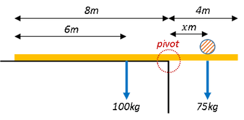
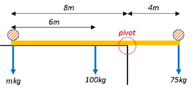

## Unknown Forces

* Magnitude of forces may not always be given.
* Eliminate an unknown/unwanted force by making the point on which it acts the pivot

---

**Sample Question:**

A uniform plank is 12 m long and has a mass of 100 kg. It is placed on horizontal ground at the edge of a cliff, with 4 m of the plank projecting over the edge.

i. How far out from the cliff can a man of mass $75kg$ safely walk?

ii. The man wishes to walk to the end of the plank. What is the minimum mass he should place on the other end of the plank in order to do this?

---

**Solution:**

Part (i)

Draw up diagram of given scenario:

Use the principle of moments and solve for $x$:

Anti-clockwise moments = Clockwise moments

$$

100kg \times 2 = 75kg \times x

$$

$$

\therefore x = \frac{100kg \times 2}{75kg} = 2.67m

$$

***

Part (ii)

Draw up diagram of given scenario:

Minimum mass therefore maximum distance from pivot.

Use the principle of moments and solve for $x$:

Anti-clockwise moments = Clockwise moments

$$

(100kg \times 2) + (mkg \times 8) = 75kg \times 4

$$

$$

\therefore m = \frac{(75kg \times 4) - (100kg \times 2)}{kg × 8} = 12.5kg

$$ 