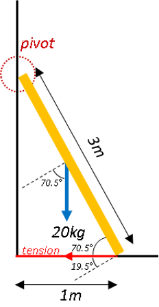

## Forces in Different Directions

* Forces may act at an angle to the plane
* Equilibrium maintained using components of forces

---

**Sample Question**

A uniform ladder of mass 20kg and length 3m rests against a smooth wall with the bottom of the ladder on smooth horizontal ground and attached by means of a light inextensible string, 1m long, to the base of the wall

i. Find the tension in the string

ii. If the breaking strain of the string is 250N, find how far up the ladder a man of mass 80kg can safely ascend.

**Solution:**

Part (i)

Daw up diagram of given scenario:

Find the angle of elevation, $\theta$, from the horizontal:

$$

cos \theta = \frac{1}{3}

$$

$$

\theta = 70.5\degree

$$

Use the principle of moments and solve for $T$:

$$

1\.5 \times 20g \times cos70.5 = 3 \times T \times cos19.5

$$

$$T = 34.7$$

Part (ii)

In above scenario assume that the man can take any position on the ladder, call it $x$

Use the principle of moments and solve for $x$:

anti-clockwise moments = clockwise moments

$$

((1.5)20g + (x)80g)cos70.5 = (3)(250)cos19.5

$$

$$

x=2.32

$$