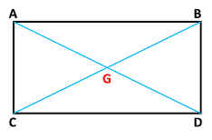
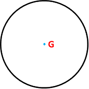
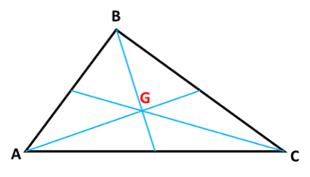
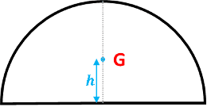
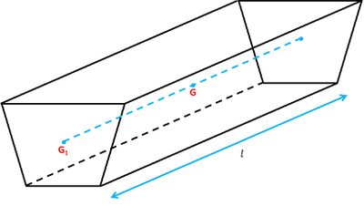
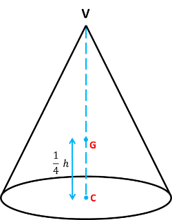

## Centre of Mass of Rigid Bodies

1-Dimensional Objects:

* Uniform rod: centre of mass lies at midpoint of the rod

2-Dimensional Objects:

* Uniform Rectangular Lamina: centre of mass is at the intersection of diagonals
* The following and more informational can be found in the formula sheet List MF19

$$

G =

\begin

\text{midpoint of AD} \

\text

\end

$$

* Uniform Circular Lamina: centre of mass is at the centre of the circle

* Uniform Triangular Lamina:

$$

A =

\begin

x_1 \

y_1

\end

$$

$$

B =

\begin

x_2 \

y_2

\end

$$

$$C =

\begin

x_3 \

y_3

\end

$$

$$

\therefore G =

\begin

\frac{1}{3}(x_1 + x_2 + x_3) \

\frac{1}{3}(y_1 + y_2 + y_3)

\end

$$

* Uniform Circular sector with angle $2\theta$:

$$h = \frac{2r sin\theta}{3\theta}$$

3- Dimensional Objects:

* Uniform Solid Prism: centre of mass lies at the centre of mass of the cross-section and in the midpoint of length

* Uniform Cone: centre of mass lies in the centre of the base and height in ratio 3:1 to its height

  

Centre of mass: $\frac{1}{4}h$ from base or $\frac{3}{4}h$ from vertex

* Uniform Hemisphere: centre of mass lies in the centre of the base and height $\frac{3}{8}$ of the radius

Copilot\_20260727\_001001.png

$h = \frac{3r}{8}$