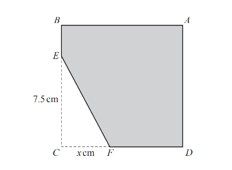
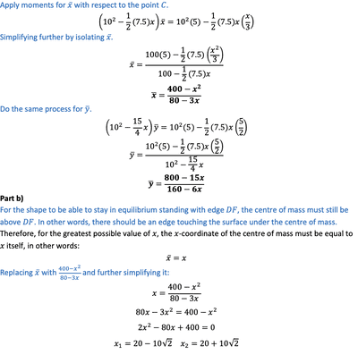

## Composite Bodies

* Split composite body into simple geometrical shapes

* Find the centre of mass of each shape individually

* By taking moments with vectors, find the centre of mass of the composite body

* If the separate geometrical shapes have different densities, use $V \times ρ$ instead of just $V$

* Therefore, in general:

$$
(v_1\rho_1 + v_2\rho_2 + \dots)
\begin{pmatrix}
\overline{x} \\
\overline{y}
\end{pmatrix}

=

v_1\rho_1
\begin{pmatrix}
x_1 \\
y_1
\end{pmatrix}
+
v_2\rho_2
\begin{pmatrix}
x_2 \\
y_2
\end{pmatrix}

+ \dots
$$

* For a lamina with a hole in it, find the centre of mass of the lamina, then find centre of mass of the hole and use moments to find centre of mass of the shaded part

* In these cases:

  

---

9231/32/M/J/20 - Question 4:

A uniform square lamina ABCD has sides of length $10cm$. The point $E$ is on $BC$ = $7.5 cm$, and the point $F$ is on $DC$ with $CF$ = $xcm$. The triangle $EFC$ is removed from $ABCD$ (see diagram). The centre of mass of the resulting shape $ABEFD$ is a distance $\overline{x}$ $cm$ from $CB$ and a distance $\overline{y}cm$ from $CD$.

* Show that $\overline{x} = \frac{400 - x^2}{80 - 3x}$ and find a corresponding expression for $\overline{y}$

* The shape $ABEFD$ is in equilibrium in a vertical plane with the edge $DF$ resting on a smooth horizontal surface

* Find the greatest possible value of $x$, giving your answer in the form of $a +b\sqrt{2}$, where $a$ and $b$ are constants to be determined

**Solution:**

Part a)

       