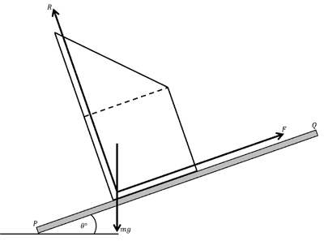
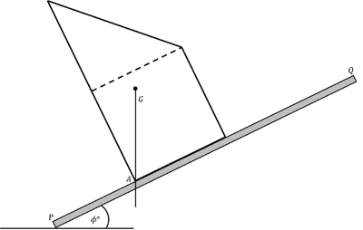

## Sliding and Toppling

* **Sliding**: when the resultant force on the object parallel to the plane of contact becomes non-zero, that is, the limiting friction force is exceeded by the other forces, the object will slide
* **Toppling**: when the total moment of the forces acting on the object becomes non-zero, the object will topple over

---

**Solution:**

First, find the angle needed to slide:

Draw a diagram at a hypothetical angle

Resolve forces horizontally to slope:

$$

F - mg sin\theta = 0

$$

$$

\therefore F = mg sin\theta

$$

Resolve forces vertical to slope:

$$

R - mg cos\theta = 0

$$

$$

\therefore R = mgcos\theta

$$

Form a relationship by dividing the unknowns:

$$

\frac{F}{R} = tan\theta

$$

Substitute $F = 0.4R$ into the equation

$$

tan \theta = 0.4

$$

$$

\theta = tan^{-1}0.4 = 21.8

$$

Now, find the angle needed to topple:

Find the centre of mass by using the composite bodies rule:

$$

m

\begin{pmatrix}

\overline{x} \\

\overline{y}

\end{pmatrix}

= \frac{2}{3}m

\begin{pmatrix}

0\.15 \\

0\.15

\end{pmatrix}

\frac{1}{3}m

\begin{pmatrix}

0\.1 \\

0\.4

\end{pmatrix}

\begin{pmatrix}

\overline{x} \\

\overline{y}

\end{pmatrix}

=

\begin{pmatrix}

0\.13 \\

0\.23

\end{pmatrix}

$$

Prism topples when the centre of mass is vertically above point $A$

Calculate this required angle using Pythagoras:

$$

tan \phi = \frac{0.13}{0.23}

$$

$$

\phi = 29.7

$$

From this, we can see $\theta < \phi$, thus when the equilibrium is broken, the object will slide.