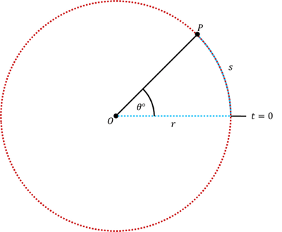
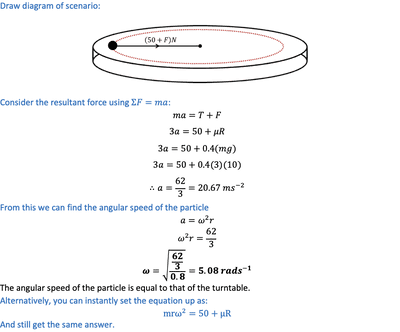

# Circular Motion

## Motions in a circular path

* Consider the following diagram:

 

* Particle $P$ moves in a circular path (the red line) 
* **Angular Displacement:** $\theta rad$ 
* **Angular Velocity:**  
* $v$ is the velocity 
* $r$ is the radius 

From here we can deduce that the velocity is 

 

* **Centripetal Acceleration:**

 

* **Centripetal Force:**

Applying $F = ma$ to centripetal acceleration, we get, 

 

* **Time taken for each complete revolution:**

 

* **Linear Displacement:**

 

---

**Sample Question:**

A particle of mass 3kg is placed on a rough, horizontal turntable and is connected to its centre by a light, inextensible string of length 0.8m. The coefficient of friction between the particle and the turntable is 0.4. The turntable is made to rotate at a uniform speed. If the tension in the string in $50N$, find the angular speed of the turntable. 

**Solution:**

 