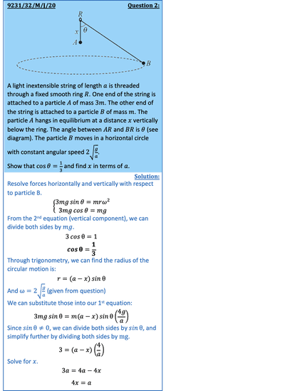

## Motion in Horizontal Circles

* In this scenario, a body is attached to a fixed point by string and travels in a horizontal circle below that point 
* Resolve forces horizontally and vertically with respect to the rotating body 

 

