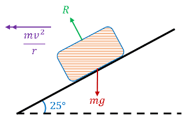
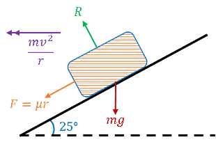
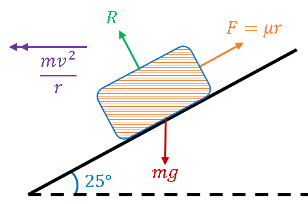

## Banked Curves

* Curved sections of public roads/railway tracks banked, enabling cars/trains to travel more quickly around curves
* Normal reaction between the vehicle and the track has a horizontal component when track is banked
* This component helps to provide central force needed to keep vehicle travelling in a circle

---

**Sample Question:**

A car is travelling round a curve of radius 150m banked at $25\degree$ to the horizontal. The coefficient of friction between the wheels and the road is 0.4

a) What is the ideal speed of the car round the curve: that is, no lateral frictional force?

b) What is the maximum safe speed of the car?

c) What is the minimum safe speed of the car?

**Solution:**

Part (a):

Draw diagram of scenario:

 

Resolve forces vertically:

$Rcos25 = mg$ 

Resolve forces horizontally:

$Rsin25 = \frac{mv^2}{r}$

Form a relationship by dividing the two:

$tan25 = \frac{v^2}{150g}$ 

$v = 26.2 ms^{-1}$

Part (b):

At max speed, car about to slip upwards $\therefore$ frictional force would act towards the centre of the circle

 

Resolve forces vertically (direction of gravity):

$mg + 0.4R sin25 = Rcos25$ 

Resolve forces horizontally (direction of centripetal):

$\frac{mv^2}{r} = 0.4Rcos25 + Rsin25$ 

Pull out common factors from both sides:

$m(g) = R(cos25 - 0.4sin25)$

$m(\frac{v^2}{150}) = R(0.4cos25 + sin25)$

Form a relationship by dividing these equations:

$\frac{v^2}{150g} = \frac{0.4cos25+sin25}{cos25 - 0.4sin25}$

Part (c): 

At min speed, car about to slip downwards $\therefore$ frictional force would act away from the centre of the circle

 

Resolve forces vertically (direction of gravity):

$mg = Rcos25 + 0.4Rsin25$ 

Resolve forces horizontally (direction of centripetal):

$\frac{mv^2}{r} = Rsin25 - 0.4Rcos25$ 

Pull out common factors from both sides:

$m(g) = R(cos25 + 0.4sin25)$

$m(\frac{v^2}{150}) = R(sin25 - 0.4Rcos 25)$

Form a relationship by dividing these equations:

$\frac{v^2}{150g} = \frac{sin25 - 0.4cos25}{cos25 + 0.4sin25}$

$v = 9.06ms^{-1}$