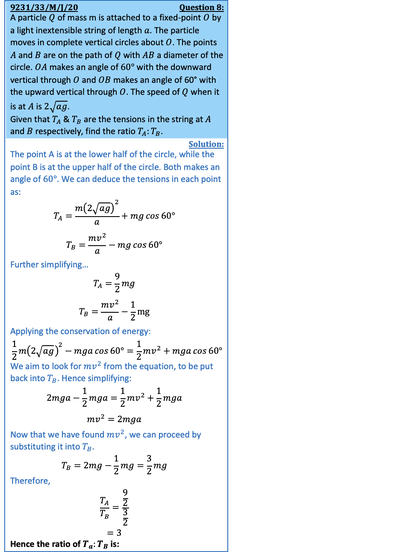

## Motion in a Vertical Circle

* When moving in a vertical circle a body is in circular motion with non-uniform speed
* If the tension or reaction force is 0 during the motion, then the object has left the circular path and is now a projectile
* The condition for a particle to complete vertical circles with radius $r$, starting from the lowest point, its initial speed must satisfy:

  $ u \ge \sqrt{5gr}$
* Although it is not mandatory to memorize the above, another way to deduce if a particle completes vertical circles is that its reaction force must not be 0 at the highest point of the circle, that is:

  $R > 0 $
* Apply the conservation of energy on solving vertical circles questions:

  $\frac{1}{2}mu^2 + PE_A = \frac{1}{2}mv^2 + PE_B$

  Where $A$ is usually the starting point, and $B$ is the general point of the motion
* Apply Σ$F$ = $ma$ towards the centre of the circle
* Once the two equations have been found, it can be simultaneously solved
* For motion on hemispheres
  * Using Σ$F$ = $ma$ towards the centre gives:

    $mg cos \theta - R = \frac{mv^2}{r}$
  * When a particle is projected from the top of a hemisphere, provided the initial speed $0 < \theta < cos^{-1}\frac{2}{3}$

---

 