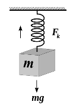
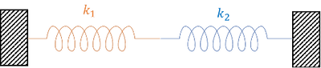
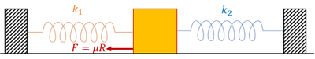
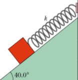

## Scenarios

* If a mass is hanging at one end of a spring with the other attached to a fixed point, the tension in the spring must be equal to the weight of the object

 

* If two springs are attached between two fixed points and both are extended, the tension in both must be the same in order for there to be no net force overall

 

* If two springs are attached to fixed points and an object in the middle, tensions and frictional force must act in such way that overall force on mass = 0 

 

* If a spring is attached to an object on a rough surface, the frictional force acts in the direction opposing tension in the spring (preventing it to return to its original shape)
* If a mass is on an incline and held at rest by a spring, the tension in the spring must be equal to the component of the weight parallel to the slope 

 

