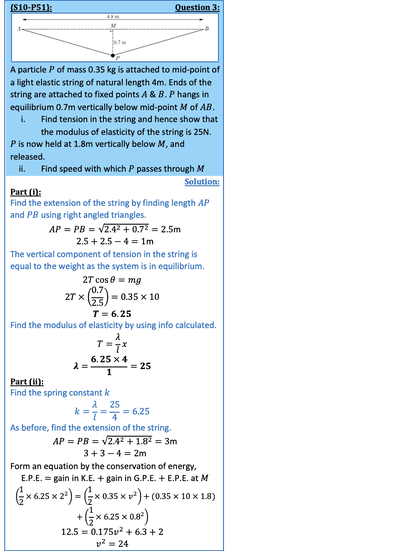
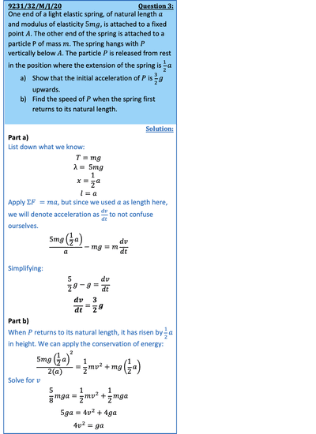

## Elastic Potential Energy

* Work done in stretching a string/spring is given by:

  $W = \frac{\lambda x^2}{2l}$

  Also gives work done in compressing a spring.

  Derivation:

   
* The case when  and  is arbitrary

  $= \frac{\lambda x^2}{2l}$
* Used in conjunction with kinetic and potential energy (work-energy principle)

---

 

---

  