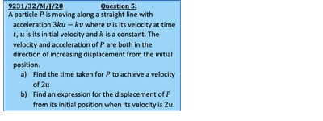
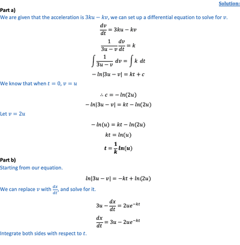

## Acceleration with respect to time

* We can denote velocity and acceleration as a derivative

  $v = \frac{dx}{dt}$ $a = \frac{dv}{dt} = \frac{d^2x}{dt^2}$
* If given velocity, we can find its displacement function by integrating the velocity function

  $x = \int v dt$
* Same goes for finding velocity if given acceleration

  $v = \int a dt$

Then apply boundary conditions (usually called initial conditions)

---

 

    