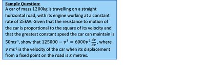
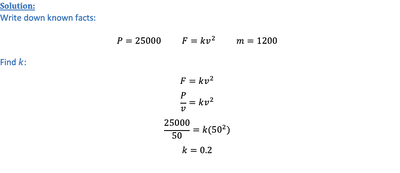
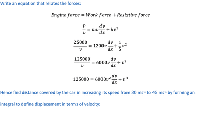

## Variable Forces

* Bodies undergo variable acceleration due to the effect of variable forces e.g., gravitational fields.
* Important to put negative sign if decelerating e.g., when a body falls in resistive medium.
* Deriving an expression for force in terms of velocity and displacement:

  $F = ma$ $a = v \frac{dv}{dx}$

  $F = mv \frac{dv}{dx}$
* Deriving an expression for force in terms of work done:

For an object moving from $x_1$ to $x_2$  the change in kinetic energy or work done can be defined as:

$W =\int_{x_1}^{x_2} F ,dx $

$\therefore \frac{dW}{dx} = F$

* Deriving an expression of power in terms of force and velocity

  $ P = \frac{dW}{dt} = \frac{dW}{dx} \times \frac{dx}{dt} = Fv$

---

   

 

   