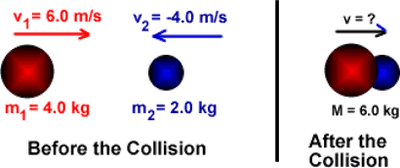

# Momentum

## Momentum

* $Momentum = mv$

* **Conservation of linear momentum**: The total momentum of a system in a particular direction remains constant unless an external force is applied.

* Momentum Before Collision = Momentum After Collision

 

* Momentum before $ = ( 6 \times 4) + (-4 \times 2) = 16$
* Momentum after $ = 6 \times v = 6v$

  $16 = 6v$

  $v = 2.67 ms^{-1}$

