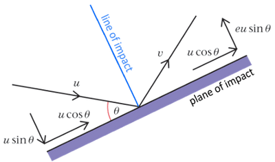
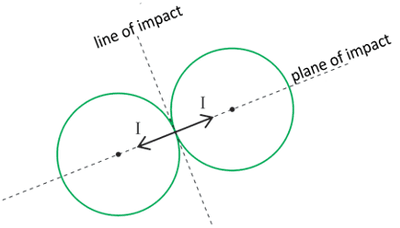
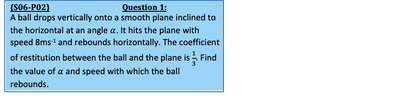
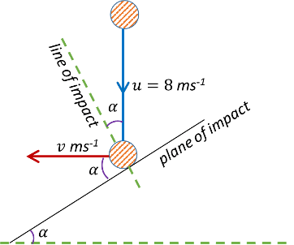
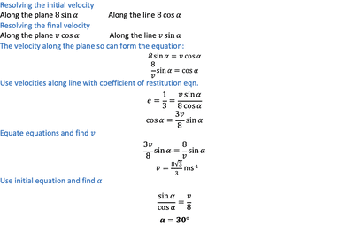

## Oblique Impacts

Impact between a smooth sphere and a fixed surface:

 

* The impulse on the sphere acts perpendicular to the surface along the line of impact
* Newton’s law of restitution applied to the component of the velocity of the sphere along the line of impact
* The component of the velocity of the sphere along the plane of impact is unchanged

**The impact between two spheres:**

 

* Impulse affecting each sphere also acts along the line of impact
* The components of velocities of spheres along the plane of impact changed
* Newton’s Law of Restitution applied to components of the velocities of the spheres along the plane of impact
* The Law of Conservation of Momentum applies along the plane of impact

---

 

Solution:

Sketch a diagram of what is happening:

    