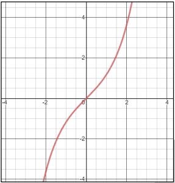
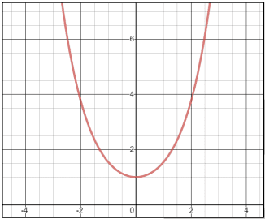
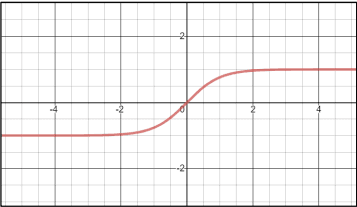

# Hyperbolic Functions

## Exponential forms

* $sinh x = \frac{e^x - e^{-x}}{2}$

  Inverse: $sinh^{-1}(x) = ln(x + \sqrt{x^2 + 1})$

 

* cosh $x = \frac{e^x + e^{-x}}{2}. x ∈ R, f(x) \ge 1$

  Inverse: $cosh^{-1}(x) = ln(x + \sqrt {x^2 - 1})$

 

* $tanx = \frac{e^x-e^{-x}}{e^x+e^{-x}} = \frac{e^{2x} - 1}{e^{2x} + 1}.x ∈ R,  -1<f(x)<1$

  Inverse: $tanh^{-1}x = \frac{1}{2} ln \frac{1+x}{1-x}$

 