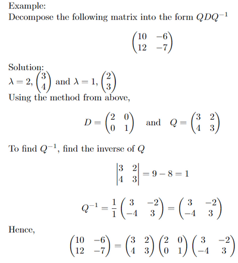

## Diagonalization

* A matrix $𝐀$ that can be written in the form $𝐀 = 𝐏𝐃𝐏^{ −1}$ is said to be diagonalizable.
* The diagonal matrix $𝐷 = \begin{pmatrix} λ_1&0&0&⋯&0 \ 0&λ_2&0&⋯&0 \ 0&0&λ_3&⋯&0 \ ⋮&⋮&⋮&⋱&⋮ \ 0&0&0&0&λ_𝑛 \end{pmatrix}$ 

Where each eigenvalue is placed in the leading diagonal of a square matrix.

* Finding matrix $𝐏$: place two eigenvectors side-by-side $\begin{pmatrix} 𝑎 & 𝑐 \ 𝑏 & 𝑑 \end{pmatrix}$

  Note: the eigenvalue should be in the same column as the corresponding eigenvector

---

 

* If there are fewer eigenvalues than the dimension of the matrix, then there will be insufficient distinct eigenvectors. This means that, in general, the matrix $P$ cannot have an inverse, and so the matrix $A$ cannot be diagonalised. There are exceptions to this, but they are not covered in the syllabus.

