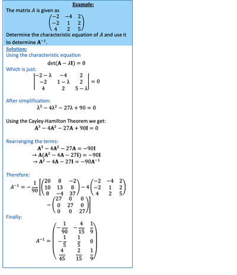

## Cayley-Hamilton Theorem

* The Cayley-Hamilton Theorem states that:

  “For a square matrix $A$, assume that the characteristic equation is $P(\lambda) = det (A - \lambda I)$. The theorem states that $P(A) = 0”$
* In other words, if you have the characteristic equation:

  $a \lambda ^3 + b \lambda ^2 + c \lambda + d = 0$

  Then it is also true that:

  $aA^3 + bA^2 + cA +dI = 0$

  We can use this to find inverses of matrices

---

 

