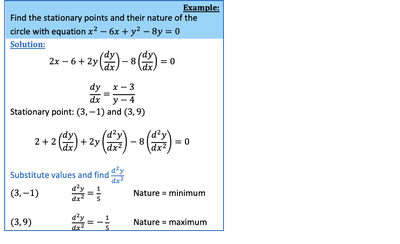

## Second Derivative of Implicit Equations

* May be asked to differentiate twice and use equation to find out nature of stationary points
* Nature of stationary point
  * 2nd derivative +ve = minimum
  * 2nd derivative –ve = maximum

    
---

 