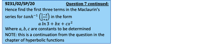
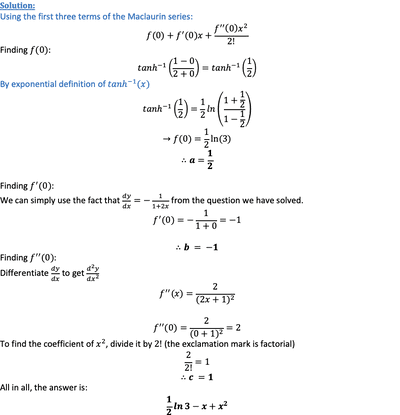

## Maclaurin Series

* For an infinitely differentiable function $f(x)$ about the point $x = 0$, the Maclaurin series is given by:

   
* In summation form, the Maclaurin series can be represented by:

 

* List of Maclaurin Series can be found in the formula sheet MF19

  