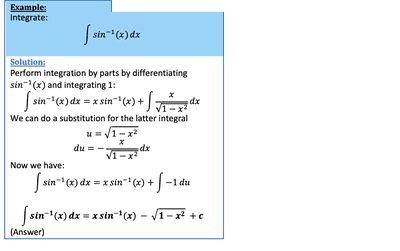

## Integrating Inverse Functions

* Use integration by parts to integrate inverse functions
* In doing it, Differentiate the inverse function and integrate 1
* In other words, let $u$ be the inverse function and $v = 1$ 

---

 

