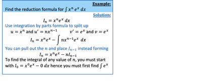
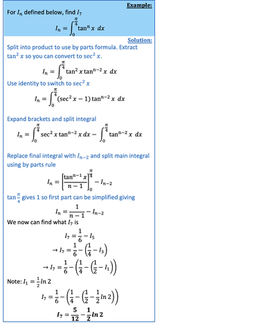

## Reduction Formula

* Enables to solve integral problem by reducing it to an easier integral problem, and then reducing that to an easier problem, and so on.
* Generally obtained from using by integration by parts.
* Usually solved by splitting the power such that the lower power can be integrated, and the higher power can be differentiated.
* Look for the original form in your solution.

---

  