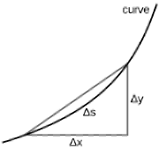

## Arc Length of a Function

* When finding the length of a curve, using $\delta x$ is not accurate enough however we may consider $\delta s$ to be straight and hence using Pythagoras’ Theorem:

   

  $\delta s^2 = \delta x^2 + \delta y^2$
* We can then integrate to obtain $s$ however before this, we must first factorize to obtain an equation we can work with

For cartesian curves:

* Factorizing $\delta x$

 

Square rooting and integrating this:

 

(can factorize $\delta y$ instead and integrate with respect to y)

**For cartesian curves defined parametrically:**

* Factorizing $\delta t$

 Square rooting and integrating this:

 

**For Polar curves (refer to 3.5):**

* Factorizing $\delta \theta$

 

Square rooting and integrating this:

 