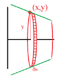
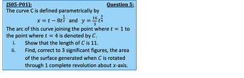
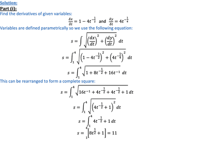
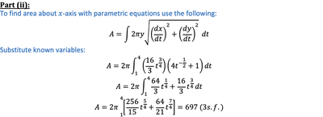
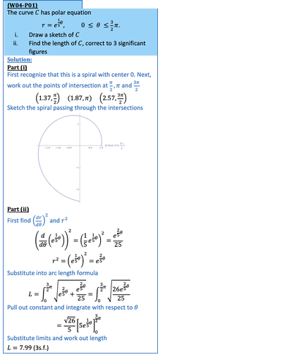

## Surface Area of a Solid Revolution

* When calculating surface area, we split curve into discs similar to when we find volume however use  instead of  for greater accuracy, treating the disc as the frustum of a cone 

 $A = \int 2 \pi \delta s$

* Using our equation formed for $\delta s$, substitute into expression and integrate 

**For cartesian curves:**

* Factorizing $\delta x$

 Square rooting and adding this to surface area equation:

 **For cartesian curves defined parametrically:**

* Factorizing $\delta t$ 

 Square rooting and adding this to the surface area equation:

 

---

   

* For arc length in polar form

   

---

 