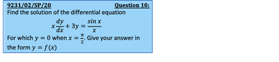
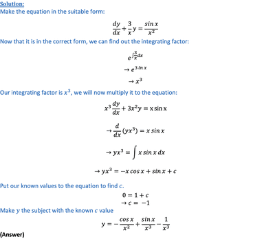

# Differential Equations 

## First Order Differential Equations

* Make sure the equation is in the form

$\frac{dy}{dx} + F(x)y = G(x)$

* To determine the integrating factor, use $I = e^{\int F(x)dx}$
* Always multiply through by the integrating factor to get:

$I \frac{dy}{dx} + F(x)Iy = G(x)I$ 

This equation will then reduce to:

$\frac{d}{dx} (Iy) = G(x)I$ 

---

  