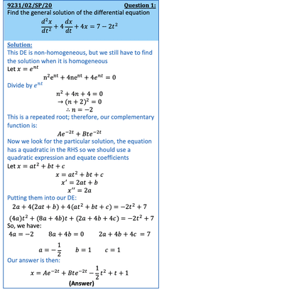

## 2nd Order DE: Non-Homogeneous Case

* These type of differential equations will be of the form:

$a \frac{d^2y}{dx^2} + b \frac{dy}{dx} + cy = f(x)$

* We find a complementary function in the same way as above, by making $f(x) = 0$
* After finding a complementary function we have to add a particular integral
* The particular integral we add is dependent upon $f(x)$ and the train solution used:

 

* Once we have the trial solution, we equate it to $y$ and differentiate it to find $y’$ and differentiate again to find $y’’$ , in terms of $P$, $Q$ and $R$
* Then substitute these into the initial differential equation and solve simultaneously for $P$, $Q$ and $R$
* The trial solution with substituted values of $P$, $Q$ and $R$ becomes the particular integral
* Addition of complementary function and particular integral gives us the particular solution

 

---

 

* If a term in your complementary function is $Af(x)$ and the RHS is $pf(x)$, then try:

  $y = \alpha x f(x)$
* If terms in your complementary function are $Axf(x) + Bf(x)$ and the RHS is $pf(x)$, then try:

  $y = \alpha x^2 f(x)$

