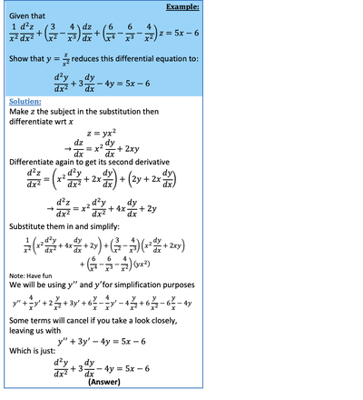

## Substitution method for DEs

* For 1st order differential equations
  * The DE will be of the form $\frac{dy}{dx} = F(x,y)$ or $\frac{dy}{dx} = F \frac{y}{x}$
  * Use the substitution given and differentiate once to reduce the differential equation to a separable form.
* For 2nd order differential equations
  * Use the substitution given and differentiate twice to reduce the differential equation to a form such as 

    $a \frac{d^2y}{dx^2} + b \frac{dy}{dx} + cy = 0$
* For 1st & 2nd order DE, the general solution or particular solution MUST be in form of the original variables

---

 