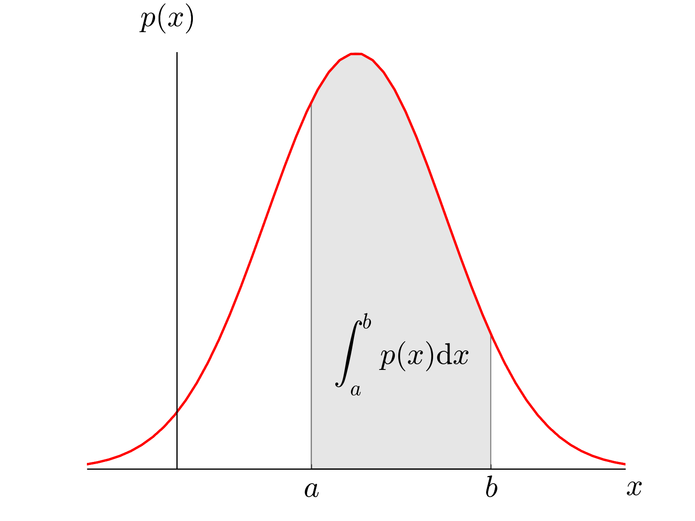

# Continuous Random Variables

## Probability Density Functions (PDF)

* Function whose area under its graph represents probability used for
  continuous random variables
* Represented by a function, such as $f(x)$, $p(x)$, $g(x)$ etc

 

**Conditions:**

* Total area always $= 1$

$$
\int_{-\infty}^{\infty}{f(x)}\ dx = 1
$$

* A PDF cannot have negative probabilities, meaning the graph cannot dip below $x$-axis; $f(x) \geq 0$
* Probability that $X$ lies between $a$ and $b$ is the integral, or area, from $a$ to $b$

$$
P\left( a < X < b \right) = \int_{a}^{b}{f\left( x \right)} ~dx
$$

* $P(X = b)$ always equals $0$
  * $\int_{b}^{b} f(x) ~ dx = 0$
* Notes:
  * $P\left( X < b \right) = P(X \leq b)$, as no additional area is obtained
  * The mode of a PDF is its maximum (stationary point)

---

**Example:**

Given that:

$$
\displaystyle x = \begin{cases} 
kx(x - 6) & \text{if $2 \leq x \leq 5$}\\ 
0 & \text{otherwise}    
\end{cases} 
$$

1. Find the value of $k$
2. Find the mode, $m$
3. Find $P(X < m)$

**Solution:**

**Part (i):**

Total area must equal 1 hence

$$
\int_{2}^{5}{\text{kx}\left( 6 - x \right)} = \left\lbrack 3kx^{2} - \frac{kx^{3}}{3} \right\rbrack_{2}^{5} = 1
$$

$$
= 75k - \frac{125}{3}k - 12k + \frac{8}{3}k = 24k = 1
$$

$$
\therefore k = \frac{1}{24}
$$

**Part (ii):**

Mode is the value which has the greatest probability hence we are
looking for the max point on the pdf

$$
\frac{d}{\text{dx}}\left\lbrack \text{kx}\left( 6 - x \right) \right\rbrack = 6k - 2kx
$$

Finding max point hence stationary point

$$
6k - 2kx = 0
$$

$$
x = \frac{6\left( \frac{1}{24} \right)}{2\left( \frac{1}{24} \right)} = 3
$$

$\therefore$ mode $= 3$

**Part (iii):**

$P(X < m)$ can be interpreted as $P( - \infty < X < m)$

$$
\int_{- \infty}^{m}{\text{kx}\left( 6 - x \right)} = \int_{2}^{3}{\text{kx}\left( 6 - x \right)} = \left\lbrack 3kx^{2} - \frac{kx^{3}}{3} \right\rbrack_{2}^{3}
$$

$$
= \frac{1}{24}\left( {3(3}^{2}) - \frac{3^{3}}{3} - 3(2^{2}) + \frac{2^{3}}{3} \right) = \frac{13}{36}
$$

