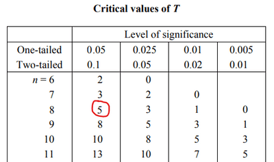

## Wilcoxon matched-pairs signed-rank test

* A Wilcoxon signed-rank test can be performed when:
  * The underlying data are symmetric
  * The underlying data are continuous
* Where:
  * P is the sum of the ranks corresponding to the positive
    differences between the matched pairs
  * N is the sum of the ranks corresponding to the negative
    differences between matched pairs
  * $T = \mathrm{\min}\left( P,N \right)$ is the test statistic

<!-- end list -->

* Given the statistic $T = \mathrm{\min}\left( P,N \right)$
  * $E\left( T \right) = \frac{n\left( n + 1 \right)}{4}$
  * $\text{Var}\left( T \right) = \frac{n\left( n + 1 \right)\left( 2n + 1 \right)}{26}$
  * For large $n$:

$$
T\sim N\left( \frac{n\left( n + 1 \right)}{4},\frac{n\left( n + 1 \right)\left( 2n + 1 \right)}{26} \right)
$$

* Allowing for an approximate z-test to be done using:

$$
z = \frac{T - \mu + 0.5}{\sigma}
$$

**Example:**

The following table shows the systolic blood pressure (mmHg) of a random
sample of eight students before and after a six-week training period.

| Student | 1 | 2 | 3 | 4 | 5 | 6 | 7 | 8 |
|----|----|----|----|----|----|----|----|----|
| B.T. | 130 | 170 | 125 | 170 | 130 | 130 | 145 | 160 |
| A.T. | 120 | 163 | 120 | 135 | 143 | 136 | 144 | 120 |

B.T. = Before Training

A.T. = After Training

a) Stating clearly your hypotheses, test, using the Wilcoxon signed-rank
test, whether or not there is evidence that the training has reduced
blood pressure. Use a 5% level of significance

At a later date, a random sample of 30 students undertake a six-week
training period. Analysis of their results using the Wilcoxon
signed-rank test gives $T = 132$

b) Stating clearly your hypotheses and using a 5% level of significance,
test whether or not there is evidence that the training has reduced
blood pressure.

**Solution:**

a)

Hypotheses:

$H_{0}:$ Population median blood pressure is unchanged

$H_{1}:$ Population median blood pressure has decreased

Construct the signed-rank table

|    | 1 | 2 | 3 | 4 | 5 | 6 | 7 | 8 |
|----|----|----|----|----|----|----|----|----|
| $A_{i} - B_{i}$ | -10 | -7 | -5 | -35 | 13 | 6 | -1 | -40 |
| P |    |    |    |    | 6 | 3 |    |    |
| N | 5 | 4 | 2 | 7 |    |    | 1 | 8 |

* $P = 9$
* $N = 27$

$$
T = \mathrm{\min}\left( 9,27 \right) = 9
$$

Crit. value:

* 5% significance level
* One-tailed test

From the tables:

 

Crit. Value = 5

Since $T=9 > 5$, do not reject $H_{0}$. There is no evidence to suggest
that the median blood pressure has decreased.

b)

Hypotheses:

$H_{0}:$ Population median blood pressure is unchanged

$H_{1}:$ Population median blood pressure has decreased

We can use the normal dist. to approximate since $n$ is large

Gather information:

* $n = 30$
* $E\left( T \right) = \frac{1}{4}n\left( n + 1 \right) = 232.5$
* $\text{Var}\left( T \right) = \frac{1}{24}n\left( n + 1 \right)\left( 2n + 1 \right) = 2363.75$

$$
z = \frac{T - \mu + 0.5}{\sigma}
$$

$$
= \frac{132.5 - 232.5}{\sqrt{2363.75}}
$$

$$
\approx - 2.06
$$

Critical value:

5% significance level & one-tailed test.

$$
z_{0.95} = - 1.645
$$

Since 2.06 > 1.645, reject $H_{0}$. The population median blood
pressure has decreased.