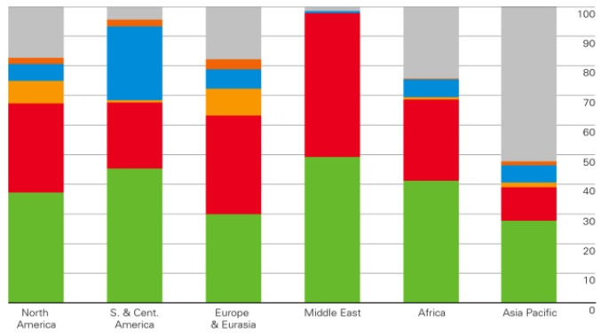
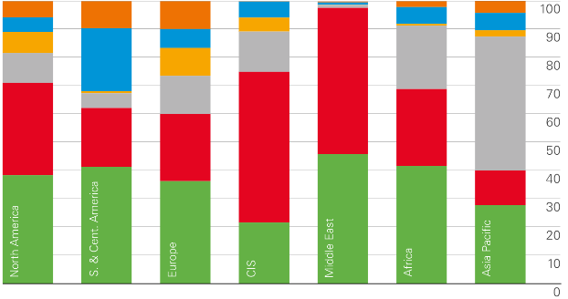

# Environmental Management

## Sustainable Energy Supplies

* Producing and using energy in such a way that it ‘meets the needs of the present without compromising the ability of future generations to meet their own needs’

### Renewable/Non-Renewable

**Renewable resources:**

Offer unlimited use that contribute no atmospheric pollution when generating

* **Critical resources:** require careful management (wood/dung for biomass) so they don’t become unsustainable

**Solar:** sunlight turned into electrical energy by striking photovoltaic cells (direct electricity conversion) or being focussed onto CSP tower, to heat steam to pass through a turbine

* **Advantages:** cost reducing every year, needs little maintenance, saves 500,000 tons CO2 in Barcelona
* **Disadvantages:** must be south-facing in a location with good sun exposure, expensive cells, needs large amount of land, harmful manufacture process
* **Plantar Solar 10:** $35$m cost, $4$ years to build, $624$ mirrors, $23.4$GWh output, $6.3m revenue per year

**Tidal:** tidal movement drives turbines, or a barrage acts as a dam that channels water flow during tidal movements to drive turbines (GPE à KE à electrical). 50% of Europe’s tidal production is in the UK

* **Advantages:** same benefits as HEP, no GHG emission, few wildlife impacts
* **Disadvantages:** possibly increased salinity, disturbed wildlife and migration, expensive, silt build-up
* **Rance Barrage, France:** 240MW facility on the coast of Brittany, 750m long with 24 turbines

**HEP:** fast flowing water (from a river, or released from a dam) is directed through turbines. The force of the water spins the turbine’s blades, generating electricity

* **Advantages:** once operating they are very cheap and efficient to run, emitting no green house gasses
* **Disadvantages:** building structures on rivers and dams may harm the wildlife, are expensive and may over flow or experience silt build up
* **See 12.2.2 – Located Example**

**Wind:** wind hits angles blades, turning a turbine, which turns kinetic energy into electrical energy

* **Advantages:** cost dropped 6x since 1980, no GHG emissions, will never run out, low operating costs
* **Disadvantages:** intermittent, supply can’t rise with demand, harms wildlife, noise and visual pollution
* **Walney Island, UK:** contributes 1GW to UK’s total 10GW, comprised of 87 turbines in Irish Sea to power nearly 500,000 homes

**Geothermal:** using either hot-dry rock (water injected into hot rocks, rises as steam) or high temperature  geo-pressurised aquifer systems (steam rises from ground) to spin turbines. Low temperature aquifers heat water for home use. 4% growth per year

* **Advantages:** no GHG emissions, small footprint power stations, free, no fuel required
* **Disadvantages:** limited locations (needs geothermal activity and correct rocks), may run out of steam or heat, may release sulphur and hazardous minerals
* **Iceland:** powers 95% of Reykjavik, 750MW power, heats 60m m3 of water to 86oC, saves 4m tons CO2

**Wave:** either a fixed structure at the coast, where waves rise on wall and compress air to turn a turbine, or oil moving through a structure at sea

* **Advantages:** regular production, with less impact compared to a tidal barrage
* **Disadvantages:** visual pollution, disrupts fishing and swimming, hard to get electricity back to the shore
* **Pelamis, Orkneys Islands:** 750kW hinged device, where oil inside snake structure flows with wave oscillation spinning a turbine as it moves

**Biomass:** high carbon plants such as sugar cane or grains are turned into ethanol by putting plants in a gasifier, which is used as a fuel. Alternatively, solids such as sewage, wood and rubbish water are burnt

* Fuel wood is the primary source of energy in many LICs. 2.5bn people rely on it for cooking and heat, but 1.5 million die per year due to smoke inhalation
* **Advantages:** easy to store and scale to demand, absorbs CO2 while growing, allows the reuse of wastes
* **Disadvantages:** produced CO2 during burning, farming is controversial (food dilemma, deforestation, soil erosion, habitat loss)
* **Brazil:** around 27m cars (73%) run on an ethanol/ petrol mixture – reducing fossil fuel consumption

**Non-renewable resources:**
Finite, so as they are used the total supply reduces. Eventually, they will become exhausted

**Coal:** 2nd most used after oil. Open cast, or deep shaft mines remove coal from coal beds in the ground. Coal is then burnt, and the heat turns water to steam, turning turbines

* **Advantages:** easy and simple to build, high energy density, plentiful supplies, new technology allows for easy ground extraction, carbon capture = ↓ emission
* **Disadvantages:** produces pollutants (SO2, CO2), bulky to transport, produces large volume of waste, high sulphur content (flue gas desulphurisation produces gypsum and needs a lot of limestone)
* **Drax, Yorkshire, UK:** provides 6% of UK’s energy needs, produces 1.3GW from coal and 3.9GW from biomass. Imports coal from Poland/Australia

**Oil:** carbon dense crude oil from fossilised animals trapped in rock layers underground

* **Advantages:** high energy density, easy to transport (pipes, ships), flexible use (petrol, heating oil, bitumen), cleaner and easier to burn than coal
* **Disadvantages:** limited supply (30bn barrels used per year, only 4bn discovered per year), price fluctuates and vulnerability under control of OPEC and wars, issues with oil spills, produces atmospheric pollutants
* **North Sea Oil:** between 1.7 to 3.3bn barrels are recoverable. Roughly 200,000 produced per day

**Natural Gas:** trapped in rocks deep underground – is blasted out with high pressure fluids (blasting and cracking shale rocks). Same steam/turbine process

* **Advantages:** large deposits yet to be discovered, cleanest of the fossil fuels, 50% reduction in USA gas prices due to fracking, new technologies developed
* **Disadvantages:** limited supply, produces GHGs, fracking induces seismic activity, associated health issues if gas/fluids leak into underground aquifers
* **Example:** 1m fracking sites in the USA, across 30 states. 1000 drilling sites in Pennsylvania, $30-50m for 1 site with 8 lines. “More gas in USA than Oil in Saudi Arabia”

**Nuclear:** uranium ore is mined and turned into fuel rods that undergo radioactive decay. The splitting of atoms creates heat that warms water to steam, turning turbines

* **Advantages:** very efficient (1 station = wind farm the size of Luxemburg), no atmospheric pollutant, reduced dependence on greenhouse gasses
* **Disadvantages:** expensive to build/run, takes long time to plan and then decommission, hard to dispose of toxic water (U235 = 700m yr half life), disasters such as Chernobyl taint the image
* **Hinkley C, UK:** plant in North Summerset will contribute 3.2GW to the UK’s total 16GW. It alone provides 7% of the UK’s power (6m homes) and 25,000 jobs

### Factors Affecting National Energy

* **Supply:** determined by the availability of energy resources in a country, its ability to harness these and its ability to purchase energy resources from abroad
  * **Management:** ensuring supplies are sufficient to meet demand. May be achieved by investing in renewables
* **Demand:** most influenced by the size of a country’s population and its economic development
  * **Management:** decreasing demand to match supply

**Physical Factors**

* **Resource endowment:** the natural resources within the borders of a country. Energy resources are not evenly distributed around the world
  * A country with a richer supply of fossil fuels is likely to use those as their primary resource supply
  * **Russia:** 177 billion tons of proven coal reserves
  * **Middle East:** 836 billion barrels of oil reserves
* **Climate:** the weather conditions for an area over a long period
  * Countries with windier, sunnier or wetter climates are more likely to harness energy from respective renewables
  * **New Zealand:** 27mph average winds in Wellington so have installed 62 turbines for 73,000 homes
  * **Canada/Scandinavia:** very cold countries use more energy than warmer HICs to keep warm in winter

**Economic Factors**

* **Level of development:** there is a global imbalance in energy demand that correlates with development
  * HICs use at least 5 equivalent oil tonnes more than LICs
  * **HICs:** can afford high energy use (cars, heating…)
  * **MICs:** have rapidly increasing demand (manufacture)
  * **LICs:** have little demand
* **Income:** to meet demand by producing energy from supplies, heavy investment is required
  * HICs have this income available so are able to maintain control of their energy policy and develop the energy supplies they need
  * LICs lose freedoms to Trans-National companies who produce energy for them
  * **Oil:** offshore rigs cost at least $500 million
  * **Coal power stations:** around $2 billion
  * **Wind turbines:** around $5 million per turbine
* **Technology available:** required to exploit resources, involved in production and use of energy over time
  * **Supply:** creation of nuclear plants, discovery technology, fracking methods and advanced coal mining techniques in 20th century meet demand
  * **Demand:** invention of internal combustion engine has increased petrol demand and online world requires lots of power

**Environmental Factors**

* **Sustainability:** meeting the current energy demands without compromising the needs of the future generations’ demands, or the natural environment
  * **Supply:** to achieve sustainable supply, non-renewables will be used sparingly, and there will be investment into renewable energies
  * **Demand:** can be sustainably managed by advising locals on their usage, and opting for more efficient energy using devices
  * **Energy conservation:** 56% of UK’s usage could be cut by using available strategies and technologies
* **Pollution:** the critical role of energy in economic development is more important than pollution consequences
  * CO2 is to blame for much of the Global Warming Effect
  * As a country develops, the environmental consequences of energy production become more important to locals and therefore the political agenda
  * **West Virginia, USA:** whole mountains destroyed for coal
  * **Northern Russia:** covered in oil spills from pipe leaks and oil tankers running aground. Kills wildlife
  * **Gulf of Mexico, Deepwater:** 2010 oil disaster

**Political Factors**

* **Energy policy:** legislation, treaties, taxation and investment incentives to either increase supply (more power stations etc.) or decrease demand (focus on efficiency, sustainability and pollution reduction)
  * **Kyoto Protocol:** 192 countries agreeing to reduce greenhouse gas emissions, an extension of the 1992 ENFCCC agreement. Superseded by Paris 2020
* **Energy security:** uninterrupted availability of energy sources at a price that people and industry can afford
  * **Short term:** ability to react promptly to sudden demand changes
  * **Long term:** future energy supply deals are inline with future economic development and environmental needs
  * In a capitalist economy, energy supply is dictated by demand and the production companies. However, governments step in to ensure security and prices
  * Is required for solid environmental growth. Some countries may interfere with the market to secure supplied

### LIC/MIC/HIC Consumption

* 2012
  
* **2019:** renewables and natural gas increased. Coal consumption reduced in HICs, constant in LICs/MICs
  
* **Fossil fuel trends**
  * **Coal:** used least in the Middle East, most in Asia Pacific (55%), about 25% in Europe, Africa, N.America
  * **Oil:** used most in the Middle East (45%), \> 30% in 5/7 countries
  * **Natural Gas:** 5% increase in the middle east
* **Nuclear power trends:** significantly greater share in South/Central America (despite N.America being big producer) and Europe than rest of the world
* **Renewables trends:** small increase 7 years on, but still \<5% in all countries. None in Middle East or CIS
* **HEP trends:** huge 25% in S.America, around 10% in all other countries except the Middle East

### Local Effects of Energy

* **Dry deposition**
  * Gasses and particles never mix with water
  * NOx, SO2, CO2 cause the air to become acidic – absorbed by plants and trees
  * Larger particles deposit directly onto the ground or in bodies of water, causing acidic effects on limestone
* **Nuclear disaster:** see Chernobyl example
  * Examples included in energy production descriptions indicate local environmental and economic effects

### Global Effects of Energy

* **Wet deposition (acid rain)**
  * Gasses and particles mix with water vapour in the sky
  * NOx, SO2, CO2 cause the precipitation to become acidic – causing erosion of alkaline rocks and structures such as Limestone
  * Carried by wind – eg. UK greenhouse gasses cause acid rains in Germany and The Netherlands
  * Ocean acidity increased by 0.05pH over 40 years
  * Soil acidification
* **Global warming**
  * Burning fossil fuels causes an increase in the concentration of greenhouse gasses (methane, CO2, SO2 etc…)
  * Cause the enhanced greenhouse effect. More insolation trapped inside the atmosphere, causing warming that if there were no additional gasses
  * Temperature has risen by 0.5°C over the last 40 years
  * Increased CO2 (340ppm to 410ppm over 40 years) increases ocean acidity
* **Ozone depletion**
  * Ozone is a protective layer of O3, 90% between 10 and 50km from Earth’s surface, absorbs UV radiation
  * Destroyed by CFCs, that react with O3 causing it to decrease
  * Reached a maximum size of 28.4km2 in 2000, now decreased to 9.3km2
  * Causes increased cancer rates, eye cataracts and effects aquatic/agricultural ecosystem