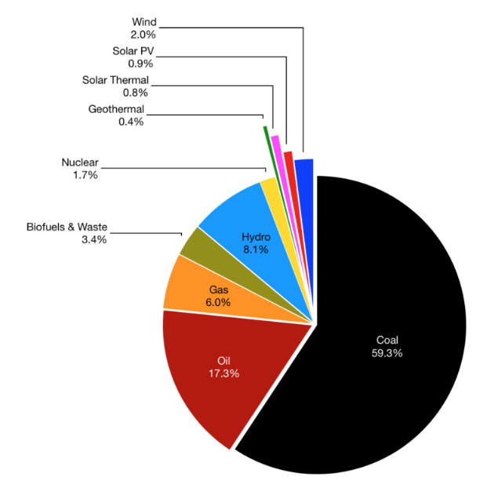
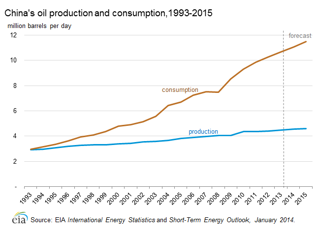
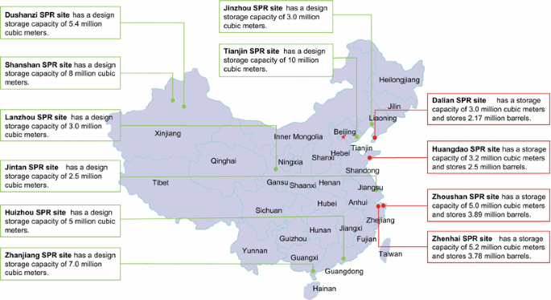
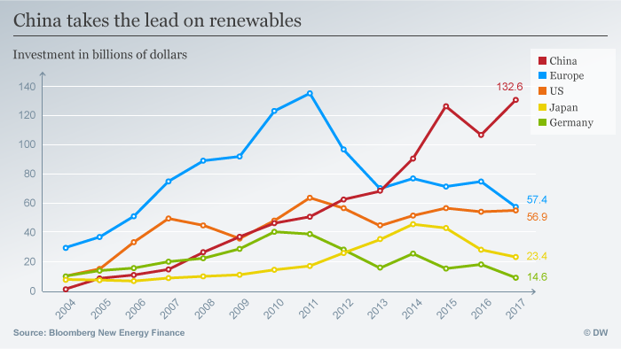
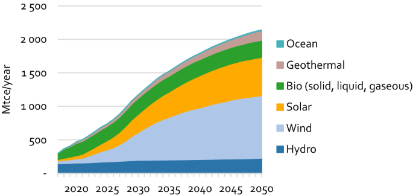
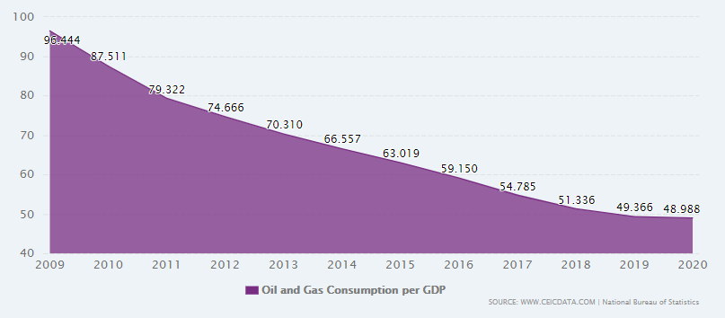
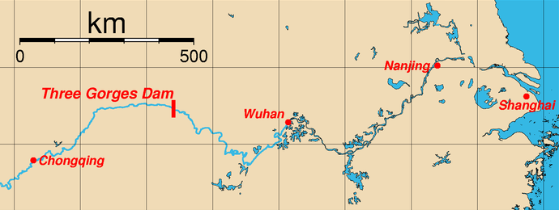

## Management of Energy Supply

### National Example

**China’s Energy Strategy**

* Strategy plans to
  * Reduce energy use per GDP by 20%
  * Ensure a more secure supply of energy
  * Increase sustainability

**Demand and changes in demand:**

* Average annual demand growth rate of 5.6%
* Consumption rose by 45% between 2006-2013
* 570Mtce used in 1978 rose to 3250Mtce in 2010
* Forecast growth to 4840-5070Mtce in 2020, and then up to 5580-5870Mtce in 2030
* Target to reduce carbon emission by 40-45%
* **Issues:** worlds top energy consumer, a total of 4.8bn KWh were generated in 2012

**Issues in changes in supply**

* Between 2000 and 2010
  * Constant 70% coal
  * Oil reduced: 22.2% to 16.5%
  * Natural gas rose: 2.2% to 4.3%
  * Renewables rose: 6.4% to 8.3%
* 2017 data:
  
* **Issues:** uranium demand (17 nuclear power stations under construction, with plans for 124), World’s top coal producer (4bn tons in 2012)

**Actual production of electricity**

* World leader in:
  * HEP: 15% of total production
  * Wind: 30% global capacity
* Open 1 ‘clean’ coal-fired power station per month
* Between 2003-13; accounted for 87% of the world’s coal consumption
* Greenpeace: 80% CO2 is from burning coal

**Oil production and consumption**

* Net imports of 6 million barrels per day
* Consumption to increase while production remains constant
  

**Strategic Petroleum Reserve**

* Supply of petroleum held by China as emergency fuel for use in emergency situations: major price increases, instability in supply, major disaster
* Managed by the National Development and Reform Commission
* Expanded in 2007
* 200 million barrels in 2014, 900 million in 2019
* Expected to reach 1.15 billion barrels, that would last 83 days in 2020
* **Main facilities**
  * Zhenhai, Zhenjiang Province: 52 million barrels
  * Tianjin: 150 million barrels
* Location
  

**Renewable energy policy**

* Produce 15% of overall energy from renewable sources by 2020 and 20% by 2030
* **Program goals (for 2005)**
  * Reach 13 Mtce of electricity using new and renewable energy (not hydroelectric)
  * Reduce CO2 by 10 Mt and SO2 0.6 Mt
  * Increase solar water heating from 11million m2 to 64million m2
  * Increase production capacity of solar cells to 15MW with total capacity 53MW
  * Increase manufacturing capacity of wind power to 200MW and increase capacity to 1.2 GW
  * Increase geothermal energy production to 20 million m2
  * Increase gas supplies to almost 2 billion m3

**Evaluation of strategy success**

* Renewables have increased
  * 2012 capacity (2.1% of consumption)
    * Wind = 61GW
    * Solar = 3.4GW
  * 2017 capacity (5.3% of consumption)
    * Wind = 169GW
    * Solar = 130GW
      
  * Forecast:
    
  * Consumption per GDP fell by 49% between 2009 and 2020 – echoing success of 2006-10 plan to reduce by 20%
    

### Located Example

**China’s 3 Gorges Dam**

**Description**

* Built on the Yangtze River, China (near Chongqing)
* Operational 2012, completed 2009 after 17 years
* Created 20,000 jobs during construction
* Ship lift installed in 2015
* Largest HEP in the world (2.3km x 100m x 115m thick)
* River which runs behind the dam is 660km long

**Reasons for development (changes in demand)**

* **Reduce downstream flooding:** 3000 dead in 1999 floods, compared to only 300 in 2012
* **Generate HEP to diversify from coal:** 70% coal
* **Fuel economic growth:** reduce flooding and protect Chongqing (35m is largest metropolitan area in the world), ship locks and lift allow navigation
* **Tame the Yangtze:** ambition of leaders such as Emperor Mao

**Actual production of electricity (new supply)**

* 34 generators with total capacity of 22,000MW
* Generates an average 95 ± 20TWh
  * 2020 monsoon rains = 112TWh
* Generated 100bn KWh in 2011
* Produces power for 60 million people

**Location**

**SEEP considerations**

* **Social**
  * Locals relocated; reduced flooding (3000 in 1998 vs. 300 in 2012); secure water supplies for 10m; created 20,000 jobs
  * 1.3m uprooted; 140 towns and 255 cultural sites flooded; houses, jobs, communities lost; less natural silt fertiliser for farms
* **Environmental**
  * Reduces China’s dependency on fossil fuels
  * Destroys wildlife by changing ecology (river dolphins, Sturgeon fish); eyesore (visual pollution); contaminants not cleaned from valley floor
* **Economic**
  * Protects 10m people from flooding in Chongqing, Wuhan and Shanghai; 10,000 tonne ships can use locks /lifts to navigate (encourages upstream industry)
  * Cost between 25 bn and 88 bn (official, estimate); cost 00bn to relocate displaced
* **Political**
  * Political pride in project
  * Risk of failure (landslides (150 in 5 months), silt build-up)

**Evaluation of scheme success**

* Scheme has social, environmental and economic consequences (some positive and negative)
* Contributes to stagnation of coal consumption (50%)
* Produced energy equivalent of 50 tonnes of coal
* Accounts for ¼ China’s electricity capacity
* HEP produced 15% China’s electricity in 2015, with 3GD being largest example (significantly contributes)
* HEP meets policy aim to ↑ renewables to 15% 2020
* Little room for future expansion – more generators?