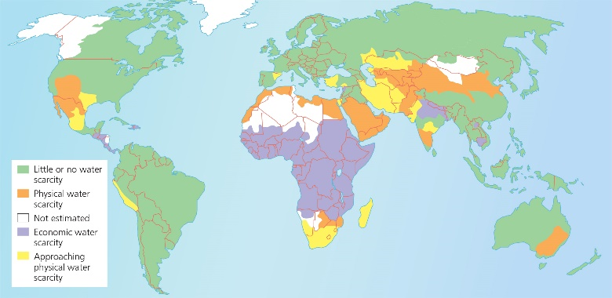
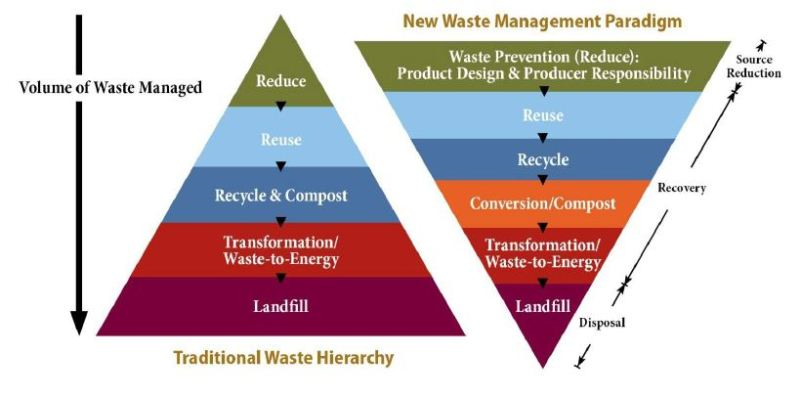

## Environmental Degradation

* Deterioration on the environment through depletion of resources such as air, water and soil

### Pollution

* Contamination of the environment
* **Incidental pollution:** one-off incident
  * **Chernobyl, 1986:** reactor 4 exploded producing 400x radiation of Hiroshima bomb, 100,000 people died, 2,600km2 exclusion zone
* **Sustained pollution:** long term impacts
  * Global warning and ozone depletion

**Land pollution**

* **Nature:** deposition of solid and liquid wastes on land or underground in a manner that contaminates the soil, groundwater, threatens public health, is an eyesore
* **Causes**
  * **Mining:** slag heaps leave scars, dust kicked up, soil erosion, destruction of forests
  * **Industry:** solid toxic waste by-products dumped on land, land is too expensive to reclaim when factor closes so is left to crumble
  * **Energy production:** overland oil pipelines leak and are an eyesore, coal ash from power stations dumped
  * **Domestic waste:** HICs throw more away, buried in landfills, methane produced as a result, rainwater leaks through waste moving toxins to aquifers
* **Canadian Oil Sands:** size of England, 3rd largest in the world, holds 170bn barrels (11% worlds oil), 80% is 75m sub-surface, produces 2-3m barrels per day, produces 3x GHGs than normal oil harvesting
* **Solutions**
  * **Energy from waste plants:** in New York, 450-600 tonnes waste is collected and transported by ship to plants as far away as Ohio and South Carolina. Burnt for energy, costs $430 per year
  * **Education:** organisations such as **Green Peace** educate locals and the **Clean India Mission** aims to ensure proper sanitation exists across India
  * **Legislation:** as with all pollution, legislation can be introduced at local and global levels to reduce land pollution. UK has the **Environment Act 1995** that prosecutions can be based on, and described what should happen with/to prevent contaminated land

**Air pollution**

* **Nature:** the presence of substances in the atmosphere that are harmful to the health of humans, other living beings, or that cause damage to the climate/materials
* **Causes**
  * **Industrial processes:** produce SO2, NOx, particulate matter, and VOCs
  * **Vehicles:** produce NOx, particulate matter, CO, Pb and VOCs
  * **Energy production:** burning fossil fuels produces harmful CO2 and SO2, causing global warming and acid rain
  * These chemicals have a range of effects, from respiratory disease and cancers to deaths
* **China:** 1.42 million premature deaths due to air pollution and nearly 400,000 extra as a result of burning household solid fuels. PM2.5 concentration is 4x higher than WHO recommendation. Coal generated pollution killed 366,000 in 2013
* **Solutions**
  * **Direct air carbon capture:** sucking fans and chemical processes filter air to remove carbon. Carbon Engineering plant in British Columbia does work equivalent to 40 million trees. Prolongs dependence
  * **Catalytic converters:** mandatory in most HICs. Precious metals such as Rhodium and Palladium remove harmful gasses. Reduce CO2 by 87% and NOx emissions by 62% over the vehicles life
  * **Reduce fossil fuel use:** simply reducing dependence and use of fossil fuels will reduce CO2. CO2from industry and energy makes up 65% of all GHGs

**Water (inland) pollution**

* **Nature:** the release of substances (including heat and radioactive material) into groundwater, lakes, streams and rivers that interferes with the beneficial use of the water or natural functioning of ecosystems
* **Causes**
  * **Industrial waste:** toxic chemicals and non-normal temperature water are discharged
  * **Mining activities:** toxic elements and heavy metals released from mining mix with water
  * **Chemical fertilisers:** an excess causes eutrophication, where algae blooms consume all oxygen, killing fish
  * **Sewage leakage:** contaminates ground water stores and aquifers, making it unsuitable to drink
* **Harbin, China:** explosion at photoelectrical plant in NE China led to Benzene levels in the river being 108x the limit. 5 dead, 60 injured, 10,000 evacuated
* **Solutions**
  * **Legislation:** ban or re-route waste pipes from factories and power stations, or send water through cleaning and cooling process
  * **Development:** untreated sewage kills 2.2 million people each year, sewage systems should be priority
  * **Land use restrictions:** limit fertiliser use in the area 10-20km from a river, water source or known aquifer to reduce the risk of eutrophication

**Water (ocean) pollution**

* **Nature:** the release of substances (including heat and radioactive material) into estuaries and oceans that interferes with the beneficial use of the water or natural functioning of ecosystems
* **Causes**
  * **Ship discharge:** some cruise ship discharge waste directly into the sea
  * **Land runoff:** overland flows during storms pick up man made and harmful contaminants, and drain to the ocean
  * **Litter:** plastic debris cannot decompose, and so remains suspended in the ocean for many years
  * **Sewage:** discharged directly off the coast, or as river runs into the sea. Toxins kill wildlife, and nutrients cause a reduction in oxygen
* **BP Deep Water Horizon (Gulf of Mexico):** blowout preventer failed in 2010, killing 11. 200m gallons spilled into ocean for 80 days. $30bn clean-up costs and $20bn compensation and image recovery for BP. 400 species threatened including pelicans
* **Solutions**
  * **Oil spill clean-up:** in situ burning, dispersion chemicals in water, booms to collect surface old and pull together so it can be sucked up or skimmed
  * **Ocean Clean-Up Project:** aims to clean up the 5 trillion pieces of plastic in the ocean (in garbage patches). Aims to remove 50% of Great Pacific garbage patch within 5 years
  * **Legislation:** US Clean Water Act (section 311), prohibits hazardous waste being disposed off from ships

### Water Demand and Supply

**Water stressed areas:** supply is less than 1700m3 per person per year

* **Surplus:** more water than necessary to meet demand
* **Deficit:** insufficient water supply to meet demand

**Demand:** water is essential for human life (survival and industry)

* **Agriculture:** if precipitation levels are too low to maintain crops, then farms must be irrigated
  * **Locational variation:** 3% UK, 80% Malawi
  * **Seasonal variation:** Arizona Alfalfa farmers use 10x more water in June, compared to February
* **Industrial:** large amounts of water are needed for power production and manufacture
  * **Locational variation:** 75% UK, 5% Malawi
  * **Seasonal variation:** Ghanaian beverage plant uses between 12,000 (May) and 7,000 m3 (July)
* **Domestic:** water must be consumed daily by humans, otherwise we dehydrate and could die. It is also used in cooking, cleaning and sanitation
  * **Locational variation:** 22% UK, 15% Malawi
  * **Seasonal variation:** stayed almost constant at 400,000m3 in the UK 2012-13

**Supply:** the provision of water by public utilities, companies, community endeavours or individuals

* **Surface water:** from rivers and lakes. Reservoirs are a form of surface storage, where a dam wall is built across a river
* **Groundwater:** water can be trapped in underground aquifer rocks, accessed by boreholes/wells
* **Desalinisation:** techniques such as reverse osmosis can turn undrinkable sea water into fresh water, but is very expensive, and so only HICs use it (eg. Dubai)
* **Public utilities:** treat water (add chlorine and fluorine) from the above sources and deliver it to buildings via a series of pipes
  * 90% of the world’s urban areas’ piped water is from publicly owned utilities
  * May limit water use in droughts, or issue boil water guidance in the case of disasters

**Factors influencing water balance**

* It is important to maintain a sustainable balance to meet current needs, while not threatening future supply (eg. desertification, wildlife loss)
* **Precipitation:** greater chance of deficit if low precipitation levels (< 500mm/yr)
* **Proximity of rivers to source:** the Nile River Valley, Egypt is fed by precipitation in Ethiopia (up to 6,000km away)
* **Water bearing rocks:** subsurface aquifers can provide a water source even in deserts
* **Evapotranspiration:** in hot, dry environments up to 90% of water is lost to evaporation and transpiration
* **Agriculture:** heavy irrigation can reduce proportion of water available for human consumption
* **Economic development:** deficits can be induced as factories and power stations require huge amounts of water
* **Population density:** the more domestic demand placed on water supply, the greater the chance of a deficit

### Effects of Supplying Water

**Uneven access:** enough water falls on Earth, but it’s uneven distribution means those who need it most, get the least

* 60% of global population gets only 25% of all rain
* Arid regions make up 40% of Earth, but get 2%

**Droughts:** prolonged periods of low rainfall, leading to a shortage of water

* **South Africa:** 9.6 million people food insecure due to crop failures, almost hit day zero (no running water)

**Over abstraction:** more water is removed from water sources than is sustainable, leading to droughts and water scarcity

* **Asia:** 90% of abstraction is for agriculture
* **Africa:** 88% of groundwater abstraction is for agriculture, but has no protective legislation in place

**Water scarcity:** lack of fresh water supply to meet demand

* **Physical:** 110,000 km3 falls on Earth’s surface, but most goes wasted or uncaptured, so is unusable
* **Economic:** a population does not have enough money to utilise a sufficient water supply
  

**Water security:** the capacity of a population to manage sustainable access to acceptable quality water for wellbeing, development, politics, the environment and for preventing disease. Limited worldwide

* ½ worlds hospital beds for water-borne diseases
* 140m hours/day spent by women and children collecting water
* 750m people lack access to safe water – 82% rurally

**Denied access:** due to economic, political, social issues

* **Detroit:** 40,000 resort to nightly ‘water-tapping’, as they cannot afford water bills
* **Bolivia:** French owned water company deemed too expensive, so 200,000 people did not connect

### Water Quality

* **Water types**
  * **Green water:** part of total precipitation absorbed by soil and plants, that is released to atmosphere
  * **Blue water:** part of total precipitation that collects in rivers, lakes, wetlands and ground water – can be consumed
  * **Grey water:** wastewater without faecal contamination
  * **Potable water:** suitable for human consumption – free from diseases and clean (free of sediment)
    * Sewage treatment plants in HICs and MICs turn raw sewage into clean water for discharge, or to be returned as drinking/fresh water
  * **Virtual water:** the amount of water used to produce food or products, and is therefore embedded in item
    * **1 steak:** 4500 litres of water
    * **1 coconut:** 2500 litres of water
* **Measuring water quality:** is important to decide if it is safe for consumption, irrigation or discharge
  * **Turbidity:** size and number of sediment particles
  * **Biological:** bacteria and viruses living in the water
  * **Chemical:** concentrations of chemicals in water
* **Contamination:** leads to disease from water, which kills roughly 500,000 people each year
  * **1997**: 369 cases of cryptosporidiosis occurred, caused by a contaminated fountain in the Minnesota zoo. Most of the sufferers were children
  * 1.8bn people are estimated to drink faecally contaminated water worldwide

### Damage to Rural Environments

**Overpopulation:** available resources are unable to support a population. Population size cannot be maintained to meet needs of the current, without compromising the needs (resources) of the future

* **Cause:** rapid economic development as a nation moves to stage 2 of the DTM (huge death rate drop)
* **Issues**
  * **Unemployment:** too many people per farm means there are more people than work – although lots of manpower could be useful for manual labour
  * **Reduced food/water:** if everyone farms subsistently, then may run out of food
  * **Worse sanitation:** more people using the same poor, undeveloped toilets and water leads to higher cases of water borne diseases like Cholera
  * **Triggers:** overgrazing and deforestation to make enough food, and room, respectively
* **Solutions (may encourage damage)**
  * **Rural-to-urban migration:** accounted for 80% of Chinese and Thailand city growth, 59% Namibia
  * **Investment:** further drives economic development, reducing the birth rate, and improving conditions
  * **Greater land exploitation:** aims to feed more people, but at the expense of soil quality and forests
  * **Green revolution:** to increase food production

**Poor agricultural practices (overgrazing):** plants and soil is exposed to excessive grazing for extended periods of time, with/out sufficient recovery periods

* **Cause:** intense crop production. No fallow period, or fertilisers leads to all of the nutrients being stripped from soil. Therefore crops can’t grow in spots, and soil erodes by wind and rain
* **Issues**
  * **Food shortage:** 690m people worldwide go hungry
  * **Global warming:** reduced foliage means less carbon dioxide capture, contributing to GHG effect
  * **Soil degradation:** 1 to 6bn hectares land degraded
* **Solutions**
  * **Sustainable practices:** manage livestock and crop rotations to ensure soil stays in good condition
  * **Livestock:** feed with stored fodder and control time land is exposed to trampling
  * **New technology:** combine scientific developments with local expertise to reach an appropriate solution

**Deforestation:** the action of clearing a wide area of trees, so that the land can be used for other purposes

* **Cause:** forests are cleared because people have no choice. Overpopulation means more food must be produced, and overgrazing means no land is available to do it; so new agricultural land must be created
* **Issues**
  * **Global warming:** responsible for 20% of global greenhouse as emissions, contributing to 0.5°C rise
  * **Run out of fuel:** current fuelwood usage exceeds the growth rate, so will run out
  * **Landslides:** the removal of trees also means the removal of the roots that bind soil together, reducing its total shear strength
  * **Triggers:** water quality issues and soil degradation
* **Solutions**
  * **Legislation:** ban slash and burn techniques
  * **Reforestation:** fund the planting of new trees
  * **Reduce consumption:** of products that require deforestation – eg. meat, paper, palm oil

**Urban environments:** cause rural degradation from polluted water, excessive water abstraction, air pollution from power stations/factories etc…

### Damage to Urban Environments

**MICs**

**Urbanisation:** the increase in the number of people living in towns and cities

* **Cause:** primarily due to a huge influx of rural residents migrating to urban areas, as they’ve been pushed (no jobs, bad living standards) and attracted to the bright city lights – hopes of a better future
* **Issues**
  * **Informal housing:** poor planning and provisions means most houses are in squatter settlements. 80% of Addis Abba homes are slums due to deterioration, population density and infrastructure
  * **Sanitation:** extremely poor due to no official access to mains water or sewage treatment. Slum children are 50% more likely to be stunted
  * **Food distribution:** little money means food is hard to access, but city pollution due to industry may mean it is disrupted, or not safe to eat
* **Solutions**
  * **Recognise shanty towns:** leads to provisions of water supplies, electricity and waste treatment. 60km of cables in Rocinha has increased electricity provisions by 30%
  * **Self-help schemes:** Favela Bairro Project in Rocinha, Rio de Janeiro provides land and services
  * **Healthcare:** 8000 kits deployed in Rio shanty towns to detect 20 common diseases, since only 55% have access to healthcare, and life expectance is only 45

**Industrial development:** the period of social and economic change that transforms a society from agrarian (farming) to industrial (manufacture)

* **Cause:** technological and scientific developments allow for automation and the use of machines, leading to an explosion in productivity, and jobs
* **Issues**
  * **Environmental degradation:** toxic emissions and by-products released with little regard for nature
  * **Poor working conditions:** people forced to work 14 to 16 hours per day. Foxconn factory workers only paid a maximum of $10k per year, 3x less than US
  * **Overcrowding:** huge influx of workers to a small area leads to high population density and disease
* **Solution:** bring in legislation to protect workers and the environment, without harming the economic benefits of the industrialisation period

**HICs**

**Inadequate infrastructure:** the outwards migration of shops and services from the inner-city leaves it disconnected and promotes degradation

* **Cause:** as HIC cities get busier, traffic routes such as ring roads are needed to cope – causing a ‘doughnut’ ring of good accessibility, services follow, leaving the inner city with few transport links and services
* **Issues**
  * **No investment:** derelict nature of the inner-city creates a spiral effect of no investment, so further degradation, so even less attractive to investment
  * **Urban sprawl:** ‘doughnut’ will keep growing in size as the further away from the inner-city, the cheaper and more accessible the land, so more homes
* **Solution:** investment in transport will cause a revival. Manchester given £1.5bn from fund, borrowed £1.2bn for roads; created 57 mile long Metrolink

**Ageing buildings:** over time, buildings become derelict – not cared for, and in a bad condition (crumbling)

* **Cause:** rapid outwards growth of cities means that the newest buildings are in the periphery zones, and older, central buildings age without maintenance
* **Issues**
  * **Cracked walls:** plaster and brick work naturally degrades with weather exposure over time becoming unstable
  * **Roof leaks:** wooden beams rot and slates loosen
  * **Unsuitable for humans:** may contain hazardous substances such as asbestos, or is at risk of collapse and therefore is a hazard to human lives
* **Solutions**
  * **Investment schemes:** New Islington, Manchester underwent 21 year scheme to turn it from a council estate to an area where houses cost > £300k
  * **City buy-back:** local council buys the property off the reluctant property developers and re-develop it

**Social segregation:** proportions of population rates of two or more populations are not homogenous (the same) in a city. Eg. different income levels, ethnicity

* **Cause:** rich and affluent leave the inner-city for new, modern sub-urban developments, leaving only the poorest, or certain ethnic groups if some leave
* **Issues**
  * **Low tax income:** if only the poorest remain, there will be little to no income for the city, and therefore buildings cannot be repaired – further degradation
  * **Racial tensions:** the isolation of ethnic groups (China town etc), may give rise to conflict, failure to integrate and language barriers
* **Solutions**
  * **Inclusive planning schemes:** city planners, event managers and property developers should aim to achieve a blend of cultures and income levels; which could mean taking on the cost of developing undesirable properties for affluent buyers

**Deindustrialisation:** the reduction of industrial activity or capacity in a region (an urban area) or economy

* **Cause:** globalisation and rising incomes in HICs has resulted in the outsourcing of manufacture to MICs
* **Issues**
  * **Derelict factories:** closure means an end to maintenance, so buildings begin to crumble, reducing the value of the land in the area
  * **Unemployment:** low-skill workers no longer needed since factories shut down, sudden surge in poverty and then crime
* **Solutions**
  * **Regeneration:** Manchester mills turned into flats that sell for up to £400k (Hilton Street, Gotham City)

**MICs and HICs**

**Inadequate waste management:** poor stores, collection and sanitation of solid and liquid waste

* **Cause:** direct link with development. The richer the city, the more consumable products used and therefore waste produced. Likewise, in cities with rapid development, waste management can not develop at the same rate of waste production
* **Issues:** landfill sites and waste transportation
  * Landfill chemicals leach into soils and water stores
  * Atmospheric pollutants (methane from landfill = 35% of the UK’s total methane emissions) and very bad odour produced as material decomposes
  * Garbage trucks add to city congestion
  * Loose material in landfills moved by winds to other locations, causing risks elsewhere
  * Plastics take 450 years to decompose
* **Solutions:** reduce volume to landfill
  * **Energy from waste plants:** in New York, 450-600 tonnes waste is collected and transported by ship to plants as far away as Ohio and South Carolina. Burnt for energy, costs $430 per year
  * **Compositing:** 40% of household waste is biodegradable, can produce biogas
  * **Recycling/Reuse:** plastic bottles easily sterilised and reused, uses 20x less energy to recycle aluminium cans than make from scratch
  * **Policy:** IOM aims by 2022 to recycle 70%, energy from waste 25% and only 5% to landfill
    
* **Rural environments:** cause urban degradation due to runoff from fertilisers and pesticides, deforestation and high levels of rural-to-urban migration – ‘urbanisation of poverty’

### Improvement constraints

* Common to both rural and urban environments
* **Environmental:** considerations to sustainable practices, climate change and natural hazards must be made. Soil quality must be maintained in rural areas
* **Economic:** often the investment needed to fix an area far exceeds the amount the area could possible afford
* **Political**
  * **Civil war:** can halt development by decades
  * **Corruption:** rife in LICs, and some HICs
* **Social**
  * **Population growth:** high, putting pressure on environments
  * **Migration:** rural-urban applies more pressure to urban areas, but also pressure to rural areas, as a loss of workforce may lead to unsustainability in farming
  * **Poor management:** leaves problems unsolved

### Protection of at-risk Environments

* At **regional** and **local** scales it is important to protect at-risk environments, as there could be social, economic, and environmental impacts otherwise.
* **Need for:** defining what can be sustainably achieved to protect the environment, while not hindering social or economic progress.
* **Measures:** the policies and actions to be taken.
* **Outcomes:** the level of success those policies and actions have achieved