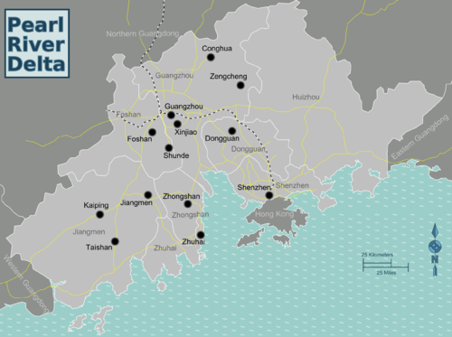
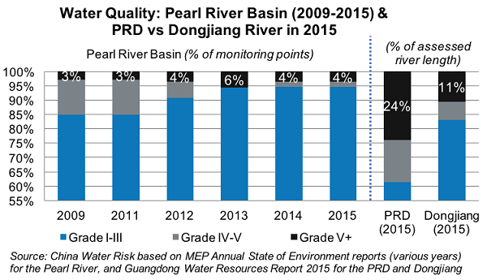

## Management of a Degraded Environment

**Pearl River Delta, South-East China**

* **Background:** 2,900 square miles, huge economic importance as main trade route for electronics

* **Economic importance:** contributes 9% to China’s total GDP, produces 5% of the world’s goods, industries on the delta make around $450bn per year
  

**Cause of degradation:** economic growth from manufacture

* **Flat, cheap land:** has made it a prime trade location, with Shenzhen offering excellent access to ships. 70,000 companies have plants here
* **Labour influx:** from nearby rural areas due to huge number of jobs. Honda alone employs 6,000 people and Foxconn employs more than 1 million
* **Direct foreign investment:** in 2008 has spearheaded rapid, unsustainable growth in the area

**Problems faced:** primarily environmental and social

* **Power stations:** 366,000 die in China each year due to coal burning
* **Air pollution:** killed 1.42 million Chinese in 2013, greenhouse gasses produced contribute to the enhanced greenhouse effect
* **Poor water quality:** water pollution from factory waste and sewage means Guangzhou water only safe for irrigation, not human use or consumption. October 2009 Greenpeace report found beryllium, copper and manganese – all carcinogens
* **Wetlands destruction:** land reclamation reduces habitats
* **Endangered species:** Chinese white dolphin, since polluted water is discharged into the sea
* **Inedible fish:** those caught from the Pearl River have high levels of heavy metals, such as lead (poisonous)

### **Attempts to improve**

**Water pollution loan:** 2007 World Bank 96m loan to fix water pollution. $7bn total spent on river by 2010. 30 water treatment plants, to treat 2.25m tonnes water per day. Aims to reduce sewage by 85%

* **Success:** an increase from 85% to 95% in Grade I-III (class A/B. Good for drinking) in water quality (% of monitored points), but still 24% of river length had water of Grade V\+ in 2015 (useless water). 62% safe
  

**PRD Air Quality Management Plan:** aims to reduce SO2 emissions from power stations by 40% by 2010, hence reducing smog and acid rain, by switching to natural gas from coal (burns cleaner, still produces GHGs). Launched 2008, referencing values to 1997. Reduce RSPs by 55% and NOx by 20%

* **Success:** between 2006 and 2014; SO2 fell by 64%, NO2 by 4% and RSPs by 25%
  

**Continued investment and development:** will naturally bring about a stabilisation in the population and energy demand, so naturally with time, the environmental consequences will become less severe

* **Success:** only time can truly tell how successful the 2 sustainable management plans have been, and if development does bring about stability for the area