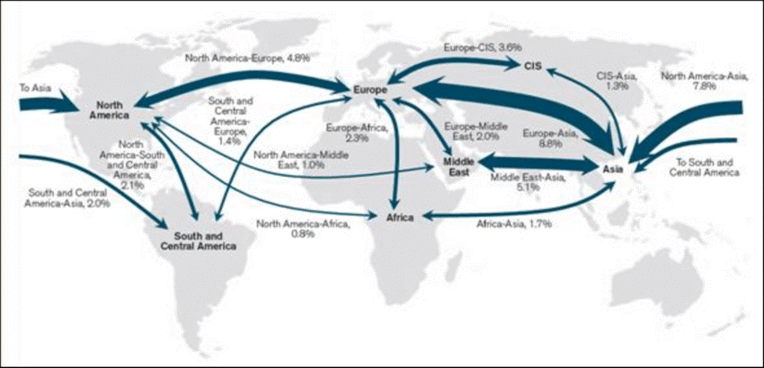
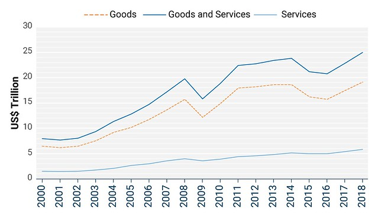
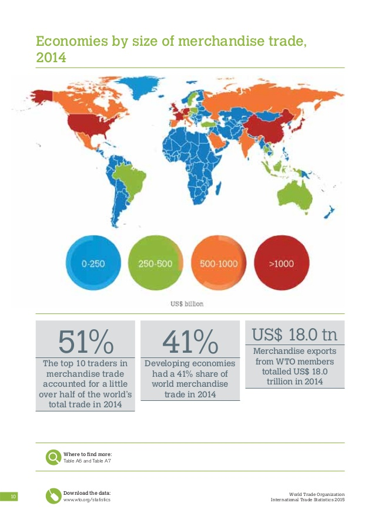
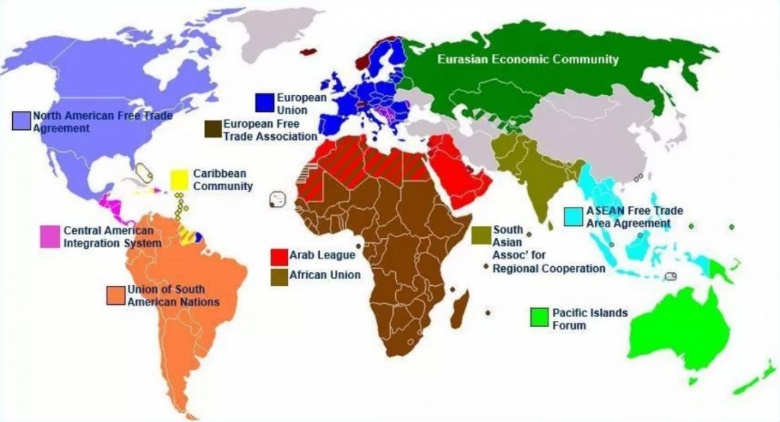
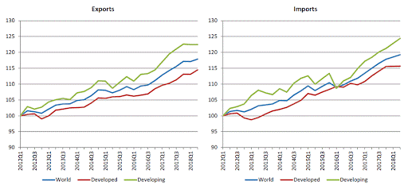

# Global Interdependence

## Trade Flows and Patterns

* **Trade:** the exchange of goods and services for money
  * **Balance =** value of exports – value of imports
* **Trade surplus:** positive balance of trade
  * Flow of money into the country – good development
* **Trade deficit:** value of imports \> value of exports
  * Flow of money out of the country – bad development

### Visible/Invisible Imports/Exports

* **Visible trade:** covers physical goods and items that are traded
  * **Primary products:** flow of natural resources (metals and rocks) from African countries to Asian manufacturers
  * **Secondary products:** flow of manufactured products from Asian countries to Western ones
* **Invisible:** covers services (not physical goods)
  * Travel and tourism, or financial/business services
* **Imports:** goods and services purchased from other countries
* **Exports:** goods and services sold to other countries

### Global Patterns

* **China:** top visible trader; total trade $4157bn (2.9% GDP) with a surplus of 259bn
* **USA:** top invisible trader; total trade $1094bn (0.5% GDP) with a surplus of 230bn
* **Trend:** stagnation and decline of North America and Europe (↓5%), but increase of Asian markets (↑5%)
  
  

### Inequalities in Trade Globally

* LICs have a smaller range of exports (primarily agriculture)
  

### Factors Affecting Global Trade

* Affect the volume, nature and direction of trade
* **Cost of products; exchange rates; environmental, health and safety standards**
* **Health crisis:** within 4 months of COVID-19 pandemic, the US and UK’s total export value fell by around $1.5bn
  * In the UK, exports fell from $25.6bn in January 2020 to 24.0bn

**Resource endowment:** the natural resources (land, minerals) a country has to exploit to produce exports, and how they use the profits to diversify economy. Raw materials are used for economic diversification

* **OPEC:** group of 12 oil producing countries dominate oil exports and coordinate policies and the market
* **Tanzania:** exports plants and food (climate and nutritious soil) to afford imports of gas and technology to produce more exports. Invisible trade in the form of tourism – Mt. Kilimanjaro

**Locational advantage:** a country may be well placed on a trade route, or be close to a target market or easily accessible – reducing transport costs

* **Canada:** close to huge US market – 76% ($400bn) of total exports to US in 2016, 52% imports from US
* **France:** mass tourism (90 million), helped by nearby European countries with large populations

**Historical factors (colonial links):** exploitive relationships prior to independence (1940-70s) maintained, but weakening within colonial groups

* **Kenya:** exports of horticultural products make up 27% of fresh produce and 56% of black tea market in the UK. Imports from the UK are motor vehicles, chemicals, machinery and printed materials
* **Exploitive relationship:** trade surplus in UK favour still exists - $350m exports from Kenya vs. $450m imports from UK

**Weather:** 2019 South African drought

* Prevented farmers from irrigating crops
* Lack of available water meant that South Africa struggled to mine their primary exports: platinum and fossil fuels
* April, SA’s exports dropped from 120,000 million ZAR to only 80,000 (drop of 1/3)

**Trade agreements:** tariffs, quotas and trading blocs influence global trade routes

* **Tariffs:** tax on imports or exports
* **Quotas:** limit on number of imports or exports
* **Trade blocs:** group of countries that manages and promotes trade with shared agreements, to stimulate trade between them
  * **Free trade areas (NAFTA):** no tariffs or quotas for members
  * **Customs unions (MERCOSUR):** free trade area with common external tariff for non-members
  * **Common markets (EAC):** custom union with free movement of labour/capital
  * **Economic unions (EU):** common markets where members adopt common economic policies
  * **Issues of trade blocs:** threaten free trade and promote protectionism by controlling types of trade and establishing tariffs to protect from outside forces.
    

**Changes in the global market:** Western developed countries are experiencing stagnated/declining growth, while developing markets keep growing

* Trade deceleration in 2018 as Europe and Asia stagnated
* Increased power of emerging economies in global negotiations
* **Financial crisis:** UK’s exports declined by 22% (worsened by the fact that 60% of exports are to the EU and USA, who were equally poorly hit)
* **BRIC:** Brazil, Russia, India and China markets grew by 4% in 2000-10, compared to global rate of 2%
  

### World Trade Organisation

* The only international organisation to deal with the global rules of trade between nations. Set up 1995

**Nature**

* Removes trade barriers to increase global trade
* Reduced tariffs from 40 à 25% (1/10 of pre-1947 tariffs)
* 160 global members
* Only considers trade of visible goods
* Ensures economic tensions do not lead up to confrontation
* Creates stability and predictable trade rules
* 10 benefits; from promoting peace to raising incomes

**Functions**

* **Trade rules:** sets the rules
* **Promotes trade:** helps governments understand rules so more members can take part in free trade
* **Settles disputes:** acts as a legal buffer between disputers
* **Monitors agreements:** checks if implemented
* **Principles:** transparency, stability, non-discriminatory…

**Advantages**

* Attractive free-trade for developed economies (allows exploitation of LICs (labour and natural resources) by HICs to lower costs)
* Provides proper platform for trade decisions = increased trade opportunities and guidance
* 160 members encompass 98% all trade. 20 applicants
* Solves disputes to prevent further escalation (may have prevented 2008 trade war, like 1930 recession)
* Total value is around $18tn per year
* 22% exports increase since 1995
* Provides concessions for LICs – legal right to no discrimination in trade deals
* Continuation of pre-1950 agreements for HICs give them more power of newly-joined LICs

**Disadvantages**

* LICs can’t use trade barriers to protect developing economy
* Unfavourable rules for LICs  - no ‘tariff period’
* Deals overshadowed by TIPP agreements that focus on the UK and EU
* Slow progress – takes too long to reach deals, leading countries to make alternative deals
* Deals still allow for protectionism of some industries
* Promotes TRIPs – medication too expensive for LICs
* Favours multi-nationals, LICs can’t use local contractors
* Expensive legal system (in 15 years; 400 cases from HICs, but only 1 brought forward by an LIC)
* Decisions made by consensus, link remains between market size and politics. LICs have small voice
* “WTO rules pull away the ladder \[from LICs\] that HICs used to climb up” – journalist quote

**Evaluation**

* Must become more democratic
* Should shift focus to labour, human rights and environmental issues
* Could be more flexible for local and national decisions
* Must treat LICs equally to HICs
* All things considered, it is impossible to please everyone

**Impact on India:**

Market forced open to USA and Asian imports (no trade tariffs to protect infant industry)· Coconut prices dropped by 90%· Coffee prices dropped by 60%· Rural incomes fell drastically and therefore so did living standards

### Free Trade

* A trading policy where imports and exports are not restricted in terms of quotas or tariffs. Free trade is promoted by the World Trade Organization
* **Advantages**
  * **Lower prices for consumers:** (↓ tariffs = ↓ cost)
  * **Greater competitiveness:** ↑ incentive to cut costs
  * **Law of comparative advantage:** free trade = ↑ economic welfare (country specialises in goods with low opportunity cost)
  * **Economies of scale:** higher quantity = ↓ cost
  * **Encourages growth of trade:** ↑ of 7% since 1945
* **Disadvantages**
  * **Environmental:** encourages LICs to use up raw materials to produce exports
  * **Encourages ‘dumping’:** flooding the market with product causes prices to ↓, other companies collapse
  * **Cuts revenue:** no import tax for the government
  * **Limits economic diversity:** countries can only produce what they’re good at
  * **Infant industries:** have a hard time breaking into global competition

### Impacts of Trade

* **Development**
  * Higher levels of trade are associated with richer countries
  * Trade is up to 20x more valuable than aid, but is constrained by trade relationships with HICs (take advantage)
  * **Africa:** if exports were maintained at 1980 levels, economy would be worth an extra $280bn. Also, a 1% trade increase = extra £49bn per year (5x value of annual aid)
* **LICs (agriculture)**
  * Opportunities to make good incomes by farming
  * Cash crops remove vital land, require irrigation and pesticides, causing environmental damage
  * **Kenya:** 6% average economic growth from 2008-13
  * **Uganda:** overproduction in 1995-2000 led to 75% fall in income
* **LICs (manufacturing)**
  * Value is added to raw materials, leading to high rates of economic growth (primarily Asian countries)
  * Human and labour rights are hard to manage, leading to abuses of workers in sweatshops
  * **China:** since 2000, has had GDP growth rate of between 15 and 6%. Workers earn around $10k per year. Foxconn factory installed nets to stop workers committing suicide
* **HICs**
  * Experience continued economic stability, powered by the exploitation of LICs for their labour and natural resources
  * **USA:** home to massive TNCs such as Apple, Tesla, Amazon etc…

### Fair Trade

* Aims to make trade fair, to produce ‘a world in which all producers can enjoy secure and sustainable livelihoods, fulfil their potential and decide on their future
* **The Fairtrade foundation:**
  * **Sets standards:** social, economic and environmental
  * **Certifies products and ingredients:** independent checks to ensure that standards are being met
  * **Works with companies own schemes:** guides them and compares their scheme to Fairtrade’s
  * **Lobbies government:** campaigns for LICs
  * **Works with farmers and workers:** work with individuals on issues and tackle global farming issues
  * **Drives awareness with the public:** advertising and education
* **Operation**
  * Small farmers group into co-operative groups
  * Co-op groups have high social and environmental standards
  * Co-ops talk to companies directly – cut out middle man, demand higher price
  * In most cases there is 100% price increase for company, and cost is passed back to consumer
  * Higher price achieved provides greater living standards and money to invest in the farms of producers and their communities
* **Advantages**
  * Minimum pricing means farmers get more income
  * Certification allows farmers to negotiate higher price
  * More income allows better farming, stronger co-ops
  * Training farmers teaches them their rights
  * Community development projects (schools, doctors)
  * Flo-cert acts as a safety net for market price fluctuations
* **Disadvantages**
  * Extra cost for consumers and farmers
  * Co-ops must meet standards, so poorest farmers can’t take advantage of the benefits of Fairtrade
  * Price guarantees lead to overproduction
  * Imposition of political views

### Sugar in Swaziland:

* **History:** 50% live on less than $2 per dayo Right climate and water for sugar productiono Government saw opportunity to improve lives and remove people from subsistence farming· **Sugar industry:** built on 3 pillars **Social:** work together for crop, adds capacity

* **Environmental:** aims to reduce impact of subsistence farming **Economic:** maximises resources, supports nationo Income has increased and so have living standardso However climate change is reducing the precipitation required for sugar cane production·

### Fairtrade Africa:

* Tailor made training so market shocks have less impact on Premium from Fairtrade goes back to community on schools, housing and healthcare 60% of total trade is target for Fairtrade products

* Diversification into vegetables resulted in 8x more income, less water dependant