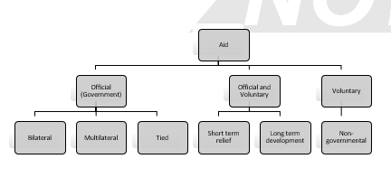

## International Debt and Aid

### National Debt

**Nature**

* **Debt:** accumulation of yearly deficits
* **Deficit:** occurs when government spending exceeds income generated from tax and other means
* **External (foreign) debt:** the part of total debt in a country, owed to creditors outside the country
  * Negatively affects a countries credit worthiness and overall economic stability
* **Sustainable debt:** considered manageable without causing long term economic damage, and that will not be paid out of future borrowing
* **Unsustainable debt:** cannot be paid without further raising debt and putting future development at risk, or even reversing development (debt ratio > 150%)
* **Unpayable debt:** external debt where the interest payments are beyond the means of the country, therefore preventing the debt from ever being repaid
* **Debt service ratio:** proportion of a countries export earnings that it uses to meet debt repayments
  * Expressed as a % of interest and principal payments against exports (goods & services) per year
  * 30% in LICs (7.8 trillion dollars in 2018), 10% in HICS

**Causes**

* **Policy failures:** flawed domestic policies fail to develop robust and stable economies, so key industries do not develop sufficient export earnings
* **Ineffective control of public finances:** excessive spending on inefficient projects, or sub-optimal tax collection, borrowing of money to fulfil promises
* **Artificially high exchange rates:** local central bank sets high exchange rate that reduce imports and controls inflation, leads to exporting problems
* **War:** diverts resources from production to defense
* **Destabilizing shocks:** macroeconomic shocks = borrowing
* **Commodity prices:** If commodity prices collapse, then countries dependent on those prices see a collapse in export revenues. Increase the need to borrow
* **Natural disasters:** infrastructure destroyed, requires rebuilding. Produces a less efficient economy (due to spending on rebuilding and reduced export/ transport), that is less able to respond to shocks
* **COVID-19:** huge diversion of resources to healthcare so increased borrowing, industries with close human contact stop operating, reducing exports
  * **227 trillion dollars** global debts in 2020
  * **50%** dept to GDP increase in HICs to 432% in 2020

**Haiti**: 1804 – slaves rebelled; French government demanded 90m gold francs over 122yrs for lost productivity· 1964-1986 – ruled by corrupt and oppressive Duvalier family, regime funded by US, locals suffered· IMF imposed a harmful economic policy, but still owed 900m dollars after debt relief· 2010 – Earthquake killing 200,000; debt to 1.3bn dollars

**Greece**: 1990s – large loans fueled economic boom and German imports, but unemployment still high· 8% govt revenue spent on military· 2008 – financial crisis; lending increased· Spending plans missed, extensive tax evasion· Goldman Sachs bank hid borrowing from books· EU and IMF lent 290bn dollars (65% of total debts)

**Problems**

* **Rising foreign debts:** Greece’s foreign owed debt has increased from 70% GDP (2007) to 150% (2020)
* **Education:** 60-70% Ghana children completed primary education between 1980 and 2006
* **Mortality:** lack of healthcare investments causes increase in mortality
* **Malnutrition:** Haiti has 48% population undernourished
* **Healthcare:** births attended by a healthcare professional 45% between 1998 and 2006 in Ghana
* **Environmental damage:** Brazil increased rate of deforestation to exploit wood and iron resources to increase exports
* **Reduced food production:** Columbian farmers turn to cocaine, Afghanistan farmers to Opium - they can make more money producing drugs than other crops
* **Illegal immigration:** people trafficking/sex slavery occurs if locals can’t be employed, or society degrades (Mexico, Greece and the Philippines)
* **Unemployment:** sharp rise from 8% (2008) to 28% (2013), now slightly lower at 15% (2020) in Greece
* **Personal poverty:** 22% of Greeks live in ‘extreme material deprivation’

### International Debt Crisis

* The causes and impacts of the debt crisis are varied between a range of countries – in particular LICs
* **International debt:** money borrowed by a government /country from another country or private lender
* **Debt crisis:** debt payments undermine a county’s economy and/or the government’s ability to protect economic and social rights of citizens

**Causes:** differ between countries, but generally –

* **1973-74 Arab-Israeli war:** triggered Organisation of Petroleum Exporting Countries (OPEC) to increase oil price by 4x – sharp increase in oil prices
  * Profits deposited in banks of affluent countries
  * Banks seeked investments for new funds, so offered low interest, poorly monitored, reckless and irresponsible loans to corrupt LICs to fund development
  * LICs forced to exploit resources to grow cash crops and pay back loans with profits on exports
  * Some of borrowed money spent irresponsibly by LICs (armaments, corruption and private projects)
* **1980-90 recession:** rising inflation in the US led to tight financial policies, causing inflation rates to rise
  * Sharp rise in interest rates globally, hitting LICs the worst
  * Worsened by high fuel costs, declining exports as a result of crop surpluses and reduced demand
  * Increasingly difficult for LICs to make repayments and interest payments
* **1990s loan rescheduling:** extended the length of debt repayment, causing the crisis to last even longer
* **2008 financial crisis:** deregulation allowed banks to engage in hedge fund trading and then subprime mortgages created to support sale of derivatives
  * **US:** 8 million jobs lost, 17 trillion dollars in household net worth evaporated, GDP shrink of 4.7%
  * **2020 COVID-19 pandemic:** global debts risen to 227 trillion dollars

**Problems created:** people in poverty take on the brunt of the crisis

* **World Bank and IMF:** take away resources from investments that contribute to socio-economic development. Schools and medical centres understaffed, underequipped, and undertrained
* **Austerity:** economic restructuring leads to short term pain for long term gain – harsh on poor and small business owners
* **Environment:** since debt repayments are demanded in ‘hard currency’, environmental destruction is encouraged to repay using profits from exports
* **Debt relief:** may solve crisis, but is a mind-field of complex and contradictory policies

**Countries effected:** primarily LICs, all but 1 country globally is indebted

* **Japan:** 236% debt-to-GDP ratio
* **Sudan:** 176.5%
* **UK:** debt is larger than economy (104% in 2020)
* **Macao:** 0% (may not fully report finances to IMF)

### Debt Relief

**Organisations**

**Jubilee Debt Campaign:** collection of NGOs, Christian organisations and other interest groups

* Pushes for debt cancellation and relief and avoiding debt agreements that cause further problems for debtor countries, where possible
* Fight for debt relief to be on the agenda of Western governments
* Led to the launch of the HIPC after campaigning at the 1998 G8 summit, and pioneered new EU principles for restructuring debt
* 130bn dollars debt cancellation (2000-15) for LICs, 100m dollars debt cancellation for LICs with Ebola crisis

**HIPC Initiative (multilateral):** requires SAP reforms, and the qualification of countries to participate

* 39 countries participate (33 in Africa), must have income < 700 dollars per person income/per year
* **Qualifying: STAGE 1** develop a Poverty Reduction Strategy, and reduce inflation; prove unsustainable debt/track record. **STAGE 2** implement key reforms with a further track record; implement the PRS for at least one year
* **Aims:** provide a comprehensive approach to debt reduction so that no poor country has to face a debt burden that it cannot manage
* **Effectiveness:** counties are able to control their finances more strictly and reduce debt, and exports increase
* **Criticisms:** requires loans to be taken out, creditors participate voluntarily, may lead to environmental degradation

**MDRI:** an extension of HIPC launched in 2005, offering 100% debt cancellation of debts owed by HIPC countries to World Bank, IMF, African Dev. Bank

* **Nature:** launched to accelerate countries completing the HIPC initiative process towards the UN Millennium Goals (income must be < 380 dollars pp/py (IMF gave relief if this was met, regardless of HIPC participation))
* **Criticisms:** low number of countries involved, so total extent of debt reduced is limited. If debts cancelled, most counties would still rely on concessional assistance
* In 2006, IMF relieved 3.6bn dollars of debt to 19 countries (Bolivia, Cambodia, Ethiopia, Niger…)

**Actions**

|**Rescheduling:** capital and interest payments are rescheduled to a time agreed with creditor and debtor||
|:---|:---|
|**Positives**|· Increased pay-off time makes the debts more manageable· May give country time to work out other relief methods, and implement policy|
|**Negatives**|· More debt than original sum, because of interest payments over extended time period· Delays the problem· More pressure over time (requirement of more exports increases environmental degradation)|
|**Example**|**Argentina:** Jan 14th, 2005 following 2001 default· Resume payments on 76% of 82bn dollars worth of sovereign bonds (323bn dollars total owed)· Bringing 38bn dollars of financial relief 2020-30|
|**Forgiveness/Cancellation:** concept of drawing a line under the debts, essentially forgetting about them||
|**Positives**|· Reduces poverty (reduced financial burden)· Improves infrastructure (more investment)· Improves growth and jobs (stimulates growth and TAX revenues)· Benefits global trade|
|**Negatives**|· Moral hazard (country may not learn, relapse)· High interest rates (creditors will aim to increase return on any subsequent lending)· Diverted resources (lost debt repayment revenue could have been used to improve other countries)· Rarely 100% forgiveness|
|**Example**|· **Ivory Coast:** 7.7bn dollars relief in early 2010s, ↓ public debts from 69% GDP to 40% (in 1 year)· **Brazil:** in 2013 cancelled/restructured 900m dollars of African owed debt. Brazil using debt relief as investment in trading bloc worth 21.5bn dollars|
|**Debt-for-Nature swaps:** debtor agrees to preserve an area of rainforest/natural reserve in exchange for cancelling debt||
|**Positives**|· Huge environmental benefits (reduced deforestation, maintained biodiversity/ ecosystems)· Creditors relieved of high risk· Conservation groups kept happy|
|**Negatives**|· Overstated financial benefits (debt is still being paid, instead just to environmental groups)· Environmental degradation (correlation between debt and deforestation for exports)· Not enough funding for conservation· Impacts poor (land taken for conservation)|
|**Example**|· 1 billion dollars worth of nature swaps globally· **Costa Rica:** 112.2 million dollars of relief is < 1% of total debt which stands at around £32bn· **Columbia:** 63.6 million dollars in nature swap|
|**Debt-for-Equity swaps:** debt is sold to multi-national investors||
|**Positives**|· Less debt for debtor nation (more hard cash puts country in better financial position)· Improved government image· Reduced interest payments|
|**Negatives**|· Current shareholders are diluted· Property exchanges with other countries· Loss of sovereignty (other countries have influence)· Interest bias (to other counties over local)|
|**Structural Adjustment Programmes (SAPS):** loans from the IMF and World Bank that adjust a country’s economic structure, improve international competitiveness and restore balance of payments||
|**Positives**|· Privatisation of water utilities and government organisation, to reduce public sector· Tackle budget deficit, inflation, tariff barriers and allows currency to float (exports are more competitive)|
|**Negatives**|· Harsh conditions (cuts to education and healthcare)· Removal of subsidies for farmers· Take out IMF loans to help (only worsens debt problem)· Promotion of grain trade (less food in country)|
|**Example**|**India:** largest SAP loan recipient since 1990· Loans cannot be spent on healthcare, education or development, so 2bn dollars to banking sector, 1.5bn dollars to Clean India Mission· High and rising debt (580bn), GDP ratio constant at around 20|

**Issues and Impacts**

* **Haircuts:** loss in present value of claims by creditors, but with time, this value will regrow with interest

### International Aid

* **Aid:** normally is the flow of resources from HICs to LICs, with occasional return flow from LICs if HICs in need
  * Money (grants/loans), goods (food/technology/ machinery), knowledge (education)

**International aid:** grants/loans at below market rates

* **2018/19:** Isle of Man gave £2.5 million in aid
* Accepted by LICs because:
  * **Foreign exchange gap:** lack hard currency to buy imports, economy replies on small range of exports
  * **Savings gap:** population pressure drains expenditure
  * **Technological gap:** lack of skills for development, or enough capital to invest in development
  * **Disaster:** natural or economic catastrophe
    

**Relief (emergency) aid:­­** immediate or short-term disaster relief from natural/human induced disasters

* Humanitarian relief raised for specific circumstances
* May come from bilateral sources and specific appeals by NGOs
* **IOM Disaster Emergency Committee live appeal contributions:** 2019 £650,000 to Yemen, East Africa, fleeing of Myanmar, Indonesian Tsunami appeals

**Development aid:** longer termed development programmes involving local communities

* Targets education and skills for sustainable development
* Directed towards continuous improvement in the quality of life
* Does not include Foreign Development Investment; but can be in the form of grants and low interest loans
* Blurred line between **relief** and **development** aid
  * **Food aid:** importing or providing foods
  * **Project aid:** for specific purposes
  * **Programme aid:** given to a specific sector
  * **Budget support:** debt relief
  * **Technical assistance:** doctors, teachers, engineers
  * **International research:** vaccines or crop varieties
  * **Intermediate technology:** projects that can be built and maintained with local resources

**Tied aid:** must be spent in the donor country, or on that countries goods and services. It is ‘tied’ to the country that provided it. Given due to:

* **Economic reasons:** donor country increases exports
* **Political reasons:** donor country has historical links, or wishes to strengthen geopolitical interests and cultural ties
* May increase LIC costs if local supplies are cheaper, so value of aid is questionable as is aid altruism

**Bilateral aid:** given by one country to a single other, amount is decided by the government of giving nation

* Majority of bilateral aid is **tied**
* In the UK, the Department for International Development distributes
* **Types of DFID aid**
  * **Financial:** funding government policies that aim to reduce poverty
  * **Technical co-operation:** enhances knowledge, skills and technical expertise of the receiver
  * **Humanitarian assistance:** food aid, shelter, advice and medical care in humanitarian disasters
  * **DFID debt relief:** sums of debt relief on old DFID loans, and cancellation of Commonwealth debt
  * **Other:** any bilateral aid delivered multilaterally

**Multilateral aid:** provided by several countries, organised by an international body such as the United Nations

* UK donates 40% of their DFID budget to NGOs
* **World Bank:** loans to developing LICs for infrastructure

**Voluntary aid:** NGOs take a bottom-up approach, by directing money generated by charities at the needs of the poor, local communities and environments

* Increasing amount of government money given to NGOs due to their expertise in LICs
* NGO money matched by DFID ( ½ of the £50 million given by NGOs in 2005 was given by the DFID)
* **3 functional roles:** disaster relief, technical assistance, network and institution building

### Effects of International Aid

* Aid has benefited many countries, but has issues
* **Aid reliance:** dependency culture created, causing productivity to halt as people realise they can just accept the aid
  * **Swaziland:** 2/3 of 1.2 million population relied on food aid
  * Aid now focuses on development projects rather than material aid
* **Tied aid:** aid is devalued when it has to be spent in the donor country. Scope of projects is limited, time to complete is lengthened (transport and acclimatisation of workers), costs increased significantly due to transport of aid. Halts productivity and development
  * **US:** 65% of food aid budget in 2015 was spent on transport
* **Larger public sector:** encourages the growth of a bloated government to distribute aid, which crowds out the private sector, and therefore productivity
* **Counterproductive conditions:** attaching conditions to loans and aid, such as removing state subsidies, means locals cannot afford supplies like fertilisers
  * **Malawi:** subsidies have increased agricultural output
* **Fragmentation = bureaucracy:** closely linked to the bloating of a public sector. Large number of GOs and NGOs reduces efficiency
  * **10 million:** NGOs worldwide
* **Prioritising aid:** targeted at high-profile or ‘in the moment’ diseases such as Ebola; ignoring health crises such as malnutrition or poor sanitation in a country that counts for more deaths
  * **Niger:** overall sanitation access is 9%, 4% rurally
* **Loan repayments:** HIPC loan repayments are too high, so aid is simply spent on repaying loans rather than development
* **Corruption:** aid received by a country may be sent to fake corrupt bank accounts – so it never reaches those who need it. Corrupt money spent on black market
  * **Kabul Bank, Afghanistan:** 850 million dollars lost to fraud
* **Talent (brain) drain:** health aid and training for LICs is undermined by HIC immigration policies that promote the immigration of nurses into donor countries
  * 79% of Indian and 88% of Chinese science PhD students in the US remain in the US
* **Hi-tech aid:** sending over modern, technologically advanced aid (normally in the form of machinery) is not useful to locals if it breaks down
  * Locals may not have electrical/technical knowledge to fix modern cars/tractors or communication tech
* **Poorest priority:** middle income countries are priority for aid – the poorest, with the smallest markets receive little interest from commercial or political groups
* **Top-down/Bottom-up:** top down approach receives criticism, partly because corruption is rife in LICs

#|
||

Top-down (governmental)

|

Bottom-up (local)

||
||

Beneficiaries are hungry· Services provided· Donors are in charge· Bureaucracy constraint· Women are vulnerable· Compensate for conditions· Target beneficiaries· Centrally managed· Government and society are implementing arm

|

· Locals are hungry· Mobilise and empower· People are in charge· Social conditions constraint· Women = key producers· Conditions transformed· Everyone mobilised· Decentralise resources· Government is autonomous· Society is a catalyst for change

||
|#

