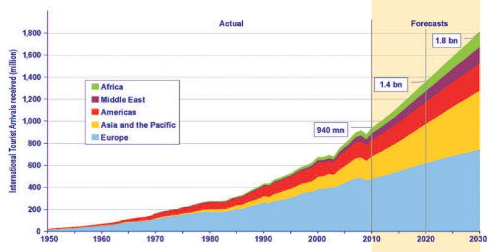
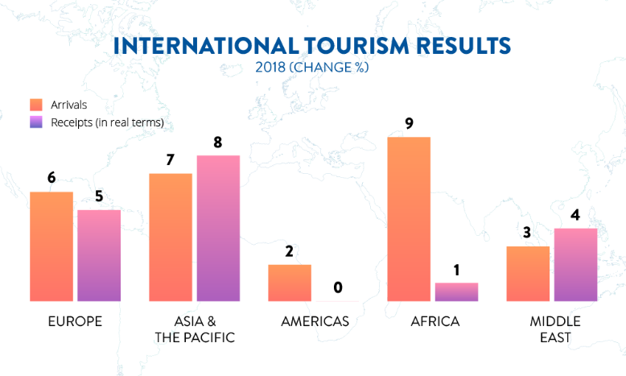
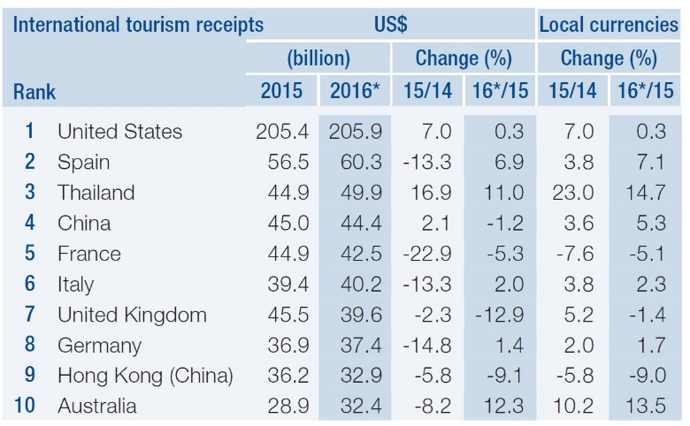
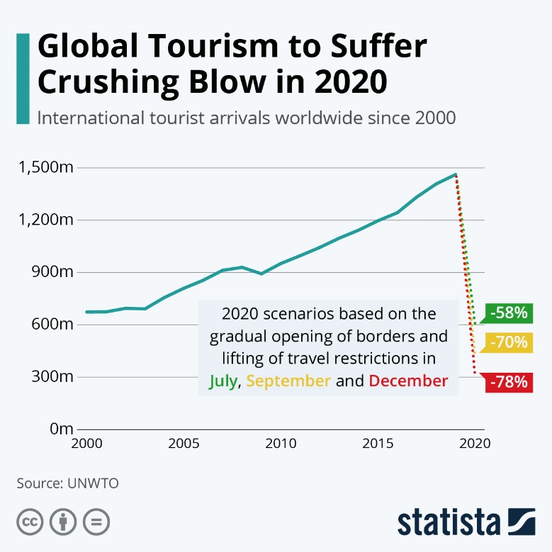
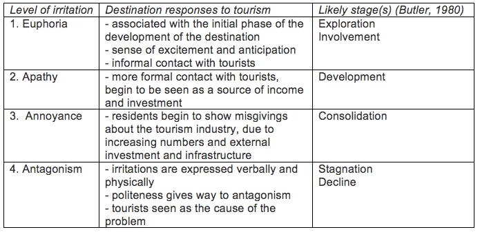
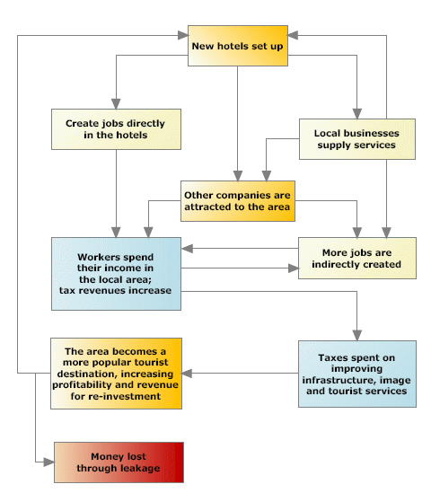
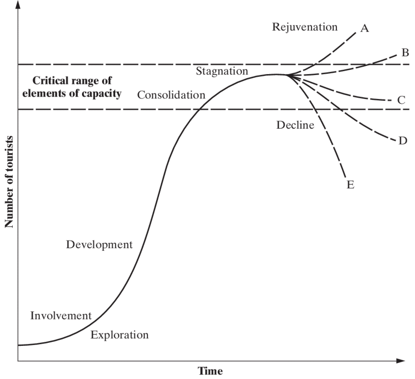

## International Tourism

* **Tourist:** a person or groups of people that travel for business, professional, leisure, recreation or holidays; to visit friends and relatives; in a place that is not their home environment.
  * Greater than 1 day, but less than 1 year
  * **Tourism:** includes all activities and services that tourists take part in or depend on

### Reasons for Growth in World Tourism

**Economic**

* **Rising incomes:** most HIC families have two working parents – tourism grows 1.3x faster than GDP
* **Lower costs:** budget airlines and decreased real costs
* **Marketing:** increased exposure to destinations, and intense promotion of short breaks to those with disposable income
* **Globalisation:** increased business travel
* **Recession:** reduces levels of tourism

**Social**

* **Paid leave:** most jobs offer paid holiday, workers have more free time and disposable income
* **Experience:** new cultures and landscapes
* **Media coverage:** more exposure to destinations
* **High international migration:** more relatives/friends live in other countries, therefore people travel more
* **Ethical reasons:** 2016 Rio Olympics caused evictions and demolishment of buildings

**Political**

* **Investment:** heavy tourism investment
* **Bidding:** for events (UK 2012 Olympics)
* **Terror risk:** perceived higher risk in some destinations
* **Travel restrictions:** to certain countries (US to/from China and Europe)
* **Boycotts:** NGOs promote boycotting destinations where human rights are violated (Burma)

**Physical**

* **Wildfires:** 2018, 2019, 2020 California/Australia
* **Eruptions:** 2010 E15 in Iceland, ash prevented flights
* **Tsunami:** 2004 Indonesian Boxing Day
* **Earthquake:** 2010 Haiti
* **Tropical storms:** 2005 Katrina

**Health:** virus outbreaks/poor healthcare deter visitors

* **COVID-19 pandemic:** global travel/flights stopped
* **2016 Rio Olympics:** Zika virus outbreak (risk to pregnancies)
* **Health insurance:** $100 per week in USA
* **Water quality:** Mexico and South America = poor
* **Injections:** cost of pre-travel drugs (Malaria etc...)
* **Ebola 2015:** African outbreak
* **Soft measures:** marketing campaigns (websites, trade fairs etc…), takes a positive, gentle approach
* **Hard measures:** installation of infrastructure, tax exemptions to encourage investors, financial promotion and physical incentives

**Travel motivators**

* **Leisure:** holidays, sport/culture, educational trips, pilgrimage
* **Business:** conference, exhibition, meetings
* **Friends/Relatives:** meet friends, visit family
* **Destination preferences:** climate, attractions, festivals, events, accommodation, services, transport
* **Externalities:** destination security, exchange rate

**Changes in growth**

* **Europe:** favourable exchange rates in Turkey, 2018 FIFA World Cup in Russia, Spain’s low-cost holidays
* **Asia and Pacific:** increased purchasing power, air connectivity and visa facilitation. Japan 2021 Olympics
* **Americas:** South American ‘instagrammable’ moments, Caribbean stagnation due to 2017 hurricane
* **Africa:** strong South African country, but drought. Improved security and positive travel advice
* **Middle East:** 2020 Expo Dubai

### Trends in Tourism Growth

**History of growth**

* **400BC:** tourism for the rich, to visit family and spas
* **1066:** allows rich to show social status for business and pilgrimage
* **1700:** The Grand Tour/spa trips for rich, but package holiday developed
* **1900:** mass tourism develops, rural tourism rises in UK (rich à rural areas, so employs rural people in tourism). Two world wars, but recovery
* **1950:** affordable air travel and increased disposable income births the Free Independent Traveller
* **2000s:** low cost travel comes into its prime, despite setbacks such as SARS/Ebola/Coronavirus. Special interest travel and local ‘staycations’ rise in popularity

**Impacts over time (↑ or ↓ in tourism)**

* **1820:** regular steamboat on English Channel = ↑
* **1936:** DC3 aircraft starts commercial operation = ↑
* **1992:** Soviet union collapses = ↑
* **2001:** September 11 attacks = ↓
* **2018:** Brexit and collapse of Thomas Cook = ↓
* **2020:** COVID-19 pandemic = ↓

**Total growth and forecast**

**2018 data**

**International receipts:** money from tourism activities (total of $1.5 trillion in 2014 from tourism exports, 1.2 trillion in receipts and 250 billion from transport)

**COVID-19**

### Tourism Impacts

**Economic:** tourism has both direct (eg. hotels) and indirect (eg. aircraft manufacture) economic effects

* **Positive**
  * Benefits to the economy (£37m from TT to IOM)
  * Provides considerable tax revenue (jobs and corporate tax rates) for governments, can balance loan payments
  * Provides rural employment, acts as a growth pole
  * Support informal sector/small business jobs
* **Negative**
  * Economic leakages in LICs (remittances, foreign debts due to tourism, import of goods, foreign hotel/attraction complex owners)
  * Location may become overdependent on tourism
  * All inclusive guests spend all money in hotel – none towards local economy/small businesses
  * Money borrowed for tourism development increases national debt

**Social and Cultural**

* **Positive**
  * Greater understanding, blending and appreciation of different cultures
  * Locals can develop language skills
  * Facilities and resources develop
* **Negative**
  * Traditional values and practices abandoned
  * Displacement of locals for tourist activities
  * Crime increase – drugs, alcoholism, crime, prostitution
  * Loss of land for local communities – homelessness
  * Visitor congestion
  * **Human rights breach:** Burma; ethnic cleansing and people forced away from tourist areas to make room
  * **Resources imbalance:** Tourists in Goa use 28x more electricity per person than locals – impinges on needs of locals

**Environmental:**

* **Positive**
  * Landscaping and sensitive improvements work with the environment
  * Tourist revenues fund protection schemes and designation/management of national forests/parks
  * Isle of Man is a UNESCO Biosphere
* **Negative**
  * Land lost to build hotels and attractions
  * Noise pollution – drinking, road traffic, nightclubs
  * Some golf courses use enough water for 5000 people per day, take land from local communities
  * **Bournemouth Beach 2020:** litter and waste
  * **2002:** 700,000 tonnes of CO2 released from flights from the UK to Cyprus alone
  * **Coral reefs:** Belize and Costa Rica blast so that water sports is unhindered

**Doxey’s Index of Irritation:** a stage 5 exists also, where the resource base and tourist type changes. Environmental degradation occurs in stage 5

### Carrying Capacity

* “The maximum number of people that may visit a tourist destination at the same time without causing destruction of the physical, economic, socio-cultural environment and an unacceptable decrease in in the quality of visitors’ satisfaction” – **World Tourism Org**
* **Considers**
  * **Physical:** actual space for tourists
  * **Economic:** acceptable level of change in a local economy
  * **Socio-cultural:** negative impacts from tourism
  * **Biophysical:** ability of natural environment to tolerate influence from tourists
* **Resource consumption:** is a large factor; tourists place a large demand on water in areas with low rainfall. Traffic too is an issue
* **Limits:** an area can still be crowded and uncomfortable when below the carrying capacity. Fundamentally flawed in the sense that it is difficult to calculate, as depends on activities tourists do
  * **Eg.** bird watching does not demand as much as a group of school children

### Multiplier Effect

* How many times money spent by a tourist circulates in a local economy
* Continues until money ‘leaks’ from local economy as imports are purchased, or remittances are returned
* **Money spent in a hotel:**
  * Directly creates jobs
  * Hotel buys food from local producers
  * Producers buy local fertilisers and clothes
  * Secondary employment increases as tourists buy souvenirs
    

### Recent Tourism Developments

* Tourists get bored of traditional ‘sun, sand and sea’ tourism, and diversify their travel to experience different parts of the world

**Niche tourism:** opposite of mass tourism, undertaken for a specific reason, desire for more sustainable tourism, desire to engage in novel interests

* Ecotourism growing at 5% per year
* Adventure tourism was worth over $600bn in 2019
* Adventure tourism growing at a rate of 46% by 2020

**Ecotourism:** growing concern about the environmental effects of mass tourism has led to tourism that aims to have minimal community and ecological degradation. Balances development and conservation

* Increased pressures and protests from Extinction Rebellion and Green Peace cause people to think twice, and industries to re-invent themselves
* Information spread and online carbon calculators highlight the impact of aviation/cruising. People shift their tourism habits, so they are more enviro friendly
* Want to help in LIC communities, or experience a different way of life
* **Kigio Conservancy, Kenya:** set up on old beef/dairy ranch in 1997. Traditional cottages. Low-impact activities promoted. Tourist code: no littering…
* **Kimana Conservancy, Kenya:** 15 miles from Amboseli National Park, covers 40km2, charges $10. Money used for development, and reduces pressure on national park.

**Adventure tourism:** involves exploration or travel with a certain degree of risk, possibly requiring special skills or physical exertion

* Under 30s can step outside of their comfort zone
* Desire to experience risk, challenge or exhaustion
* Rise in ‘Instagram’ culture – impressive photos on social media, makes people want to do the same
* **French Alps/Switzerland:** skiing expeditions and holidays. 14 million Germans ski, 6 million Brits ski. 2.2 million British ski holidays per year.

**Extreme tourism:** travel to dangerous places, or participation in dangerous events. Also called shock tourism, and overlaps with extreme sport tourism

* ‘Trophy tourism’ for rich and elite – hunting, boasting rights and social media culture
* Desire for tourists to be presented to (to see environments/activities seen on TV, in real life)
* **Antarctica:** 50,000 people visiting in 2010s, booking 18 months in advance. Popular with elderly, one of worlds last unspoilt places. 2013 Polar code, 100 people on land at a time, only 500 people per ship. £25,000 per trip. 2007 Explorer ship submerged – oil leak caused extensive environmental damage.

**Dark tourism:** visit areas affected by or associated with disasters or public tragedies. Fascination with real-world events

* Rise in accessibility of information (TV programmes, social media, the news)
* Ability to educate tourists, allows them to emotionally absorb themselves in an atmosphere similar to the time of the disaster
* **Chernobyl, Ukraine:** location of world’s largest nuclear disaster as a result of bad reactor design and serious protocol breach. Reactor 4 produced 400x radiation of Hiroshima bomb, 100,000 people died, 2,600km2 exclusion zone. TV show increased visits by 40%. 72,000 visits in 2018, up 50,000 from 2017.

### Life Cycle Model of Tourism

* **Butler Model:** proposed in 1980, shows how tourist numbers change with time

|**1. Exploration –** discovery/adventure (Guatemala)||
|:---|:---|
|· Few tourists visit the area and few facilities· Attracted to undeveloped nature of area· Much interaction between  locals and tourists· Area information spreads by word of mouth||
|**2 . Involvement –** independent travel (Cambodia)||
|· Steady increase in numbers and facility quality· Pressure on local govt to improve and promote tourism activities· Season develops, locals leave current jobs||
|**3. Development –** early package holidays (Chile)||
|· Large, rapid increase in the number of tourists· Modern facilities, but not run by locals· Tensions between locals and outsiders who control development· More people discover, more advertising, more people visit, more shops open, much busier||
|**4. Consolidation –** package holidays (Tenerife)||
|· Rate of increase in tourist numbers decreases· Wide awareness of resort/location· Locals employed in industry, people move into area for jobs, locals feel tourists in control· Congestion in summer when area is full||
|**5. Stagnation –** cheap holidays (Benidorm, Greece)||
|· Area loses its popularity due to ‘tackiness’, ageing facilities, changing tourism fashions· May be due to over-reliance on single attraction· Agitation from ignored locals· Area so busy, so people go elsewhere· Some shops close down - unemployment||
|6. **Rejuvenation**|**Decline**|
|· Development of niche market or new USP· Loyal tourists return· New money, advertising, ‘buzz’, new tourists, new jobs· Resort survives|· Resort offers no new attractions· Bored tourists go elsewhere· High unemployment (due to reliance)· ‘Tacky’ reputation· Area looks neglected|

* **Blackpool:** fits the Butler model very well

#|
||

Blackpool:

|

NW of UK, initial purpose to house workers for northern industrial towns. Developed over 100 years from 1850 into UK sea-side jewel

||
||

Exploration (pre-1850)

|

Fishing village visited by wealthy Victorians (didn’t work, could afford to spend days travelling north)

Took break from countryside/busy industrial towns of N England; visit the sea and 7-mile beacho Luxury trip in horse-drawn carts

Doctors in cities told sufferers of respiratory diseases to take a trip to the seaside so they could get ‘fresh sea air’ and clear their lungs out

||
||

Involvement (1850)

|

Road in 1781 and railway in 1840 - Blackpool became more accessible to more of England

In 1850 a 2,500 population experienced an influx of working and middle-class tourists, due to cheap train travel and intensive marketingo A culture of weekend travel developed

New attractions: Central Pier (opened 1868), Blackpool Tower (opened 1894), Blackpool Illuminations (starting in 1879) and South Shore’s Fairground (opened 1904)

Wakes weeks = 2.5 million increase in tourists per year, from 1.5 million to 4 million in 1910.

Wakes weeks given to factory workers and were staggered across the country which provided Blackpool with a constant stream of visitor

||
||

Development and Consolidation (1950s)

|

1900-50 5x increase from 3 million to 17 million

Both phases occurred in 50 years, previous factors that led to Blackpool’s growth were only intensified

Workers felt cramped in industrial terraced housing, so strong desire to experience a ‘holiday’

Reputation as one of Europe's leading coastal and holiday resorts

Population increased by around 50,000 - industrial workers came to join the lucrative hospitality sector

Further growth in 1936, law passed to grant workers paid holiday leave – holiday no longer a financial burden: Blackpool much more attractive and financially accessible

The Beatles and other music/drama performances were held in Blackpool, attracting even further interest from tourists

||
||

Stagnation

|

Caused by WW2 aftermath in 1960s

Stagnation of facilitieso Rise of cheap low-cost, no-frills air travel in the 60s tourists were leaving for warmer destinations in the Mediterranean and Spain

Lack of investment and pull factors resulted in its decline destruction of reputation - ‘run-down’ town, only good for stag and hen parties

Male babies born in 2015 had lower life expectancy than babies born in war-ridden Lebanon

||
||

Rejuvenation

|

£300 million rejuvenation scheme launched in 2000 to renovate the iconic tower and sea wallo Hopes of enticing new tourists

Successfully increased visitor numbers from 11 million per year to 13 million per year

||
|#

* **Geographical models:** used to predict ideas and analyse geographical processes, but are not always accurate
* **Positives**
  * No specific numbers or values means it is adaptable
  * Used as a guide, can help plan infrastructure/ development and sustainable practices
  * Shows development and rate of tourism over time
* **Negatives**
  * Too simple and vague
  * Only two final stages described in any detail
  * Relies too heavily on carrying capacity concept, fails to recognise complexities of modern travel
  * Assumes all destinations hit the stages in the same order, if at all
    * Is naive to assume all countries reach consolidation
  * Model doesn’t consider backwards movement in time
  * No consideration of the seasonality of tourism
  * Political heavyweight, but makes no policy theories
  * Describes the lead of demand – ignoring uneven supply/demand relationship
  * Development and consolidation shift is blurred