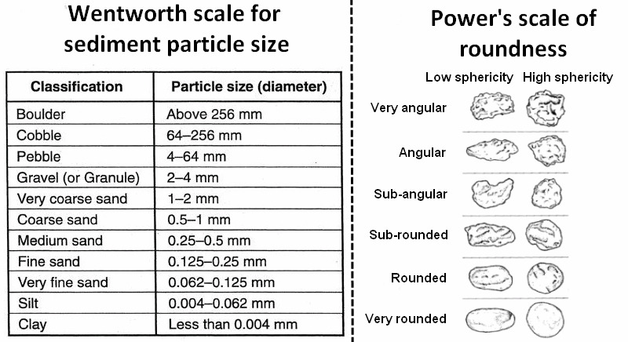
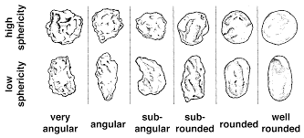
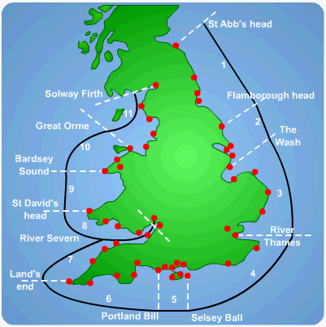
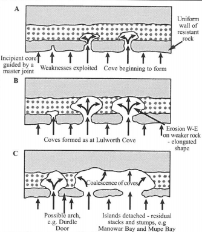
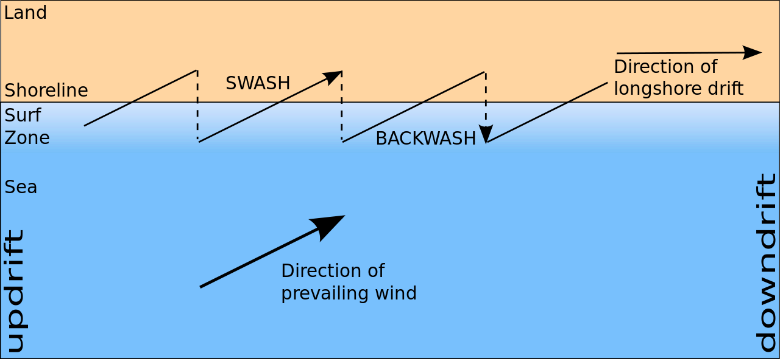

## Coastal Processes

### Waves

* Waves are created by the transfer of energy from the wind blowing over the sea. They result from friction between the wind and the sea surface.

### Wave Terminology

* **Orbit:**  The shape of the wave. It varies between circular and elliptical. The orbit’s diameter decreases with the depth of the sea.

* **Fetch:** The maximum distance of open water over which the wind can blow.

* **Crest:** The highest point of a wave.

* **Trough:** The lowest point on a wave.

* **Height:** The vertical difference between crest and trough.

* **Wavelength:** The distance between 2 successive crests or troughs.

* **Period:** The time taken for a wave to travel one wavelength.

* **Velocity:** The speed of the wave:

$$\frac{µλ}{µT}$$

* **Frequency:** The number of waves that break per second.
* **Steepness:** The ratio of the wave height to the wavelength. If greater than 1:7, the wave will break. This is given by:

$$\frac{\text{Wave Height}}{\text{Wave Length}}$$

* **Energy:** The wave energy relative to the wave height.

*e**n**e**r**gy*  ∝ $(\lambda \times h^2)$

* A small increase in height produces a large energy increase due to a square relationship.

* Energy is released when the wave breaks.

  

### Wave Generation

* **Open ocean generation:**
  * The prevailing wind blowing across the water's surface generates a frictional force between the two.
  * This force causes the water to be ‘dragged’ in the direction of the wind. Waves are parallel to the wind direction
  * Like tsunamis, waves are not caused by the moon’s effect on Earth. The moon only influences tides.
* Only the wave’s energy moves forward. Individual water particles experience circular motion as the wave passes.
* **Factors affecting size/strength:**
  * **Wind field:** The speed, duration and direction.
  * **Fetch of wind:** The distance of sea the wind blows over.
  * **Water depth:** Depth of the sea at the wave generation area.
* **Swell waves:** These occur when factors build up sufficient energy so that the wave can propagate freely in directions independent to the wind.

### Waves at the Shore

* Wave shoaling at the shore causes waves to break
* **Wave shoaling:** Near the shallower shore, friction increases with
  the seabed. Wave energy is compressed into less water volume, so
  the wavelength reduces and the wave height increases. A breaker then forms
* **Breaking:** wave breaks at the shore, releasing wave energy in the form of swash. Energy is reduced due to friction and the uphill gradient
  * **Spilling breakers:** Occurs on gentle beach gradients and steep waves. The wave gradually peaks at the crest until the crest becomes unstable and then spills forward.
  * **Plunging breakers:** Occurs on steep beach gradients and intermediate wave steepness. The wave curls over and plunges vertically downwards with immense force.
  * **Surging breakers:** Occurs on steep beaches with shallow waves. The wave crest remains smooth and slides up the beach without breaking. The wave energy is reflected.
* **Swash:** The body of water that rushes up the slope of the beach.
* **Backwash:** The body of water returning down the beach gradient due to gravity.
* **Constructive waves:**
  * Constructive waves feature spilling breakers and generally occur at gentle beach gradients.
  * As the wave gets taller and faster, it gets steeper. The front face of the wave is gently sloping.
  * As frictional forces increase, the wave slows down until it collides with and gently spills onto the beach. The swash scales a long distance upon the beach and is much stronger than the backwash
* **Destructive waves:**
  * Destructive waves feature plunging breakers and generally occur at steeper beach gradients.

  * The front face of the wave curls inwards and flows down vertically with a plunging behavior upon collision with the beach.

  * These waves consist of a weak swash and a much stronger backwash.

  * These features have a high frequency (at about 10-14 waves per minute) and height.

* **Refraction:** A change in the speed and direction of the wave front at the shore.
  * As a wave approaches the shore, its speed is greatly reduced due to frictional forces.
  * Due to the trend of the coast, the waves approach the shore at an angle. This angle causes waves to bend at an attempt to break parallel to the shore. This distortion of the wave front is called **Wave Refraction**.
  * **Wave shoaling** occurs in shallower water (increased friction) allowing waves in deeper water to travel relatively faster
  * Wave energy, and therefore erosional energy, is concentrated onto the headlands and must diverge at bays.
  * Perfect refraction is rarely achieved. When not, longshore currents are set up, causing the **Longshore Drift.**
  * Due to complexities of coastline shape, wave refraction is not totally achieved.
  * Wave refraction is a major source of sediment transportation along the beach. If refraction is not completed, **Longshore Drift** occurs.
* **Longshore Drift:**
  * Longshore drift is the gradual movement of sediment along the shore.

  * This is done by the swash colliding with the beach in the direction of the prevailing wind, and backwash following the gradient of the beach vertically down towards the sea.

  * Sediment displaced by the swash is picked up by the backwash and carried to the sea.

### Tides

* Tides are regular movements in the sea’s surface, caused by the gravitational pull of the moon and Sun on the ocean. **(Tides are influenced by the Moon/Sun while waves are not)**

  * Low spring tides:

    * Occur just after the new moon.

    * Low tide level at shoreline.

    * Likely to expose more land at the shoreline.

  * High spring tides:

    * Occur after a full moon.

    * High tide level at shoreline.

    * Likely to hide more land at shoreline, often leading to coastal flooding.

  * Neap tides:

    * Occur when the Sun and Moon are at right angles to the Earth.

    * Lowest tide level.

### Marine Erosion

* Most erosion occurs between the high-water mark and the low-water mark. In stormy periods and spring tides, erosion can occur just above the high-water mark.

* **Hydraulic Action**:

  * A parcel of air trapped and compressed in a cave joint within a cliff or between a breaking wave and cliff will lead to a pressure increase.

  * Over a period of time, pieces of rock will weaken and break off or damage sea defenses.

* **Cavitation**: as the wave retreats, pressure drops. Air bubbles form, expand and explode, causing a huge pressure release. Air in cracks/joints rapidly expands also

* **Abrasion/corrasion**:

  * The weathering away of cliffs by sand, shingles or boulders that are hurled at them by the waves.

  * It is the most effective method of marine erosion and is fastest on coasts exposed to storm waves.

* **Sandpaper action**

* **Corrosion**:

  * The dissolving of limestone by carbonic acids in sea water as sea water collides with the cliff face at the wave breaker.

  * The evaporation of salts in cave joints or cracks to produce crystals that expand as they form cause rocks to disintegrate.

* **Attrition**:

  * Rocks and boulders already eroded from cliffs are broken down into smaller and more rounder particles.

* **Increasing erosion potential**

  * **Energy:** Steep, Destructive waves, Strong tides, Longshore drift and Rip currents. Offshore winds that erode sand from dunes.
  * **Material:** Constant supply of material, larger platform widths, Low resistance rock and well-jointed cliffs.
  * **Geometry:** Steep seabed, concentrated waves by refraction and an increased fetch

* Oversupply and hence accumulation of material protects the coast, causing rates of erosion to **decrease**.

### Sub-Aerial Processes

* **Weathering:** The weakening of rocks on the cliff due to atmospheric changes.

  * **Temperature changes:**
    * **Freeze-thaw**:
      * Water in cliff joints or cracks freezes in colder weather and expands, which degrades and disintegrates rocks.
    * **Exfoliation**:
      * The gradual peeling of rock layers. Continuous Thermal expansion and contraction allows for the peeling of a rock’s outer surface.

      * Deeply buried rocks are subject to high pressure from overlying rocks. Once the overlying rocks are excavated, these rocks undergo a pressure release and expand which causes rock layers to peel away in a sheet-like formation.
  * **Oxidisation**:
    * The rusting of rocks containing iron compounds due to exposure to the air.
  * **Biological weathering**:
    * Biological growth within cave joints or cracks weaken rock structure.

    * This is often carried out by plant growth or other smaller marine species.
  * **Chemical weathering**:
    * Weathering of Calcium in Limestone by acidic water, which tends to occur in rock pools.

    * Saline water enters rock cracks and evaporates leaving behind salt crystals. Salt Crystal growth exerts immense pressure inside a rock over time causing it to disintegrate.
  * **Slaking**:
    * Materials disintegrate when exposed to water for a long time due to the hydrological cycle,

* **Mass movement:**

  * Mass movements are triggered by excessive rainfall or by undercutting off cliffs.

    * The type of Mass Movement depends on the **moisture**, **gradient,** and **rock type** of a cliff.
    * **Rock falls**:
      * Weathering processes weaken the coastline.
      * Increased crack sizes allow rainwater to penetrate.
      * Over time, the crack widens to a point where it can no longer be supported – and falls.
      * **Dorset Coastline:** 300m affected when 4,000 tonnes detached in April 2021 due to dry ground.
    * **Rotational slumps**:
      * Precipitation causes an increase in soil moisture.
      * Moisture penetrates to the slip plane through the flow and baseflow.
      * Lubrication of the slip plane allows for a slump along the rotational slip plane.
      * **Christchurch Bay:** 42 slumps in a 2 km stretch in the 1900s.

### Beach Sediment

* **Sources**
  * **Cliffs:**
    * Erosion is increased by storm events and tsunamis.

    * Higher sea levels can contribute up to 70% of beach sediment if the beach has high-energy waves and weak cliffs.
  * **Offshore bed:**
    * Tides, currents and constructive waves bring sediment from offshore and nearshore zones.
  * **Backshore:**
    * The Aeolian transport of fine sands from dunes, sandbars and other beaches.
  * **Rivers:**
    * In some locations, up to 90% beach sediment is from rivers.

    * Direct deposition of sediment on steeper gradients normally during
      flood events.
  * **Drift along the coast:**
    * Longshore drift moves sediment from one coastal area and supplying it to an adjacent region.
  * **Human action:**
    * Beach nourishment and other hard engineering helps maintain sediment equilibrium.
* **Characteristics:**
  * **Types:** Boulder, Cobble, Pebble, Gravel, Coarse sand, Fine sand, Silt and Mud.
  * **Particle size**

* **Particle roundness**

### Sediment Cells

* An area of the coastline where sediment is in a closed system (self-contained). Each cell can be broken into smaller sub-cells.
* The Coastal sediment system is also known as the **Littoral cell system**.
* **Cell boundaries:**
  * Occur at headlands and estuaries as the longshore drift ceases to exist.
* **Dynamic equilibrium:**
  * Any system is a result of inputs and outputs that exist within it.

  * A change in inputs causes a knock-on effect on the processors resulting in a change in landform.

  * This change in balance is known as dynamic equilibrium.
* **Operation:**
  * Sediment is supplied from a range of sources.
  * ‘Conveyor belt’ system moves sediment along the coastline and is influenced by the wave direction and fetch.
  * Movement processes require high-energy waves.
  * Sediment is deposited at the cell boundary when the movement is prevented (by the headland) or sediment momentum is reduced (at an estuary).
  * Sediment can only be lost out to sea, primarily by seaward currents (enhanced by river flows) removing mud, silt and sand out to the deep sea.
* **Conveyor Belt System**:
  * Dictated by the wave direction, the conveyor belt system moves sediment across the shoreline via longshore drift.

### Sediment Transport

* **Traction:** The dragging and rolling of material along the seabed.

* **Saltation:** The bouncing of material along the seabed.

* **Suspension:** Particles are held up in water and transported down the beach.

  **Solution:** Clays and mineral ions are dissolved into the seawater, and are transported with the body of water.

* **Aeolian:** Picked up and transported by the wind.

* **Longshore Drift:**

  * The gradual movement of sediment along the shore.

  * The waves, and therefore the swash, move in the same direction as the wind, causing them to hit the beach at an angle.

  * This is done by the swash colliding with the beach in the direction of the prevailing wind, and backwash following the gradient of the beach vertically down towards the sea.

  * The swash pushes sediment up the beach at this angle until it loses all kinetic energy.

  * Sediment displaced by the swash is picked up by the backwash and carried to the sea.

  * This motion repeats to produce a net movement of sediment along the coastline.

> 

* **Traction:**
  * The dragging and rolling of material along the seabed.
* **Saltation:**
  * The bouncing of material along the seabed.
* **Suspension:**
  * Particles are held up in water and transported down the beach.
* **Sediment size and wave energy:**
  * The method of transportation of sediment is governed by the mass of a particle and the energy of the water.

    * Large boulders are too heavy to be suspended, so they can only be
      moved via traction. Will deposit 1\<sup\>st\</sup\>
    * Pebbles may bounce in turbulent flows, deposit 2\<sup\>nd\</sup\>
    * Silts stay in suspension until water flows stop, almost
      completely, or a sudden coastal direction change.
    * Ions will never deposit unless they group together. Some are
      lighter than the water molecules.
    * Clays must flocculate (group together) to fall out of
      suspension and cease transportation. This occurs due to
      different charges on ions (electrostatic attraction).

### Sediment Deposition

* Occurs when the rate of accumulation of material is greater than the rate of removal.
* **Beaches:** Deposition is determined by the energy of the wave which carries particles.
* **Estuaries:** Common flocculation due to the stagnant nature of the water, as water directions are opposite.