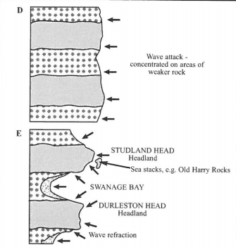
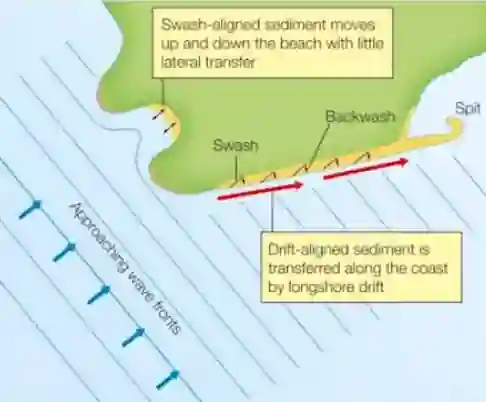

## Coastal Landforms

* The formation of coastal landforms is strongly influenced by the type of coastline and the types of rock present.

> 

### Types of Landforms

* **Beaches:**

  * The accumulation of material deposited between the low water mark (LWM) spring tides and the highest point reached by the storm waves at the high-water mark (HWM) spring tides.

  * A beach consists of 3 zones: backshore, foreshore and offshore.

  * Above the HWM, there may be a berm or a shingle ridge.

  * The berm is the course material pushed up the beach by spring tides.

* **Swash-Aligned Beach:**

  * A Swash-Aligned Beach is a coast where ocean waves break parallel to the shoreline.

  * The swash and backwash move directly up and down the beach profile causing minimal longshore drift.

  * Sediment broken loose by the swash is carried vertically down the slope by the downwash and pushed back up by the next wave. This provides minimum lateral movement of the sediment.

  * This up and down movement of waves creates smooth or shingle beaches with beach cusps.

* **Drift-Aligned Beach:**

  * A Drift-Aligned Beach is coast where ocean waves break at an angle to the shoreline.

  * The Prevailing Winds bring blow at an angle to the shoreline causing waves to break at this angle. The swash moves up the beach at the same angle however the backwash flows vertically down the slope of the beach.

  * Sediment broken lose by swash is moved laterally by small distance and pulled to shore by the backwash. This creates Longshore Drift and sediment is continuously moved laterally down the coast in a zigzag pattern.

  * This continuous process of Longshore Drift leads to the formation of a Tombolo, Spit or Bar.

    

* **Beach cusps:**

  * Beach cusps are shoreline formations made up of different types of sediment in an arc pattern. They may be formed in between the headland.

* **Headland:**

  * A narrow piece of land that projects from the beach out towards the coast. This primarily consists of hard rock.

  * The headlands receive the highest energy waves and are most prone to erosion.

  * The headlands play an important role in Wave Refraction allowing for the process to take place.

  * Example: The Old Harry Rocks at the Studland Bay on the Dorset Coastline.

* **Bays:**

  * The less resistant rock experiences the most erosion and retreats inwards leading to the formation of a Bay.

  * **Swanage Bay, UK:** Consists of clear headlands and bays corresponding to the hardness of the rock band they sit on.

* **Concordant Beach:**

  * Concordant beaches are usually formed in locations where the rock structure runs parallel to the coastline.

  * They usually lead to the formation of Coves, which are a small, sheltered bay (i.e. Lulworth Cove).

* **Coves:**

  * A crack in the outer hard rock is attacked by waves.
  * Crack penetrates to the softer rock, where the rate of erosion by water increases drastically.
  * This forms a cove that looks like a bay that is set back by 1 band of harder rock.
  * **Lulworth Cove, UK:** Consisting of Portland limestone outer rock, clays, and then chalk cliff.
  * **Dalmatian coastlines:** Waves travel at an angle to the bands of rock Increasing rates of erosion on softer rocks leaving behind only the harder bands of rock.

* **Discordant Beach:**

  * Discordant beaches are usually formed in locations where the rock structure runs at an angle to the coastline.

  * The Alternating rock types may lead to the formation of Headlands and Bays.

  * One such example is on the **Dorset Bay** to the east of Lulworth Cove.

* **Cliff:**

  * A mass of high rising rock that is almost vertical.

  * If the caves on either side of a headland merge, the cliff is called an arch.

  * Further erosion and weathering of the roof of the arch may lead to the roof collapsing, forming a stack.

  * An inlet that is undercut into a cliff is called a cave.

  * Vertical erosion of a cliff may lead to the formation of blowholes.

### Coastal Platforms

* **Wave-cut platform:**

  * A platform along the coast that is created due to cliff retreat.

* **Bars:**

  * A ridge of material that is connected at both ends to the mainland.

  * It is located above sea level.

* **Offshore bars:**

  * Sediment/Material that is eroded from the beach is carried towards the offshore region where it sinks. The buildup of sediment in this region is forced upwards and forms an offshore bar.

  * They are made of coarse sand or shingle.

* **Spit:**

  * Long, narrow accumulations of sand and/or shingle with one end joined to the mainland and the other projecting out towards the sea or extending out across a river estuary.

  * A spit is formed due to longshore drift as sediment carried along the coastline is deposited. This buildup of sediment over a period of time may lead to the formation of a spit

* **Barrier Island:**

  * Natural sandy breakwaters formed parallel to a flat coastline.

  * The world’s longest series of barrier islands is located at the east and **southern coasts of the USA** consisting of about **300 islands**.

* **Tombolo:**

  * A ridge of material linking an island with the mainland.

  * **Chesil Beach** on the south coast of England. It is 25 km long, connecting the Isle of Portland to the Dorset Coast.

* **Cuspate Foreland:**

  * Single ridges deposited in a triangular shape, due to two different spits joining together.

  * **Dungeness coast** near Dover in the UK, where the foreland forms the seaward edge of the Romney Marsh.

* **Estuary:**

  * An estuary is a partially enclosed coastal body of water with one or more rivers or streams flowing into it that is freely connected to the open sea.

* **Lagoon:**

  * A shallow body of saltwater separated from the sea near the mouth of a river.

* **Salt Marsh:**

  * Silt accumulation on low-energy coastlines behind spits and barrier islands, and in estuaries and harbours may lead to the formation of a Mudflat. Vegetation growth in such areas will form a Salt Marsh.

  * **Scolt Head** Island on the North Norfolk coast of England.

* **Mangroves:**

  * Mangroves are salt-tolerant trees and shrubs located in the intertidal regions of tropical and subtropical coastlines.

  * They are uniquely adapted to survive in harsh, waterlogged conditions and act as densely populated biodiversity and nursing grounds for fish and other marine creatures.

  * They are equally beneficial for the human population as they act as a natural barrier between the sea and land. They reduce wave energy and trap sediment protect the shoreline from erosion whilst acting as major carbon sinks, absorbing huge amounts of carbon dioxide from the atmosphere and storing it efficiently.

* **Sand Dune:**

  * Strong onshore winds blow sand in the direction of the prevailing winds. These sand particles are trapped by a large tidal range and vegetation to form Sand Dunes. Sand Dunes are only located on coasts with an abundance of sand.

  * The sand grains are trapped and deposited against any obstacle on land to form dunes.

\<table\> \<thead\> \<tr\> \<th\>\<strong\>Factor\</strong\>\</th\> \<th\>\<strong\>Resultant effect\</strong\>\</th\> \</tr\> \</thead\> \<tbody\> \<tr\> \<td\>\<strong\>Hard rock\</strong\>\</td\> \<td\>Vertical. Rock falls common. Slow retreat vs rapid of soft rock\</td\> \</tr\> \<tr\> \<td\>\<strong\>Soft rock\</strong\>\</td\> \<td\>Gently sloping stepped. Rotational slumping common\</td\> \</tr\> \<tr\> \<td\>\<strong\>Dip to sea\</strong\>\</td\> \<td\>Large slabs slide off easily, slopes towards sea\</td\> \</tr\> \<tr\> \<td\>\<strong\>Dip from sea\</strong\>\</td\> \<td\>Vertical and rugged, slow rate of retreat\</td\> \</tr\> \<tr\> \<td\>\<strong\>Impermeable base, porous top\</strong\>\</td\> \<td\>Unstable as top saturates and bottom acts as slip plane\</td\> \</tr\> \<tr\> \<td\>\<strong\>Raised beach\</strong\>\</td\> \<td\>Modern cliff degrades cliff line above it\</td\> \</tr\> \</tbody\> \</table\>