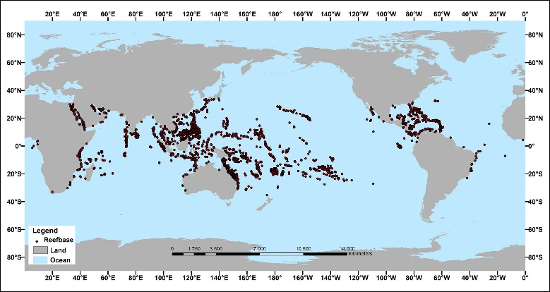
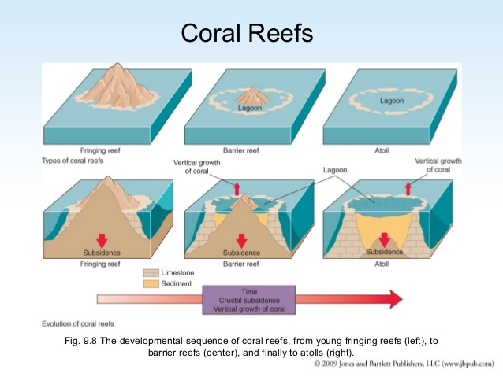

## Coral Reefs

* Calcium Carbonate structures, made up of reef building stony corals.

### Location of Coral Reefs

* When describing distribution, use **T(CLUES)EAM**
  * **Trends:** loose/strong, positive/negative correlation
  * **(CLUES):** clustered, linear, uneven, even, scattered
  * **Evidence:** use specific place names to support
  * **Anomalies:** find features that disagree with the trend
  * **Manipulate:** make simple calculations if data is present
* **Global distribution**
  * Along coastlines +/- 30° from the equator.

  * Major Clusters across North-East Australia, Southern Indonesia and other equatorial regions.

  * Scattered across the Pacific Ocean.

  * Randomly scattered and spread.

    
    

### Reef Characteristics and Formation

**1. Fringing:**

* Located near the coast near narrow, shallow lagoons.

* A concave platform of coral that is connected but has grown away from the land.

* Outer reef edge (due to breaking of waves and highly oxygenated water).

* Less than 500m wide.

* **Tahiti:** 150 species of coral and 1,000 species of fish (between Australia and South America).

**2. Barrier:**

* Broader, older and more continuous reefs that are separated from the land and located in deep lagoons.

* Located 500m away from shore.

* **Great Australian:** 2,600km along the East Australian coast, 10% of global coral reefs, 3000 reefs.

**3. Atoll:**

* Circular reefs typically found around old volcanoes.
* Not found at continental coastlines, as they need a circular reference to grow around
* More common in **Indonesia**.
* **Bikini Atoll:** 23 atomic bombs were dropped here by the US, but it is now home to 1000s of species (including tuna and sharks), with the lagoon is 25 miles wide.
  

**Reef Formation:**

* **Origin:**
  * Corals simply grow Seward from land.

  * The main reason for Coral growth is **Land Subsidence**.

  * This is the theory that reefs are originally formed as fringing reefs, however, develop into barrier reefs due to the sinking of land, and eventually into atolls as the lank subsides completely.
* **Formation:**
  * Free-swimming coral polyp larvae attach to the seabed

  * Symbiotic relationship with Zooxanthellae (lives inside its tissues) which provide a protective environment, and photosynthesis produces Glucose, Glycol, and essential amino acids.

  * Polyps secrete calcium carbonate and limestone cups around the organism.

  * Clones develop and join to form a colony.

  * This colony forms a fringing reef around the island.

  * Fringing reef grows continually upwards as the island subsides, to allow it to access sunlight, oxygen, and food, forming a barrier reef.

  * An atoll forms as the corals continue to grow outwards and upwards to maintain oxygen, food, and sunlight supply, as the island simultaneously sinks.

### Coral Growth Conditions

* **Temperature:**
  * A temperature of above 20° C.

  * Optimal conditions for growth are between 23° C and 25° C.
* **Depth:**
  * Depth of water less than 25 m.
* **Water Salinity:**
  * Corals are intolerant of water salinity levels below 32 psu, although they can tolerate high salinity levels of above 42 psu as found in the Red Sea or the Persian Gulf.
* **Waves:**
  * Strong wave action is preferred to ensure water remains oxygenated and a cleaning action may take place.
* **Air Exposure:**
  * Corals will die if they are exposed to the air for too long, therefore coral growth can only occur below the low water mark.
* **Light:**
  * Corals prefer shallow water to photosynthesize.
* **Sediment Levels:**
  * The Sediment Level in the water must be low as corals require light to photosynthesize, which may be blocked by murky waters.
* **Seabed:**
  * Must have solid features present, such as rock or an artificial structure (sunken ship).

### Threats to Coral Reefs

**Importance:**

contributes $100bn to the global economy, 500m depend on them for the following reasons

* **Food:** 15 tonnes of fish per km2
* **Tourism:** huge income for LICs
* **Medicines:** Biodiversity is huge – some chemicals may hold the key to curing cancers and diseases
* **Coastal protection:** the breaking of waves out at sea reduced erosion at the coast
* **Human Impacts:**
  * **Tourism:**

    * Corals are a major source of income for Low Income Countries in the form of Tourism.

    * Tourism in the form of boats impact corals in the form of swash, crash or the release of pollutants. Moreover, boats may collide with corals, destroying them.

    * Propellers/Engines may mix in gaseous pollutants into water using the same mechanism as a breaking wave and reducing oxygen levels.

    * Global Coral tourism provides $36bn per year in revenue, with 70 million trips.

    * Divers may take shells and remove pieces of coral from the reef.

  * **Medicinal Purposes:**

    * Corals possess medicinal purposes and chemicals which may heal diseases.

    * Coral harvesting in large amounts and theft is leading to widespread coral endangerment and subsequent extinction.
* **Global Warming:**
  * The temperature has risen by 0.5°C over the last 40 years, and increased CO2 (340ppm to 410ppm over 40 years) increases ocean acidity.

  * **Coral bleaching:**

    * A variation in temperature may cause coral bleaching.

    * A 1-2°C fluctuation causes bleaching (zooxanthellae leave, coral in energy deficit, and colour drains out.)

    * The 1998 Coral bleaching was the largest ever recorded with major impacts to the Persian Gulf, East Africa and across the Indian Ocean with temperatures exceeding 30°C leading to the bleaching of 16% of the global reefs.

  * **Acidity:**

    * 70ppm increase over 40 years, CO2 concentration has led to the pH to drop by 0.05 to a more acidic 8.05

  * **Sea level rise:**

    * Sea levels rising across the world have led to the increase in depth of water at the shore. Corals at deeper depths receive lesser sunlight and cannot photosynthesize.

    * If photosynthesis stops for zooxanthellae, it cannot produce food for itself, and the coral, so bleaching occurs.

    * 0.3cm (but value is increasing) per year sea level rise vs. 0.3-2cm coral reef growth rate.

  * **Pollution:**

    * The contamination of water in the form of chemicals from boats, oil spills and microplastic may increase water sediment levels, reduce water salinity and block sunlight, limiting coral growth.

    * Tiny pieces of plastic (Microplastics) may be eaten by corals or fish that use the corals, killing the ecosystem and relationships between corals and fish.

    * Excess fertilizers from agricultural land may trigger eutrophication (algal blooms)

    * Not enough oxygen for corals is left, nor is there enough light for photosynthesis in zooxanthellae.

    * **Deepwater Horizon explosion** leaked almost 5 million barrels into the ocean, killing coral.

  * **Storm activity:**

    * Global warming increases the intensity and frequency of storm activity. Harsh waves cause physical damage
      to the corals.

    * **Boxing Day Tsunami (2004)** destroyed many corals in the Indian Ocean.

### Sustainable Management of Corals

* **Law enforcement:**

  * Law enforcement may enforce policies to restrict tourism or fishing in regions with Coral Reefs.

  * Regular Patrols to enforce Coral reefs are protected and any trespassers will be dealt with heavy fines.

  * Policies to avoid harvesting of Corals.

* **Trust Organizations:**

  * Coral Trust organizations may be established to invest in research and schemes to better protect coral reefs.

* **Awareness Programmes:**

  * Awareness Programmes by the government for the public may be established to teach the general public about the benefits and risks to corals.

### Case Study

**<u>Great Barrier Reef, Australia</u> Background**

* Extends over 14 degrees of latitudinal range.
* Supports 64,000 jobs.
* $6.4bn per year to the Australian economy.

**Reef Structure and Ecosystem**

* 344,400km2 = half the size of Texas.
* 3000 separate reefs.
* 600 species of hard and soft corals, 1600 types of fish, including Parrotfish.
* 35m average depth, up to 2000m continental slopes.
* 50% of mangrove species worldwide.

**Problems:**

* 50% of coral cover lost in 30 years.
* **Crown of Thorne starfish outbreaks:**
  * poisonous spikes, moving at 20m per hour, eat through any coral at 10 square meters per year, 1m diameter, outbreak (>30 in one area), a result of nutrient runoff, overfishing, and removal of natural predators.
* **Tropical cyclones:**
  * They affect large areas by inflicting physical damage to corals, but also raise the temperature of the sea, possibly to bleaching levels. Intensity and frequency are increasing due to climate change.
* **Coral bleaching:**
  * Most of the loss in coral cover is due to bleaching, primarily due to stress put on zooxanthellae due to temperature fluctuations.
* **Coastal development:**
  * 80% of the catchment area supports agriculture, Queensland urban development sits on floodplains –
    toxins drain into coral reefs.

**Management**

* **Legislation:**
  * $200 million invested by the Australian and Queensland governments, with patrols by police to enforce laws. 1975
    The Marine Park Act controls zoning and fishing limits to maintain the ecosystem.
* **Reef Trust and Great Barrier Reef Foundation:**
  * Almost $1.6bn in investments for research and schemes, such as monitoring and education.
* **Turtle Hospital:**
  * Supported injured marine life for 27 years to maintain ecosystem balance. Dedicated turtle hospital treated 165 since 2009, 1300 ANIMAL hotline for anyone who spots ‘floating’ turtles.
* **Eye on the reef:**
  * Turned tourism into an ally. 1997 operators make coral observations during visits to obtain regular data and
    build knowledge. Incorporates the tourism industry to do something positive. Good training for those who know the area best - invaluable education and knowledge gathering,
* **2050 Water Quality Improvement Plan:**
  * Provides strict guidance for locals, businesses, and farmers on water management. Mainly fertiliser and sediment controls.

    * Inorganic nitrogen fell by 4.3%.

    * Unsuccessful attempts to increase groundcover and therefore reduce overland flows (fell by 58%).

    * 80% species are protected from pesticides.

    * Sediment reduction of nearly 10%.