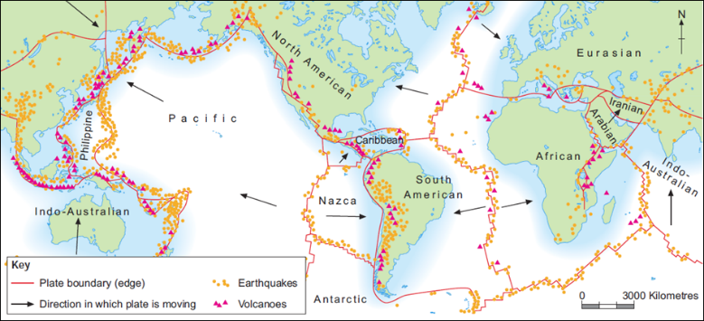
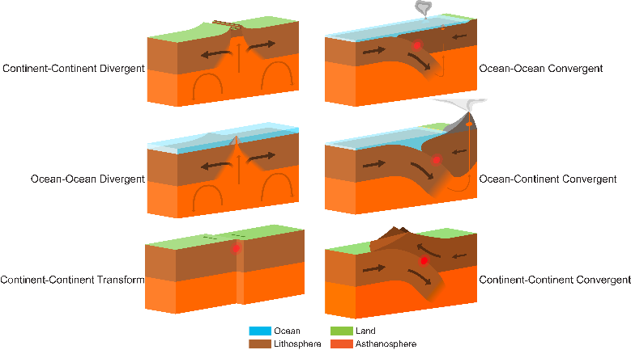
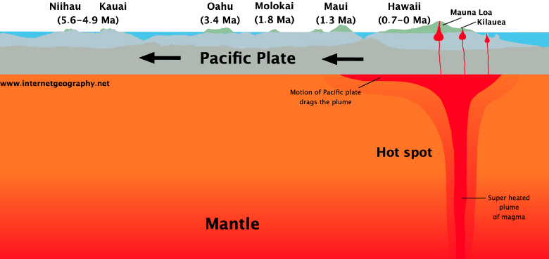
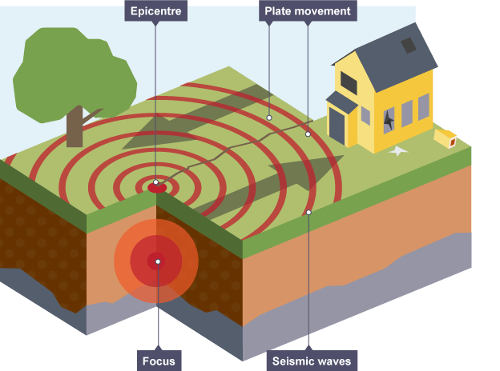
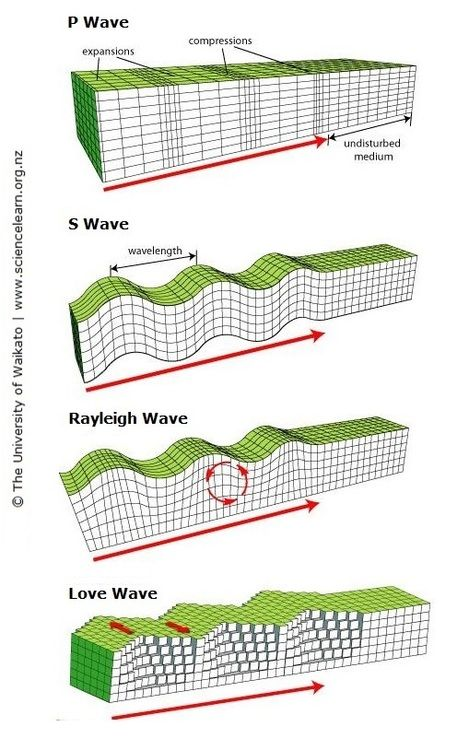
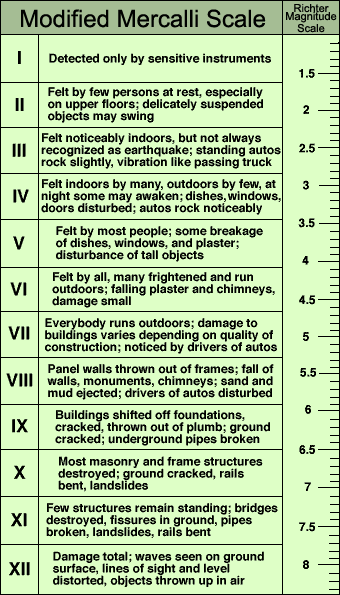

## Hazards From Tectonic Processes

### Volcanoes and Earthquake Distribution

* When describing distribution, use **T(CLUES)EAM**

  * **Trends:** loose/strong, positive/negative correlation.
  * **(CLUES):** clustered, linear, uneven, even, scattered.
  * **Evidence:** use specific place names to support.
  * **Anomalies:** find features that disagree with the trend.
  * **Manipulate:** make simple calculations if data present.

  

* **Earthquakes**

  * Clear linear chains along plate boundaries (Mid-Atlantic Ridge).
  * Broad chains along subduction zones (Nazca/South American plate).
  * Few earthquake events not on boundaries, due to human activities or hotspots (Hawaiian Hot Spot).

* **Volcanoes**

  * Strong bands of linear volcanoes along boundaries.
  * ¾ Earth’s volcanoes lie around Pacific Ring of Fire.
  * Clustered volcanoes over hotspots (Hawaii).
  * Most intense along subduction zones.

### Hazards on Boundaries

* Different boundaries produce different hazards.

  

**Conservative**

* Intense earthquakes due to intense friction along boundary (San-Andreas fault line).
* No volcanic eruptions.

**Collision**

* Earthquakes due to collision and friction along boundary.
* No volcanic eruptions.

**Destructive**

* Shallow to deep earthquakes, inclined along the Benioff zone, where slab pull occurs.
* Explosive, ashy, viscous volcanic eruptions due to greater melting causing silica rich magma.

**Constructive**

* Moderate earthquakes as a result of weak oceanic crust being moved by volcanic intrusions, or by transform faults caused by different speeds of spreading along the boundary (Mid-Atlantic Ridge).
* Fluid basaltic lava rises to form new oceanic crust.

**Hotspot Theory**

* Radioactive decay in Earth’s core causes uneven heat.

* Triggers intense heat transfer from core through mantle.

* Mantle only becomes in motion in upper mantle as per convectional processes.

* Thermal plume causes magma build up under plate.

* High pressure forces causes magma to seep through cracks onto sea floor.

* Plate moves over stationary plume, causing a chain of islands.

* Inactive volcanoes erode and become inactive seamounts.

  

### Earthquakes

* **Process**

  * Tectonic plates move about each other as a result of convectional current in the mantle.
  * Plates do not move smoothly due to intense friction.
  * So, they ‘lock up’ and huge amount of tension builds.
  * Eventually tension is too great and plates slip, causing a rapid release of pressure.
  * Foreshocks and aftershocks occur throughout.

* **Epicentre:** point on Earth’s surface immediately above the focus.

* **Focus:** sub-surface point where the energy is released and plates slip past each other.

  

**Seismic waves:** resultant waves from earthquake

* **Body waves:** transferred through Earth’s structure
  * **Primary waves:** incident compresses rock, causing a band of compression (high density) to move in the direction of the wave. Compression waves, where propagation is parallel to the direction of travel.
  * **Secondary waves:** incident compresses rock sideways, causing deformation in one direction and adjacent layers to move in the opposite direction. Transverse waves, where propagation is perpendicular to the direction of travel.
  * P-waves occur first, followed by S-waves at 60% of the speed. S-waves can only travel through solids due to the elastic properties of needed for a transverse wave. P-waves can cause liquefaction.
* **Surface waves:** body waves arrive at surface, generating waves that propagate parallel to surface.
  * **Raleigh waves:** similar motion to water waves – the ground ‘rolls’ but particles rotate away from the direction of travel.
  * **Love waves:** faster than Raleigh waves, propagate across Earth’s surface, particles move side to side, perpendicular to the path of the wave’s energy.
* Surface waves do the most damage in an earthquake event, but are the result of body waves.

**Seismic scales**

* **(Modified) Mercalli Scale:** qualitative measurement of quake damage an area faces. It is possible to have low Richter magnitude, and high Mercalli result, if infrastructure and buildings are poorly constructed.
* **Richter Scale:** quantitative measurement of earthquake amplitude, measured with a seismometer. 0  10 scale, with 1 dp. Mapped to a logarithmic scale, so 1 integer increase = 10x quake strength = 32x energy release.

* **Frequency:** how often earthquakes occur. Around 1 million Richter 2 earthquakes occur per year globally, but only 3 of Richter 8.

**Factors affecting damage (to lives and property)**

* Strength, depth of focus and number of shocks.
* Population density and time of day.
* Building/soil/sediment types.
* Distance from epicentre.
* Economic development.
* Secondary hazards.

**Human Interference**

* Disposal of liquid waste.
* Underground nuclear testing.
* Fracking/mining/explosions/tunnelling.
* Increased crustal loading.

### Earthquake Hazards

**<u>Primary Hazards:</u>** initial effects caused by an earthquake

* **Ground Shaking:** the result of seismic waves passing through the
  ground that causes the collapse of infrastructure, structures, and
  buildings.
  * **Alaska, 27th March 1964:** lasted 7 minutes.
  * **Loma Prieta, 17th October 1989:** columns of
    Cypress viaduct collapsed – 41 killed when top layer fell on
    lower.
* **Surface Faulting:** displacement of the ground that will cause
  underground pipes and wires to fail.
  * **California, 1952:** 3 railroad tunnels damaged, halting rail
    travel for 25 days despite 24 hour repair work.

**<u>Secondary Hazards:</u>** occur because of primary hazards

**Landslides/Avalanches:** entire mass of material moves down a
slope, holding its structure. Avalanche is snow.

* Seismic shocks cause sudden increase in shear stress.
* Must be a pre-existing slip plane or line of weakness.
* Huge seismic shocks breach line of weakness and triggers the mass movement.
* Or, ground motion causes mass on slip plane to fully detach and slide.
* **Effects**
  * **Infrastructure destroyed:** sewage/water pipes,
    telephone/electricity cables broken, isolating people.
  * **Blocked access:** material on road networks blocks aid,
    food supplies and emergency (medical) access.
  * **Flooding:** if mass falls into lake/reservoir, may
    suddenly displace water, or cause dam wall to fail.
* **Management**
  * **Avalanches:** snow compaction and land use plans.
  * Land use planning or mapping.
  * Pinning, netting, grading, afforestation, greening.
* **Peru, 1970:** ground-shaking from magnitude 7.9 quake loosened
  rocks and ice on Mt. Huascaran, triggering a 200km/h debris
  avalanche obliterating village of Yungay. 67,000 dead, 800,000
  homeless.

**Soil Liquefaction:** ground shaking causes weak/ unconsolidated
material to act as a fluid, normally when ground water is high.

* Soil must be saturated/near a water body.
* Normally soil particles are tightly packed together held
  together by friction.
* Ground shaking destabilises soil and spaces between particles
  increases. Sudden pore water pressure increase causes soil to
  lose all cohesive strength.
* No cohesive strength in soil = loss of solid properties, behaves
  like a liquid.
* **Effects**
  * **Gas and water pipe buckling:** soil motion causes forces
    on pipes that they cannot withstand, therefore they fail –
    cuts off supplies to locals.
  * **Ground spreading:** soil moves down like a liquid, surface
    features spread outwards.
  * **Sinking buildings:** foundations suddenly unsupported, so
    buildings sink and tilt.
* **Management**
  * Improve foundations.
  * Improve soil drainage (Vibro-compaction).
  * Do not construct on saturated or flood prone soil.
  * Use of flexible pipes and automatic shut-off valves.
* **Alaska, 1964:** sandy layer of soft clay liquefied causing a
  landslide that destroyed 75 homes and utilities.
* **Loma Prieta, 1989:** extensive soil cracking.

**Tsunami:** very long (200km wavelength) and high (up to 30m)
series of waves caused by a large oceanic disturbance, other than
tidal processes.

* Form as a result of sudden water displacement.
* Pressure builds up along an earthquake boundary with a ‘stick
  and slip’ relationship.
* Through tectonic processes, pressure and strain energy builds up
  between the plates.
* Plates eventually fail and slip, suddenly assuming new positions
  on the seabed – sudden displacement, e.g., Flicking upwards.
* Almost all of released energy transferred to water.
* Water raised to above sea level, then swell falls under gravity,
  and splits into two opposite directions.
* **Wave shoaling** occurs near the shallower shore, as a huge
  amount of energy is compressed into less water volume. Wave
  speed (800km/h down to 50km/h) and wavelength reduces, height
  increases.
* **Effects**
  * **Coastal retreat:** as tsunami wave approaches, trough of
    wave following behind causes water to be pulled out to sea
    to form peak tsunami wave.
  * **Coastal flooding:** few natural warnings – unprepared.
    Continuous wave doesn’t break until loss of energy around
    10km inland, frequency of between 5-40 minutes on average.
* **Management**
  * Coastal abatement.
  * Tsunami warning systems.

### Impacts on Lives and Property

* **Primary impacts:** immediate results of a hazard event
  * **Earthquakes**
    * Primary hazards
    * Deaths, injury, panic and shock
    * Building and infrastructure collapse
  * **Volcanoes**
    * Primary hazards leading to destruction and injury
* **Secondary impacts:** consequences of primary impacts that occur
  once shockwaves/eruptions have finished
  * **Earthquakes**
    * Secondary hazards
    * Homelessness and night-time hypothermia
    * Disease from sewage (water borne – cholera)
    * Fires and floods due to burst/broken pipes
    * Loss of communications
  * **Volcanoes**
    * Secondary hazards
    * Flight disruption
    * Atmospheric cooling/warming
    * Crop damage and famine
    * Homelessness

### Prediction, Preparation and Monitoring

**Earthquakes**

* **Prediction:** short term prediction is impossible, but strain
  cycles can be analysed to give approximate intervals
  * **Seismic gap theory:** considers the gap along a fault line
    that is inactive, but due for an event, based on history of
    seismic activity in that direction and frequency
* **Preparation/Protection**
  * **Building design:** shock absorbers, dampers, cross
    bracing, double glazed windows with automatic blinds, gas
    and electricity valves, deep foundations
  * **Safe houses:** light walls and roofs, small windows,
    reinforced walls (plastic mesh) and shock absorbers
  * **Bridges:** suspension bridges
  * **Pipes:** flexible joints
  * **Evacuation:** plan in place that all residents and
    emergency services are familiar with
* **Monitoring**
  * Gas emissions
  * Strain meters and magnetic field meters
  * Lasers
  * Ground tilt and seismometers
  * Fluid pressure at greatest stress (can be modified to reduce
    the risk of an earthquake)

**Volcanoes**

* **Prediction:** can be roughly predicted due to obvious run-up
  period prior to hazardous event
  * **Seismometers:** monitor micro foreshocks prior
  * **Satellite imaging:** detects changes in shape and size
  * **Ultrasound:** monitors low frequency waves in magma,
    resulting from gas surges or movement
  * **Ground tilt meters:** measure change in volcano shape as
    magma causes volcano to bulge
  * **Chemical sensors:** changes in sulphur gas emission
* **Preparation/Protection**
  * Possible to evacuate given lengthy prediction and measuring
  * Lava dams
  * Increased levees on outburst floodplains
* **Monitoring:** similar to **Prediction**

**Tsunamis**

* **Prediction:** International Tsunami Warning System in Pacific
  Ocean gives warnings – plenty of time to take local action due
  to length of time it takes wave to reach land
  * However, system in LICs such as Indonesia (gifted as aid) is
    in disrepair
* **Preparation/Protection:** flood walls, coastal evacuations,
  requires functioning warning system
* **Monitoring:** sea level and pressure meters, seismographs,
  communication and satellite systems

**Mapping:** hazard can be mapped over a long time period, with
different risk levels for different locations denoted with varied
colours

### Risk Perceptions around the World

* **Based on 3 factors**
  * **Experience:** greater experience means someone is greater
    equipped to adapt to the hazard
  * **Material possessions:** affluent have more choices
  * **Personality:** risk taker or conservative?
* **Actions to take**
  * **Accept the hazard:** fatalistic attitude (Afghanis)
  * **Adjust to the situation:** fight the hazard (Icelandic people
    spraying water on lava) or prepare for it (make buildings safe
    and have procedures in place)
  * **Leave:** move somewhere safer
* **Choosing to live near a hazard:** people live near hazards for a
  range of reasons
  * **Earthquakes:** unpredicted hazard; reluctant to leave
    employment, friends and family; buildings are safe
  * **Volcanoes:** tourism in area; fertile soils; culturally
    symbolic
* **Increasing risk perception:** practicing evacuation drills,
  awareness days, automatic gas shut off and safety systems (maps,
  marked exists, survival kits near exits); allow locals to be well
  prepared despite facing high risk