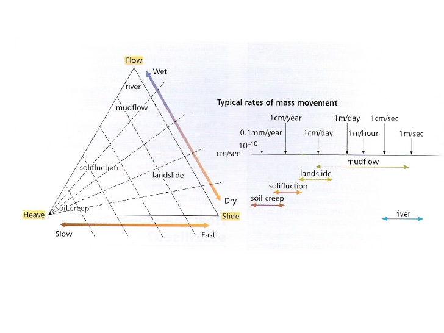
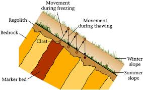
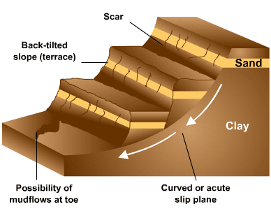
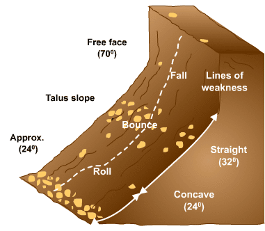

## Nature of Mass Movements

* **THIS SECTION RELIES UPON KNOWLEDGE FROM SECTION 3 AT AS-LEVEL.
  Content is summarised here**
* Hazardous mass movements are ones that occur unexpectedly, or have
  an impact on lives and property
* **Mass movement nature considers**
  * **Size and shape:** area covered and size of mass
  * **Water content:** impacts rate of flow
  * **Slope angle:** steeper may produce faster movement
  * **Speed:** higher speed is more of a hazard
  * **Material:** size of debris inside the movement

**Categorising movements**

**Slip plane:** 

* Junction between two layers along a bedding line,
  between two rock types. Point beneath the surface where shear
  stress > shear strength

**Heaves (soil creep):** slow movement of material where soil
particles are heaved to the surface by wetting, heating and freezing
of water. Occurs mainly in winter

* Particles move perpendicular to the surface, falling under
  gravity once particle has dried, cooled or water thawed with net
  movement down the slope
* **Evidence:** tension cracks in roads, tilted poles,
  terracettes, soil piled behind field stone walls

**Talus Creep:** slow movement of fragments along a scree slope

* **Affect on shape:** small slope terracettes create and material
  build up at slope base

**Slumps:** weaker rocks such as clays ‘slump’ with a rotational
movement along a curved slip plane

* Clay saturates with water and minerals expand. Lubrication of
  slip plane causes a series of material slumps, along slip plane.
  Commonly occurs if the base has been undercut
* Can be gradual or sudden separate, jerky events.
* **Affect on shape:** leaves a crescent shape scar on slope

**Flows:** more continuous, smoother form of slump. Occurs in deeply
weathered clay, and if particle size is the same or smaller than a
grain of sand

* **Mudflows**: fine grains mixed with water, slowing down a
  channel. Accumulates material down the slope. Faster than
  earthflows (which are deeper and thicker)
* **Debris flows:** loose mud, sand and soil saturated with water.
  Larger than mudflows, accumulating material as it travels
* Higher water content allows flows to occur on shallower slopes
* Can occur on saturated toe of a landslide, or as a separate
  event.
* **Affect on shape:** creates scar, flowtrack and toe lobe

**Falls:** occurs on steep slopes (>40°), with bare rock faces
and exposed joints

* Rocks detach and fall freely under gravity. Short fall =
  straight scree; otherwise a concave scree is produced
* Significantly contribute to the retreat of steep rock faces and
  providing debris for scree/talus slopes
* **Affect on shape:** creates steep backwall and lower scree
  slope

**Slides:** when an entire mass of material moves along a slip plane
– internal structure is maintained. Water infiltrates through
limestone and adds weight to material on slope. Water reaches
impermeable clay and lubricates slip plane. Blocky limestone slides
down plane towards valley base. Can be rock/landslides, or a
rotational slide. Material holds its shape until hitting the slope
bottom.

* **Conditions:** weak rocks, steep slope, active under cutting,
  intensely cold conditions or sudden change in water content
* **Landslides:** when material moves downslope as a result of
  shear failure. Downward force > resistance. An increase in
  water content reduces strength (particles pushed apart) and more
  mass is added
* **Rockslides:** large rock mass slides down slip plane
* **Affect on shape:** rotational slide cause stepped profile with
  upper steep scarp, main mass and lower lobe

**Avalanches:** fast (40-200km/h) mass movements of ice and snow
along a slip plane, often where the slope is steeper than 22°. Often
triggered by skiing, when new snow falls off old snow layer, or
where lack of sun means snow does not stabilise on the slope

* **Categorisation**

|**Type of breakaway**|**Single point – loose snow**|**Large area (leaving wall) - slab**|
|:---|:---|:---|
|**Position of sliding surface**|Whole depth – full depth|Some top strata – surface|
|**Form of track**|Open slope - unconfined|In a gully – channelled|
|**Form of movement**|Through the air – airborne powder|Along the ground - flowing|

### Risk Perceptions around the World

* Further distance from a site, the less perceived risk
* Personal knowledge of slips effects risk perception
* Longer time between events means people become more paranoid
* Governments, insurance companies and private land owners should be
  well informed – take responsibility for informing the public