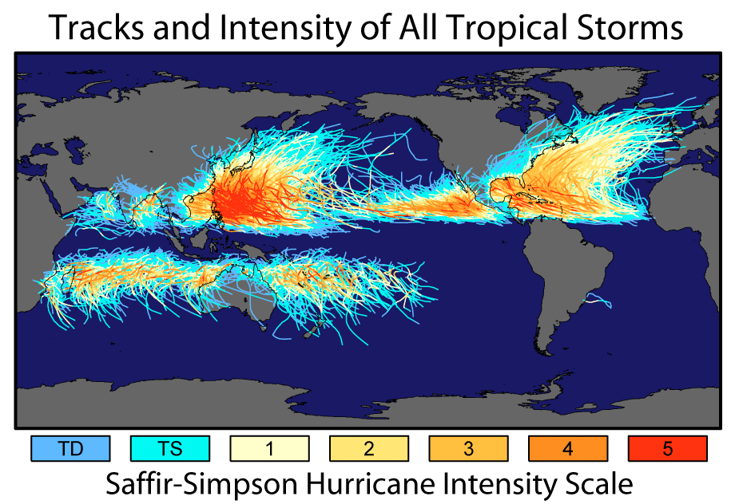
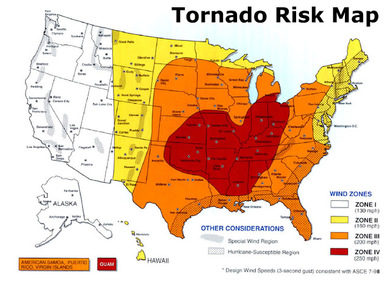
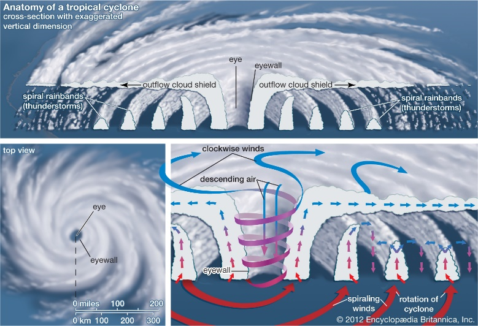
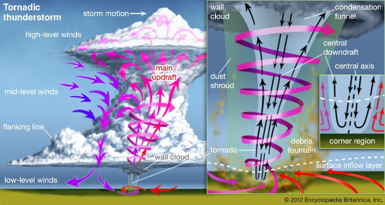
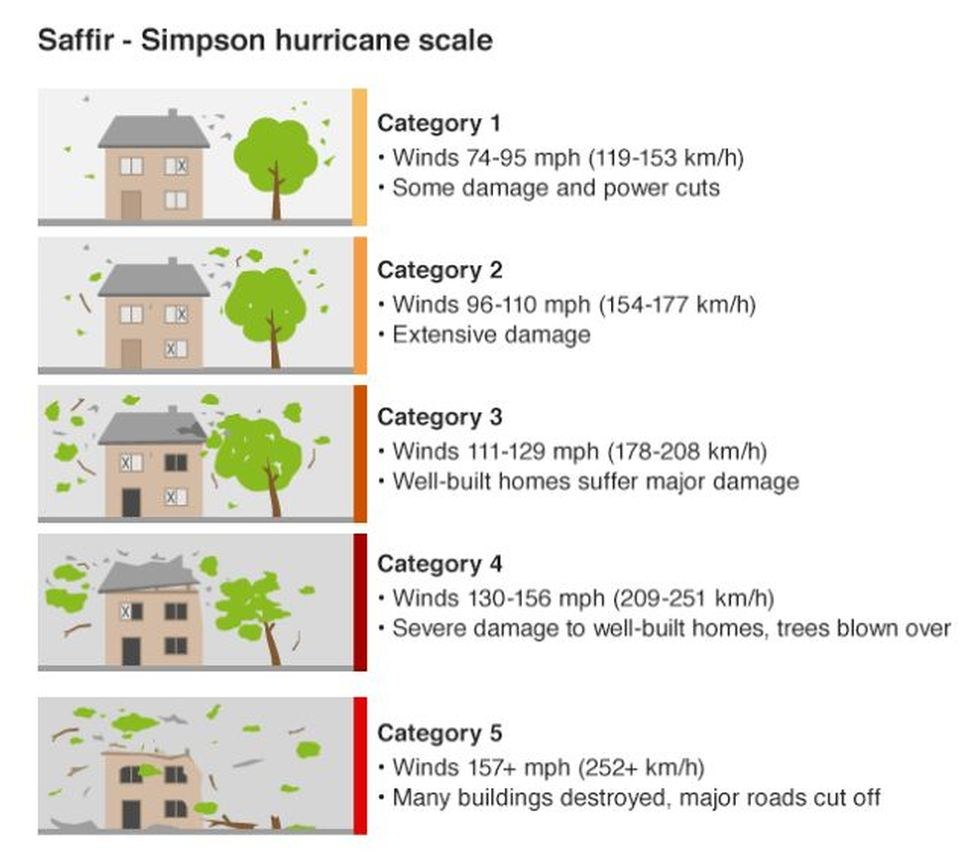
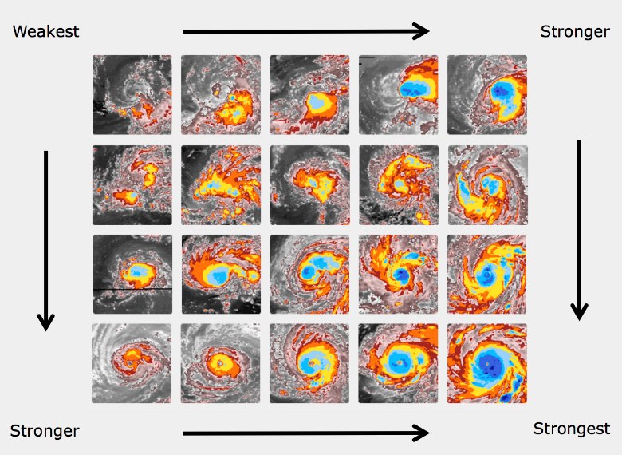

## Hazards From Atmospheric Disturbances

* **Tropical storms:** large, low pressure systems (as low as 880mb) with winds at least 63km/h (storm) or 119km/h (cyclone)
  * **Hurricanes:** Western Atlantic, Eastern Pacific
  * **Cyclones:** Indian Ocean, South Pacific
  * **Typhoons:** Western Pacific
* **Tornadoes:** rapidly rotating, violent, fast moving, narrow,
  funnel shaped cloud common on USA Tornado Alley
  * **Average tornado:** 500km/h winds, lasts for 5 mins, maintains
    ground contact for 4km, < 600m diameter, path width of <
    50m, pressure difference of 850mb

### Global Distribution

* When describing distribution, use **T(CLUES)EAM**

**Tropical Storms**

* **Location:** primarily form along tropics between 5-30 degrees
  north/south, and **none** on equator
* **Density:** greater in northern hemisphere
* **Intensity:** greater in northern hemisphere, over Asian
  continent and East coast of North America. Few storms of
  intensity 5 are in southern hemisphere
* **Direction:** northern hemisphere = deflect to right with
  anti-clockwise rotation, southern hemisphere deflect to left
  (clockwise). Storms travel east to west
* **Timing:** northern hemisphere = June to November, southern
  hemisphere = November to April

**Tornadoes**

* **Location:** occur in every continent other than Antarctica.
  Between 20-60°N/S, but most commonly in the United States in
  ‘Tornado Alley’
* **Density:** UK has the most per land size (33 per year), but
  the US has the most in total (>1000 per year)
* **Intensity:** most intense in the US. 10-20 violent tornadoes
  per year, don’t occur outside the US
* **Direction:** unpredictable and can travel in any direction.
  Most travel from southwest to northeast
* **Timing:** typically between spring and summer due to the
  collision of cold polar and warm tropical air

### Formation of Atmospheric Disturbances

**Tropical Storms**

* **Require:** heat, moisture, light winds, rotation
* Develop in intense low-pressure zones over tropical oceans in
  the easterly wave
* Warm sea temperature (>26.5°C to a depth of 55m) heats up the
  air directly above it
* This latent heat powers convection (creating an intense
  low-pressure zone)
* Convectional processes draw air upwards, pressure gradient
  supplies new air to the warm sea
* Moist, warm air cools and condenses, forming large anvil-headed
  cumulonimbus clouds
* Storm begins to rotate (anticlockwise in northern hemisphere)
  due to the Coriolis force deflecting the rising air and winds
  (to the right in the northern hemisphere). Low pressure must be
  far enough away from the equator for Coriolis force to be
  significant
* The eye forms when a small amount of built-up air flows inwards
  to the centre of the storm instead of outwards. Pressure builds,
  and weight of air counteracts updraft force, air descends – no
  clouds
* Self-sustaining (creates a positive feedback loop) and the storm
  generates heat, until it runs on land – dying quickly as there
  is now no warm, moist air to fuel it

**Tornadoes**

* **Require:** moisture, instability, lift and windshear
* **Supercell** thunderstorm develops in late afternoon
  * Cold front meets a warm front, so warm air rises
  * Insolation heats ground, moist air rises and rapidly
    condenses in the presence of condensation nuclei
  * Atmospheric instability allows shallow cumulus cloud rise,
    forming a towering cumulonimbus cloud
  * Intense low pressure at surface from updrafts
* Cyclonic motion (**Mesocyclone**) develops
  * Wind shear (as a result of gradient between wind speeds)
    causes air to overtake other air, causing rotation.
    Horizontal rotation flicked vertical by updrafts. Air spins
    rapidly relative to storm rotation
  * Spiralling air moving upwards due to Coriolis effect adds
    rotational momentum to system
* Heavy rainfall due to high potential energy and moisture drags
  down a column of rapidly descending cold air – dragging
  mesocyclone closer to surface
* Mesocyclone feeds off moisture pulled from the ground and warm
  saturated base of cumulonimbus cloud
* Moisture concentration forms a rotating wall cloud – tornado is
  10-20 minutes away
* Mesocyclone spins increasingly fast, and Rear Flank Downdraft
  narrows base and pulls it closer to ground
* Intensity continues to increase as long as warm moist air can
  provide latent heat and as long as RFD does not cut off moisture
  supply at base of tornado

### Nature of Large-Scale Atmospheric Disturbances

* **Saffir-Simpson scale:** indicates damage based on sustained wind speed

  

* **Dvorak technique:** estimates storm intensity based on satellite imagery and temperature difference between the eye and surrounding thunderstorm clouds

  

### Hazards caused by Large-Scale Atmospheric Disturbances

* **Storm surges:** abnormal rises in seawater
  * Strong winds in contact with the surface by friction cause water
    to pile up and rise at the coast (95%)
  * Low pressure system around storm takes weight off the ocean
    surface, allowing it to rise (5%)
  * Worse with strong winds, approaches coast at right angle, at
    high tide, few obstructions but bays and inlets on coast to
    funnel water, gently sloping seabed
* **Intense rainfall:** most intense either side of the storm eye where thickest and tallest cumulonimbus clouds are
  * Worse when storm is slow moving as highest rainfall part of
    storm remains over land area for long time
* **High winds:** Coriolis force creates winds in excess of 157mph for a category 5 storm
  * Categorised by Saffir-Simpson scale or Dvorak technique
  * Worse when storm is far enough away from the equator for strong
    impact of Coriolis force
* **Mass movements:** mudflows and landslides triggered by intense rainfall
* **Air pressure imbalances:** low pressure system modifies local weather
  * Low pressure allows moist air to rise and cool, causing
    unsettled weather and precipitation
* USA has a lot of experience with tornadoes
* Hard balance to achieve between economy and personal safety
* A degraded perception of risk overtime may result in a degradation of infrastructure and protection methods