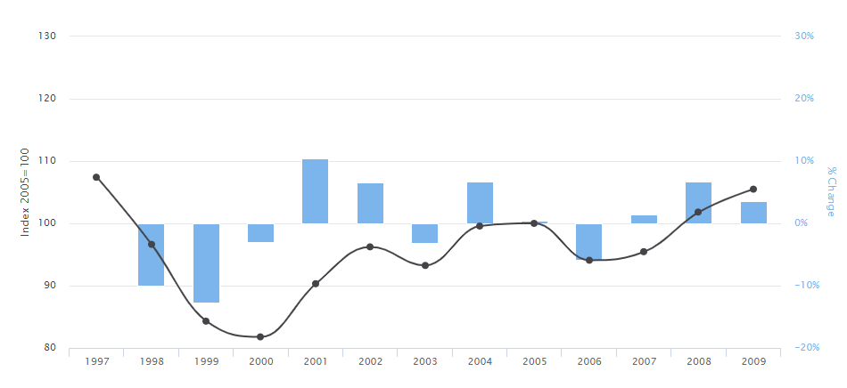

## Sustainable Management of a Hazardous Environment

* **Montserrat:** a Caribbean mountainous island that is part of the British Overseas Territory. It’s small population of 5,000 has a GDP per capita of around 30,000 dollars with exports equating to around 4 million dollars, but imports of 40 million dollars
* $25^{th} \text{June 1997}$**:** resultant pyroclastic flows from the
  Soufriere volcanic eruption could not be restrained by the Ghaut,
  killing 19 people in Streatham village and burning others
* **May 2006:** Soufriere dome collapsed, triggering a tsunami that
  was 1m at its highest in Guadeloupe. No one died, but flights were
  cancelled due to ash

**Problems**

* **Population fluctuations:** dropped from 11,000 (before 1997)
  to only 4,000 (1999); then rose to 8,000 in 2002. Now stable at
  roughly 5,000 (2021)
* **Economic hardship:** the economic boom that came with the 2002
  population rise did not last long. Almost immediately after new
  football stadiums, schools and houses were built, jobs fell away
  and so did income
* **Reduced aid:** UK started to reduce aid payments following
  120 million dollars after the 1997 eruption. An extra 40 million dollar would be committed
  however
* **Difficulty reaching the island:** building of a new airstrip
  caused US and UK to cease subsidisation of ferry service – thus
  the cost of imports and for tourists to trave rose. Campaigning
  against the airstrip in favour of boat port failed
* **Declining tourist sector:** since ferry costs are much higher,
  many tourists see it as a barrier to travel there, thus visitor
  numbers are reduced

**Attempts to solve**

* While all the below plans are theoretically good, evidence of
  their success is hard evaluate as:
  * Not enough time has passed
  * COVID-19 pandemic has halted development plans and
    potentially reversed economic development
* **Redevelopment:** new urban centre and port at Little Bay are
  being built, but have been hindered by the COVID-19 pandemic.
  Will provide jobs when complete
* **Tourism Master Plan 2015-25:** a fully costed plan based on
  improving infrastructure, services and travel links to promote
  tourism in Montserrat
  * **Success:** increase from 13,600 in 2015 to 19,300 in 2019
* **Economic Growth Strategy and Delivery Plan of 2018:** aims to
  strive for economic prosperity in the context of a small,
  vulnerable island – with mechanisms in place to cope with
  potential future volcanic events
  * **Little change:** scheme not been in action for long
    enough, but previous history shows stability

**‘The Vision Pillars’ from the Sustainable Development Plan
2008-20:**

* Stable and enlightened community that promotes integrity,
  accountability, inclusiveness and empowerment of society
* Thriving and viable population
* Adequate housing for the population
* Sustainable utilisation of natural resources
* A vibrant agricultural sector
* Educational opportunities increased and improved
* Adequate and affordable transport links to and from
  Montserrat
* Private sector enabled to be the engine of growth
* All tourism sectors thriving (cruise, residential, eco)
* Economic growth leading to self sufficiency
* Total island infrastructural development
* Accessible, comprehensive health care system
* Heritage and cultural resources managed and fully utilised

**Possible other solutions**

* **Bottom-up aid:** delivering aid (financial or skills) directly
  to locals ensure that it cannot be misspent by government
  officials, and the re-skilling of locals allows for development
  to take a natural course
* **TAX incentives:** offering lower TAX rates to mainland
  companies could potentially attract a finance sector to the
  island, producing many jobs and increasing living standards
* **Focus on tourism:** as a Caribbean island, it has a lot of
  potential. A national focus on image and a Unique Selling Point
  (USP) could allow it to re-break into that sector, producing a
  wealth of jobs in hospitality