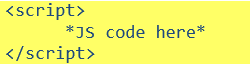
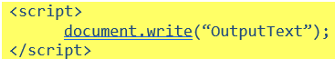
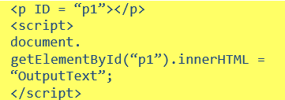
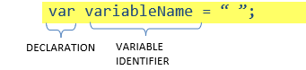

# Programming for the Web

## JavaScript

* Programming language that can be used to add interactivity to web pages. Can also be integrated with ‎other programming languages.‎

* To print/output 

* Or to add in set location

* Variable is a space in memory given a name where data ‎can be stored and changed.‎

* Data types:

| Type | Description |
|----|----|
| Number | Numeric value |
| String | Letters, characters, and numbers. Use   “…” / ‘…’ to surround text string. |
| Boolean | True or False |
| Array | Series of values of same data type |
| Object | Series of named values of variable |

* Arithmetic operators

| Operator | Description |
|----|----|
| + | Addition |
| - | Subtraction |
| \* | Multiplication |
| / | Division |
| ++ | Increment (increase by 1) |
| -- | Decrement (decrease by 1) |
| % | Modulus (return whole part of quotient) |

* Comparative operators

| Operator | Function |
|----|----|
| > | Greater than |
| < | Less than |
| >= | Greater than or equal to |
| <= | Less than or equal to |
| == | Equal to |
| === | Equal to and same data type |
| != | Not equal to |
| !=== | Not equal to or not of same data type |

* Logical operators

| Operator | Function | Explanation |
|----|----|----|
| && | AND | TRUE if both conditions true |
| \|\| | OR | TRUE if either true |
| ! | NOT | TRUE if false |

* String manipulation

| Operator | Description |
|----|----|
| *word = “Hello World”;* |    |
| substring*(startLetter, endLetter);* | Return letters from position of *startLetter* to *endLetter**subword = word.substring(7,11);*subword holds “World” |
| substr*(start,noOf);* | Starting at start letter, return letter numbers.*Subword = word.substr(2,4);*Subword will hold “llo” |
| replace*(“string”, “string”);* | Replaces first string with second*newW = word.replace(“Hello”, “Ok”);*newW will hold “Ok World” |
| concat*(“string1”, “string2”);*  or  *String1 + String2* | Joins strings*word1 = “h”;* *word2 = “world”**final = word1.concat(word1, “ ”, word2);*or *final = word1 + “ ” + word2;* \n final stores “h world” |
| toUpperCase(); | Converts string to uppercase*final = word.toUppercase();*final stores “HELLO WORLD” |
| toLowerCase(); | Converts string to lowercase*final = word.toLowercase();*final stores “hello world” |
| charAt(*number*); | Returns the character in the string at number given*letter = word.charAt(2);*letter will now store ‘e’ |

* Comments: text in code which interpreter does not run. Used to make notes about how your code works ‎so other developers can understand. Add // before and after text you want to mark as comment.‎
* Arrays: Data structure that allows you to store multiple values under one name. an array value can be ‎extracted and stored as variable, be replaced or even added. length of array can be found too. ‎
* Conditional statements:‎
  * IF checks a condition. If true, first block of code is run.‎
  * ELSE gives an option to run code when condition false
  * ELSE IF allows multiple conditions with different outcomes.‎
  * SWITCH used instead of combining multiple if statements as that can get difficult.‎
* Loops:‎
  * FOR – need to know number of times loop is to run
  * FOR/IN – used when there’s an object to loop through each element
  * WHILE – runs code when condition true
  * DO/WHILE – condition checked at end of loop.‎
* Functions: set of instructions that perform a specific task. It has a given name and can take values ‎‎(parameters)‎
* Iterative methods: function (or task) that is repeated.‎
  * Every: checks every element in an array against a condition.‎
  * SOME: checks if at least one item meets the conditions
  * FILTER: returns any array with all elements that meet the criteria
  * FOR EACH: runs task on every element within the array
  * MAP: runs task on every element within the array and returns the new/edited array
* Trap errors: detect errors. Try and catch code is used. ‎
* HTML forms and control events: Lets you combine multiple objects and receive input from user.‎
  * BUTTON
  * TEXT BOX
  * DROP-DOWN BOX
  * RADIO BUTTON

