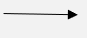
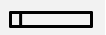
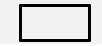
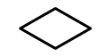

## Design‎

The design stage determines how the new system will work.

* Main outputs of this stage include

  * DFDs

  * System flowcharts

  * Database design

  * Input forms

  * Output reports

* ### Data Flow Diagrams

  * movement of data

  * processing

  * storage

  * external entities

These diagrams do not show any program logic, decisions, or looping.

#|
||

Element

|

Purpose

|

Symbol

||
||

Data flow

|

Data that flows through the system

|

||
||

Processes

|

Action that uses/manipulates data

|

||
||

Data store

|

Place where data is stored

|

||
||

External entity

|

Where data originates or is destined

|

||
|#

* Levels of DFD

  * Level 0: Entire system as one process

    * one process only

    * external entities

    * data flows

    * No data stores

  * Level 1: Major processes

  * Level 2: Detailed subprocesses

* System flowchart shows processes that take place within the system and decisions that are made. ‎

#|
||

Element

|

Purpose

|

Symbol

||
||

Terminator

|

Start and end of flowchart

|

||
||

Arrow

|

Direction of flow

|

||
||

Process

|

Activity within system

|

||
||

Decision

|

Decision with different outputs based on result

|

||
||

Input/Output

|

Input data or output data for system

|

||
|#

* ### System Flowchart vs DFD

#|
||

System Flowchart

|

DFD

||
||

Shows processing sequence

|

Shows movement of data

||
||

Uses decision symbols

|

No decision symbols

||
||

Shows hardware

|

Does not show hardware

||
||

Shows storage separately

|

Uses data store symbol

||
||

Shows program logic

|

Does not show program logic

||
|#

### Data Storage

* **Databases** store related data in structured tables for efficient searching and updating, such as customer records, student database, hospital records

* **Files**

  * **Input** contain raw data that has not yet been processed.

    * Examples include:

      * Customer orders

      * Examination entries

      * Online booking forms

      * Employee timesheets

      * Survey responses

  * **Output** contain processed information generated by the system.

    * Examples include:

      * Receipts

      * Reports

      * Payslips

      * Timetables

      * Certificates

      * Financial statements

### Input Forms

* Good input forms should have the following features

  * be simple

  * use logical order

  * minimise typing

  * include validation

  * provide helpful error messages

  * use suitable controls

* Good screen designs

  * logical layout

  * clear labels

  * white space

  * consistent style

  * helpful instructions

  * immediate feedback

  * validation

  * navigation buttons

* Validation

  * checks data is sensible

  * automatic

  * prevents unreasonable input

* Verification

  * checks data is copied correctly

  * manual or automatic

  * prevents transcription errors

### Output Reports

* Should include

  * headings

  * company logo

  * totals

  * page numbers

  * date/time

  * clear layout

  * grouped information

* Outputs may be:

  * printed reports

  * dashboards

  * on-screen reports

  * emails