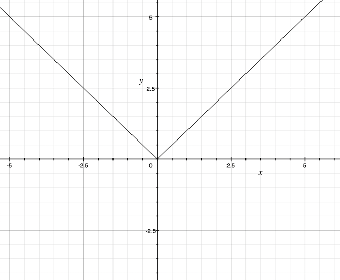

# Algebra

## The Modulus Function

* It gives the absolute value of a number.
* The modulus of a value gives the distance of the value from the
  origin.
* No line with a modulus ever goes under the x-axis.
* Any line that does go below the x-axis, when modulated is reflected
  above it.

$$\left| a\times b \right| = \left| a \right|\times \left| b \right|$$

$$\left| \frac{a}{b} \right| = \frac{\left| a \right|}{\left| b \right|}$$

$$\left| x^{2} \right| = \left| x \right|^{2} = x^{2}$$

$$\left| x \right| = \left| a \right|\overset{\Leftrightarrow}{\ }x^{2} = a^{2}$$

$$\sqrt{x^{2}} = \ \left| x \right|$$

* Graph of y=|$x|$

   

