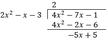

## Partial Fractions

$$\frac{ax + b}{(px + q)(rx + s)} \equiv \frac{A}{px + q} + \frac{B}{rx + s}$$

  - Multiply $(px + q)$, substitute $x = - \frac{q}{p}$ and find
    $A$

  - Multiply $(rx + s)$, substitute $x = - \frac{s}{r}$ and find
    $B$

$$\frac{ax^{2} + bx + c}{\left( px + q \right)\left( rx + s \right)^{2}} \equiv \frac{A}{px + q} + \frac{B}{rx + s} + \frac{C}{\left( rx + s \right)^{2}}$$

  - Multiply $(px + q)$, substitute $x = - \frac{q}{p}$ and find
    $A$

  - Multiply $\left( rx + s \right)^{2}$, substitute
    $x = - \frac{s}{r}$ and find $C$

  - Substitute any constant e.g. $x = 0$ and find $B$

$$\frac{ax^{2} + bx + c}{(px + q)(rx^{2} + s)} \equiv \frac{A}{px + q} + \frac{Bx + C}{rx^{2} + s}$$

  - Multiply $(px + q)$, substitute $x = - \frac{q}{p}$ and find
    $A$

  - Take $\frac{A}{px + q}$ to the other side, subtract and simplify.

  - Linear eqn. left at top is equal to $Bx + C$

  - **Improper fraction case:** if numerator has $x$ to the degree of
    power equivalent or greater than the denominator then another
    constant is present. This can be found by dividing denominator by
    numerator and using remainder

&nbsp;

**{S12-P33} Question 8:**

Express the following in partial fractions:

$$
\frac{4x^{2} - 7x - 1}{\left( x + 1 \right)\left( 2x - 3 \right)}
$$

**
Solution:
**

*Expand the brackets*

$$
\frac{4x^{2} - 7x - 1}{2x^{2} - x - 3}
$$

*Greatest power of* $x$ *same in numerator and denominator, thus is an
improper fraction case*

*Making into proper fraction:*

*This is written as:*

$$
2 + \frac{5 - 5x}{\left( x + 1 \right)\left( 2x - 3 \right)}
$$

*Now proceed with normal case for the fraction:*

$$
\frac{A}{x + 1} + \frac{B}{2x - 3} = \frac{5 - 5x}{\left( x + 1 \right)\left( 2x - 3 \right)}
$$

$$
A\left( 2x - 3 \right) + B\left( x + 1 \right) = 5 - 5x
$$

*When* $x = - 1$

$$
5A = 5 + 5
$$

$$
A = - 2
$$

*When* $x = \frac{3}{2}$

$$
\frac{5}{2}B = 5 - \frac{15}{2}
$$

$$
B = - 1
$$

*Thus, the partial fraction is:*

$$
2 + \frac{- 2}{x + 1} + \frac{- 1}{2x - 3}
$$