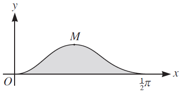
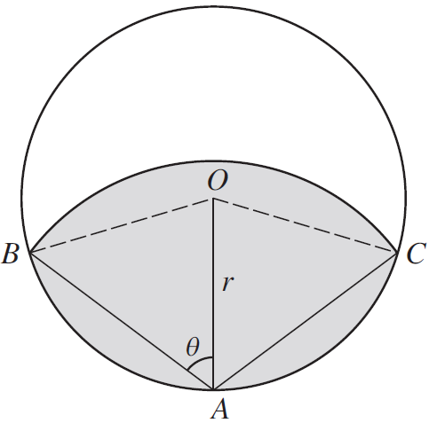

## Changing Forms

$a\sin x \pm b\cos x \Longleftrightarrow R\sin\left( x \pm \alpha \right)$

$a\cos x \pm b\sin x \Longleftrightarrow R\cos\left( x \mp \alpha \right)\ $

Where $R = \sqrt{a^{2} + b^{2}}$ and

$R\cos\alpha = a\ |\ R\sin\alpha = b$ with
$0 < \alpha < \frac{1}{2}\pi$

&nbsp;

**{S13-P33} Question 9:**

Diagram shows curve,$\ y = \sin^{2}{2x}\cos x$, for
$0 \leq x \geq \frac{\pi}{2}$, and $M$ is maximum point. Find the
$\text{x }$coordinate of $M$.

**
Solution:
**

*Use product rule to differentiate:*

$$
u = \sin^{2}{2x}\ \ \ \ \ \ \ \ \ \ \ \ \ \ \ \ \ \ \ \ v = \cos x
$$

$$
u^{'} = 4\sin{2x}\cos{2x}\ \ \ \ \ \ \ \ \ \ \ \ \ \ \ \ \ \ \ \ \ v^{'} = - \sin x
$$

$$
\frac{\text{dy}}{\text{dx}} = u^{'}v + uv^{'}
$$

$$
\frac{\text{dy}}{\text{dx}} = \left( 4\sin{2x}\cos{2x} \right)\left( \cos x \right) + \left( \sin^{2}{2x} \right)\left( - \sin x \right)
$$

$\frac{\text{dy}}{\text{dx}} = 4\sin{2x}\cos{2x}\cos x - \sin^{2}{2x}\sin x\ $

*Use following identities:*

$$
\cos{2x} = 2\cos^{2}x - 1
$$

$$
\sin{2x} = 2\sin x\cos x
$$

$$
\sin^{2}x = 1 - \cos^{2}x
$$

*Equating to* $0$*:*

$$
\frac{\text{dy}}{\text{dx}} = 0
$$

$$
\therefore 4\sin{2x}\cos{2x}\cos x - \sin^{2}{2x}\sin x = 0
$$

$$
4\sin{2x}\cos{2x}\cos x = \sin^{2}{2x}\sin x
$$

*Cancel* $\sin{2x\ }$*on both sides*

$$
4\cos{2x}\cos x = \sin{2x}\sin x
$$

*Substitute identities*

$$
4\left( 2\cos^{2}x - 1 \right)\cos x = \left( 2\sin x\cos x \right)\sin x
$$

*Cancel* $\cos x$ *and constant* $2$ *from both sides*

$$
4\cos^{2}x - 2 = \sin^{2}x
$$

*Use identity*

$$
4\cos^{2}x - 2 = 1 - \cos^{2}x
$$

$$
5\cos^{2}x = 3
$$

$$
\cos^{2}x = \frac{3}{5}
$$

$$
\cos x = 0.7746
$$

$$
x = \cos^{- 1}\left( 0.7746 \right)
$$

$$
x = 0.6847 \approx 0.685
$$

&nbsp;

**{W13-P31} Question 6:**

$A$ is a point on circumference of a circle center$\text{ O}$,
radius $r$. A circular arc, center $A$ meets circumference at $B$
& $C$. Angle $\text{OAB}$ is $\theta$ radians. The area of the
shaded region is equal to half the area of the circle.

Show that:

$$
\cos{2\theta} = \frac{2\sin{2\theta} - r}{4\theta}
$$

**
Solution:
**

*First express area of sector* $O\text{BAC}$

$$
Sector\ Area = \frac{1}{2}\theta r^{2}
$$

$$
OBAC = \frac{1}{2}\left( 2\pi - 4\theta \right)r^{2} = \left( \pi - 2\theta \right)r^{2}
$$

*Now express area of sector* $\text{ABC}$

$$
ABC = \frac{1}{2}\left( 2\theta \right)\left( \text{Length\ of\ BA} \right)^{2}
$$

*Express* $\text{BA}$ *using sine rule*

$$
BA = \frac{r\sin\left( \pi - 2\theta \right)}{\sin\theta}
$$

*Use double angle rules to simplify this expression*

$$
BA = \frac{r\sin{2\theta}}{\sin\theta}
$$

$$
= \frac{2r\sin\theta\cos\theta}{\sin\theta}
$$

$$
= 2r\cos\theta
$$

*Substitute back into initial equation*

$$
ABC = \frac{1}{2}\left( 2\theta \right)\left( 2r\cos\theta \right)^{2}
$$

$$
ABC = 4\theta r^{2}\cos^{2}\theta
$$

*Now express area of kite* $\text{ABOC}$

$$
ABOC = 2 \times Area\ of\ Triangle
$$

$$
ABOC = 2 \times \frac{1}{2}r^{2}\sin\left( \pi - 2\theta \right)
$$

$$
= r^{2}\sin{(\pi - 2\theta)}
$$

*Finally, the expression of shaded region equated to half of circle*

$$
4r^{2}\theta\cos^{2}\theta + r^{2}\left( \pi - 2\theta \right) - r^{2}\sin{(\pi - 2\theta)} = \frac{1}{2}\pi r^{2}
$$

*Cancel our* $r^{2}$ *on both sides for all terms*

$$
4\theta\cos^{2}\theta + \pi - 2\theta - \left( \sin\pi\cos{2\theta} + \sin{2\theta}\cos\pi \right) = \frac{1}{2}\pi
$$

*Some things in the double angle cancel out*

$$4\theta\cos^{2}\theta + \pi - 2\theta - \sin{2\theta} = \frac{1}{2}\pi
$$

*Use identity here*

$$
4\theta\left( \frac{\cos{2\theta} + 1}{2} \right) + \pi - \sin{2\theta} - 2\theta = \frac{1}{2}\pi
$$

$$
4\theta\cos{2\theta} + 4\theta + 2\pi - 2\sin{2\theta} - 4\theta = \pi
$$

*Clean up*

$$
4\theta\cos{2\theta} + 2\pi - 2\sin{2\theta} = \pi
$$

$$
4\theta\cos{2\theta} = 2\sin{2\theta} - \pi
$$

$$
\cos{2\theta} = \frac{2\sin{2\theta} - \pi}{4\theta}
$$
