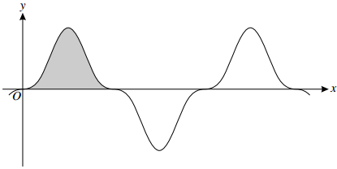

## Integration by $\mathbf{u}$-Substitution

$$
\int_{}^{}{f\left( x \right)}\ dx = \int_{}^{}{f(x)}\frac{\text{dx}}{\text{du}}\text{ du}
$$

* **Make** $\mathbf{x}$ **equal to something:** when differentiated,
  multiply the substituted form directly
* **Make** $\mathbf{u}$ **equal to something:** when differentiated,
  multiply the substituted form with its reciprocal
* With definite integrals, change limits in terms of $u$

 

{W12-P33} Question 7:

The diagram shows part of curve $y = \sin^{3}{2x}\cos^{3}{2x}$. The
shaded region shown is bounded by the curve and the $x$-axis and its
exact area is denoted by $A$.

‎ ‎

Use the substitution $u = \sin{2x}$ in a suitable integral to find the
value of $A$

**
Solution:
**

*To find the limit, you are trying to the find the points at which*
$y = 0$

$\sin x = 0$ at $x = 0,\ \pi,\ 2\pi$ $\cos x = 0$ at
$x = \frac{\pi}{2},\frac{3\pi}{4}$

*Choose the two closest to* $0$ *because the shaded area has gone
through* $y = 0$ *only twice*

$$
\therefore 0 \text{ and } \frac{\pi}{2}
$$

*Since it is* $\sin{2x}$ *and* $\cos{2x}$*, divide both by 2*

$$
\therefore \text{ Limits are } 0 \text{ and } \frac{\pi}{4}
$$

*Integrate by* $u$ *substitution, let:*

$$
u = \sin{2x}\text{     }\frac{\text{du}}{\text{dx}} = 2\cos{2x}\text{     }\frac{\text{dx}}{\text{du}} = \frac{1}{2\cos{2x}}
$$

$$
\sin^{3}{2x}\cos^{3}{2x} \equiv \left( \sin{2x} \right)^{3}\left( \cos^{2}{2x} \right)\cos{2x}
$$

$$
\equiv \left( \sin^{3}{2x} \times \left( 1 - \sin^{2}{2x} \right) \right)\cos{2x}
$$

$$
\equiv \left( \sin^{3}{2x} - \sin^{5}{2x} \right)\cos{2x} \times \frac{1}{2\cos{2x}}
$$

$$
\equiv \frac{1}{2}\left( u^{3} - u^{5} \right)
$$

*Now integrate:*

$$
\frac{1}{2}\int_{}^{}\left( u^{3} - u^{5} \right) = \frac{1}{2}\left( \frac{u^{4}}{4} - \frac{u^{6}}{6} \right)
$$

*The limits are* $x = 0$ *and* $x = \frac{\pi}{4}$*. In terms of*
$u$*,*

$u = \sin{2\left( 0 \right)} = 0$ and
$u = \sin{2\left( \frac{\pi}{4} \right)} = 1$

*Substitute limits*

$$
\frac{1}{2}\left( \frac{1^{4}}{4} - \frac{1^{6}}{6} \right) - \frac{1}{2}\left( \frac{0^{4}}{4} - \frac{0^{6}}{6} \right) = \frac{1}{24}
$$

