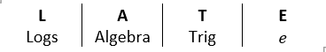

## Integrating By Parts

$$
\int_{}^{}{u\frac{\text{dv}}{\text{dx}}\ dx = uv - \int_{}^{}v\frac{\text{du}}{\text{dx}}\text{dx }}
$$

**For a definite integral:**

$$
\int_{a}^{b}{u\frac{\text{dv}}{\text{dx}}\text{ dx}} = {\lbrack uv\rbrack}*{a}^{b} - \int*^{b}{v\frac{\text{du}}{\text{dx}}\text{dx}}
$$

**What to make** $\mathbf{u}$**:**

**\\{W13-P31\} Question 3:\</span\>**

Find the exact value of

$$
\int_{1}^{4}\frac{\ln x}{\sqrt{x}}\text{dx}
$$

**\<center\>Solution:\</center\>**

*Convert to index form:*

$$
\frac{\ln x}{\sqrt{x}} = x^{-\frac{1}{2}}\ln x
$$

*Integrate by parts, let:*

$$
u = \ln x\text{        }\frac{\text{du}}{\text{dx}} = \frac{1}{x}\text{         }\frac{\text{dv}}{\text{dx}} = x^{- \frac{1}{2}}\ \ \ \ \ \ \ \ \ \ v = 2x^{\frac{1}{2}}
$$

$$
\therefore\ln x2x^{\frac{1}{2}} - \ \int_{}^{}{2x^{\frac{1}{2}}} \times x^{- 1} \equiv 2\sqrt{x}\ln x - \ \int_{}^{}{2x^{- \frac{1}{2}}} \equiv 2\sqrt{x}\ln x - 4\sqrt{x}
$$

*Substitute limits*

$$
= 4\ln 4 - 4
$$